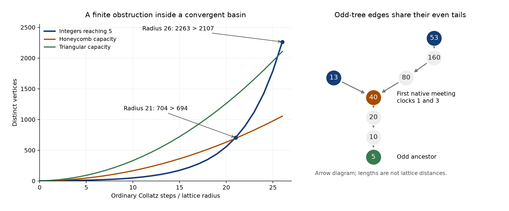

# Collatz lattice capacity, native meetings, and palette transport

Status: **PROVED elementary identities/obstructions; FINITE-EXACT certificates;
recovered and external results credited; major conjectures remain OPEN.**
Same-agent proof review and normal/optimized exact replay; no independent audit.

The strongest constructive result is [JOINT_PORTS.md](JOINT_PORTS.md): an odd
inverse tree plus its valuation clocks determines its entire native expansion,
first meetings, and an exact weighted recurrence. Independent subdivision
overcounts because halving tails are shared. At SF5 depth8 it would count2811
states; the actual native union has2001, with810 duplicate states removed.

The user's fixed-scale hexagonal picture has a finite obstruction:
704 distinct integers reach5 in at most21 ordinary steps, but a honeycomb
ball has only694 vertices. Hexagon centres form a different lattice;
that lattice fails at radius26, with2263 sources versus2107 positions.
[GEOMETRY.md](GEOMETRY.md) supplies the all-size distortion/fibre bounds,
credits the two concurrent growth proofs, and states which geometric repairs
remain possible.

Incoming [Session140's repair](../session140_collatz_hexagonal_geometry_20261102/collatz_hex/PROOF.md)
constructs a faithful honeycomb subdivision using a cited grid-minor
theorem, with necessarily unbounded route lengths. This is inherited
progress; original integer markers and clocks remain essential.

[COLOUR_AND_CLOCKS.md](COLOUR_AND_CLOCKS.md) separates arithmetic arrows
from all Euclidean unit-distance pairs; classifies palette transport on
functional components; and proves why a fixed3-adic chart loses future
inverse precision. [SYNTHESIS.md](SYNTHESIS.md) records the inheritance,
concept board, explicit connection maps, and remaining proof obligations.

[MINIMAL_CHART.md](MINIMAL_CHART.md) proves the exact minimum2*3^h states
for its specified horizon-h branch/clock observer, and3^(H+1)-2 states
when remaining horizons0..H are included. The full weighted polynomial
separates every root class through h7; its all-horizon faithfulness is OPEN.

[AUDIT.md](AUDIT.md) gives universes, controls and reproduction commands.
[HANDOFF.md](HANDOFF.md) names the next decisive tests. The receipt is
[verification.json](verification.json); every source of the radius26 witness
is in [inverse_root5_depth26.tsv](inverse_root5_depth26.tsv).

No Collatz convergence, new Hadwiger--Nelson bound, LRC(14), or unrestricted
tournament-carrier theorem is claimed. The81/27 control is recomputed, not
replaced by an abstract pair with the same group orders.
