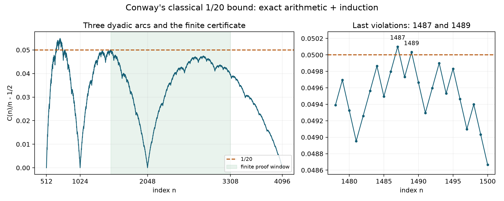

# Conway's 1024 arc: a finite boundary proving an infinite tail

2026-10-13. **PROVED elementary induction and representation identities;
FINITE-EXACT finite boundary; CITED classical identification.** This recovers
the classical answer 1489. It is not a new solution to Conway's challenge,
nor a proof of global regularity for Hofstadter Q or Collatz.

## Inheritance and live concepts

The owner's recurrence is the Conway-Hofstadter sequence C, rather than Q.
The closest classical mechanism is complementary recursive addresses;
[Pelesko, Generalizing the Conway-Hofstadter $10,000 Sequence](https://cs.uwaterloo.ca/journals/JIS/VOL7/Pelesko/pel11.pdf)
distinguishes numerical agreement from agreement of recursive addresses.
[Sloane, My Favorite Integer Sequences, section 5](https://arxiv.org/pdf/math/0207175)
records 1489 as the classical last 1/20 exceedance, following Mallows and
Kubo-Vakil. We prove the finite-to-infinite transfer below directly.

The repository's closest mechanism is authenticated child closure in
[the four-problem certificate packet](four_problems_finite_certificates_20261013a.md).
The hostile example is a finite prefix or a vanishing dyadic endpoint
mistaken for control of all future addresses. The corrected near miss is
Collatz's paid copies failing to repair their original source. A less-used
sidecar is the alternating-sign Pascal transport in
[the AMM 12592 golden transient packet, G1](amm12592-golden-transient-bound-boxeph.md):
phase and source terms must survive a transport before a scalar envelope
can be applied. That exact identity is relevant; its other historical
strategic claims are not used as dependencies here.

Live board: recursive addresses, conserved mass, terminal multiplicity,
signed defect, finite boundary, and source rank.

## 1. Legality and lower bound precede the experiment

Let C(1)=C(2)=1. For n>=3 set

    j=C(n-1),  k=n-j,  C(n)=C(j)+C(k).

**PROVED, all n.** The sequence is defined, and for n>=2,

    n/2 <= C(n) <= n-1.

Induct simultaneously. The previous bound gives 1<=j<=n-2 and
2<=k<=n-1, so both calls are earlier positive indices. The lower bounds
at the children give C(n)>=(j+k)/2=n/2. The upper bounds C(j)<=j and
C(k)<=k-1 give C(n)<=n-1. The exceptional index j=1 is already handled
by C(1)=1. No observed finite trajectory is used for this all-index fact.

There is also an elementary slow-growth induction. Write
d_n=C(n)-C(n-1), with d_2=0,d_3=1. For n>=4 put m=C(n-2). If
d_(n-1)=0 then d_n=d_(n-m); if d_(n-1)=1 then d_n=d_(m+1).
Both right addresses precede n, so every d_n is zero or one. This permits
plateau compression, although the tail consumer below checks every value.

## 2. The error is a count of terminal defects

Unfold C(n)'s actual recursive calls into a binary tree, terminating at
indices 1 and 2. Every edge decreases its positive index, so this tree is
finite. Count the two leaf types with multiplicity as L1 and L2. Then

    n=L1+2L2,        C(n)=L1+L2,
    D(n):=2C(n)-n=L1,        C(n)/n-1/2=L1/(2n).        (1)

These identities follow because child addresses sum to their parent and
each leaf has value one. Repeated addresses can be stored in a DAG, but
their multiplicities must be retained. Counting distinct leaf addresses
would destroy (1).

Equivalently, D(n)=D(j)+D(k), and the normalized error is the convex
combination of its child errors with weights j/n and k/n. This is a
literal mass-distribution statement with authenticated finite addresses.

For Q(1)=Q(2)=1 and Q(n)=Q(n-Q(n-1))+Q(n-Q(n-2)), let its two valid
addresses be u,v. On any defined prefix,

    D_Q(n)=D_Q(u)+D_Q(v)+(u+v-n),
    u+v-n=n-Q(n-1)-Q(n-2).                              (2)

The extra signed source term prevents automatic transfer of (1). The
experiment only asserts Q legality through 4096. Its first decrease is
Q(16)=9<Q(15)=10. Although C(20)=Q(20)=12, C(1024)=512 and Q(1024)=557.
Equality of one readout does not identify their address systems.

## 3. A general finite-window tail theorem

Fix an integer N>=2 and rational q with 1/2<q<1. Define

    T=max(2N, ceil((N-1-q)/(1-q))).                     (3)

**PROVED.** If C(n)<qn for every N<=n<T, then C(n)<qn for every n>=N.

For a strong-induction step n>=T, the global lower bound gives
j=C(n-1)>=ceil((n-1)/2)>=N. The preceding upper barrier gives

    k=n-C(n-1) > (1-q)n+q >= N-1,

so integrality gives k>=N. Both are strictly less than n by section 1.
Apply the induction hypothesis at both children:

    C(n)=C(j)+C(k)<q(j+k)=qn.

The strict inequality before the integer rounding is essential. The
finite window is a sufficient certificate, not a claim that its length
is minimal. The theorem works for each fixed slope; by itself it does
not prove that a successful N exists for every q>1/2.

For q=11/20 and N=1490, (3) gives T=3308. Exact recurrence evaluation
checks all **1818 values from 1490 through 3307** and finds

    max_(1490<=n<=3307) (20C(n)-11n) = -3.

Consequently C(n)/n-1/2<1/20 for every n>=1490. At the preceding index,

    C(1489)=819,        20*819-11*1489=1,
    C(1489)/1489-1/2 = 149/2978 > 1/20.

Thus **1489 is exactly the last exceedance**, with no appeal to a plot
or to monotonicity of successive arc peaks. The complete 1024..2048 arc
has just two violations: 1487 and 1489. Its ratio peak is at 1487, where
C=818 and the error is 149/2974; the largest error and the last violation
are different questions.

| Arc | Ratio peak index | Peak error | Number of violations |
|---|---:|---:|---:|
| 512..1024 | 719 | 79/1438 | 100 |
| 1024..2048 | 1487 | 149/2974 | 2 |
| 2048..4096 | 2897 | 275/5794 | 0 |

The finite rows illustrate the geometry; equation (3), not the rows,
supplies the all-later conclusion.

## 4. What the recurring 20 and 1024 actually encode

- Here 20 is the tolerance denominator, and 1024=2^10 is a dyadic
  address scale with C(1024)=512. They enter different parts of the proof.
- Five labelled tournament vertices have ten unordered pairs and twenty
  ordered distinct pairs. Their ten independent orientations give 1024
  tournaments. This is an exact Boolean encoding, used in
  [LEM-003, automorphisms act freely on Hamiltonian paths](../../01-canon/theorems/LEM-003-aut-acts-freely-on-ham-paths.md).
  Six vertices with a prescribed Hamiltonian path likewise leave ten
  free orientations. Neither bijection identifies a Conway index with a
  tournament invariant without a further map.
- In the older Collatz controller,
  H(x)=(729x+669)/1024 has native guard x=155 mod2048. The
  [Syracuse window packet](syracuse_window_alphabet_20261005.md) explains
  why H is a common-future dependency rather than a forward word: the
  actual junction valuation is indispensable. Its power of two is a
  denominator/address modulus, and cannot be treated as just a scale.
- AMM 12592's scale-1024 experiments also required an invariant
  continuation certificate after a finite transient. The transferable
  operation is proving closure at the boundary, not transporting the
  numerical threshold from one problem to another.

## 5. Transfers and the next precise obstruction

The source is the complete recurrence state, the target is a tail bound,
and the map unfolds child calls while preserving total address mass.
The quotient to a single error value loses the child addresses; the
sidecar is the legality/lower-bound proof and the entire closing window.
The cheapest hostile tests are N=1025 (zero endpoint but later violations)
and N=1489 (the final bad value). Both are rejected.

For Collatz, a comparable finite-to-all theorem needs an invariant set
of actual source states whose authenticated child maps return to that
set or to grounded terminals, with a decreasing rank. The
[native-tail packet](collatz_native_tail_recursion_20261013c.md) now supplies
exact families and such ranks on its stated subdomains, but does not
trap their uncovered complement. For Jacobian, the
[derivative address boundary](jc_derivative_address_budget_20261013c.md)
is another genuine closure consumer. Geometry's
[colour-preserving deletion](unit_triangle_product_boundary_20261013c.md)
retains the entire supported boundary relation instead of merely its
cardinality. These are precise shared proof obligations, not equivalences
between the underlying problems.

## 6. Incoming generation model: a closed-arc theorem and an exact selector

The concurrent [one-sided-walk packet](meta_fibonacci_one_sided_walks_20261013.md)
and HYP-9259 arrived at integration. Its exact deviation identity agrees
with (1), and its lagged continuum iteration is useful **NUMERICAL**
evidence. Two boundary/clock distinctions are required before transferring
that model to an exact recursion claim.

**PROVED closed-arc theorem.** For every dyadic N=2^k, k>=1,
C(N-1)=C(N)=N/2, and every child of every n in [N,2N] belongs to the
closed previous arc [N/2,N]. To prove the endpoints, induct on blocks.
The base N=2 holds. Inside the next block, the preceding bound gives
p=C(n-1)<=N, and the global lower bound gives q=n-p<=floor((n+1)/2)<=N.
Monotonicity then gives C(p)+C(q)<=2C(N)=N. At 2N-1 the global lower
bound forces equality; at 2N the two children are both N. This closes
the endpoint induction. For the lower child bound, p>=C(N-1)=N/2;
slow growth gives C(n-1)<=C(N-1)+(n-N), hence q>=N/2.

Thus the maxima of C(n)/n-1/2 over consecutive **closed** dyadic arcs
are nonincreasing, by the convex identity. This alone does not prove a
decay rate or a zero limit. Both endpoints are pinned to zero for k>=1.

The incoming half-open claim loses a real boundary, rather than merely a
rounding convention: n=2^21-1 has children (2^20,2^20-1). There are exactly
19 exceptions in its k=20 half-open generation, at2097133..2097151.
The fraction of nonexceptional indices rounds to1.0000 at four decimal places. The elementary
smaller witness is n=7, with children4,3. The boundary child's error is
zero, which is exactly why retaining it is compatible with pinned models.

At a lattice point x=n/2^k, write h_k(x)=C(n)/n-1/2 and
epsilon_n=C(n)-C(n-1) in {0,1}. The exact selector is

    s_n=C(n-1)/n-1/2=h_k(x)-epsilon_n/n.

The exact identity is

    h_k(x)=(1/2+s_n)h_(k-1)(x(1+2s_n))
           +(1/2-s_n)h_(k-1)(x(1-2s_n)),

where both arguments belong to the closed previous arc. Replacing s_n
by the current h_k changes the selector by at most1/n; controlling the
resulting profile evaluations also needs their regularity. Replacing it
by the lagged h_(k-1)(x) is a separate model approximation. At x=3/2,k=19,
the exact value n*(h_k(x)-h_(k-1)(x)) is -1430. A finite witness is not an
asymptotic disproof, but it exposes the omitted generation increment; the
one-step slow-growth bound does not control that increment. The incoming
smooth-model Taylor expansion and fitted inverse-square-root amplitude
must retain that distinction. This packet proves neither fitted constant
nor convergence of the continuum model to the discrete sequence.

## Reproduction and scope audit

Run `python 04-computation/experiments/conway_tail_barrier_20261013c.py`.
The script checks every Conway and Q address through 4096, uses an
independent memoized Conway evaluator, checks the terminal-count model,
and authenticates the complete ancestor prefix before accepting a tail
receipt. Corrupt ancestry, a truncated window, floating slopes, boolean
indices, and failed boundaries are rejected. Three additional rational
slopes exercise the general consumer. The incoming extension checks closed
arcs through4096 and the k20 boundary census using a Conway prefix through
2097151; it does not extend the Q universe. All **36900** checks remain active
under `python -O`; output is saved in the paired `.json` file. The
optional `--plot` requires matplotlib and has no role in exact decisions.
