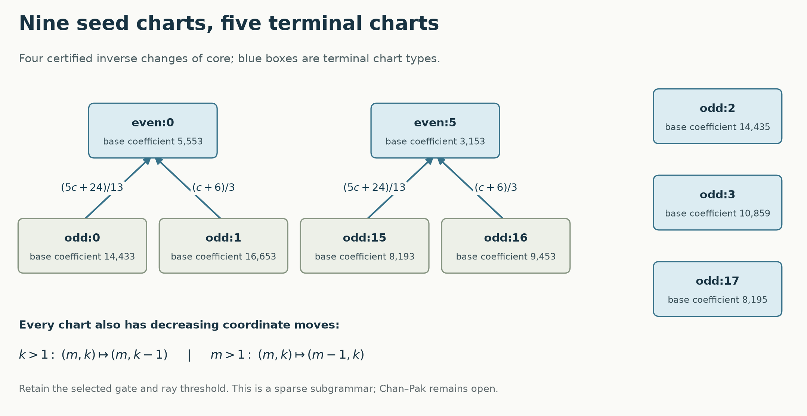

# Core-changing descent with endpoint and valuation guards

**PROVED scoped / FINITE-EXACT, 13 November 2026 (12 November locally).
Chan–Pak OPEN; all 473 previously unclosed repair families remain unclosed.**
These are 473 specified families, not 473 globally missing integers.

The positive result is a **five-base terminating grammar** inside the 70
inherited birth families. Nine infinite coefficient charts admit decreasing
coordinate moves, and four literal changes of core join them. The inverse
rules retain the selected gate, coupled/free blocks and ray threshold.
All overlapping moves commute within this grammar; the earlier failure of
general stable-contraction confluence remains in force.

Concurrent [Session290](../session290_core_descent_20261113/descent/PROOF.md)
provides a complementary full-target descent across all 70 charts with the
free port fixed at length one. Here that clock varies, and the normalized
odd coefficient decreases with its valuation guard retained.

Two core-transition laws are

    13*c_parent - 5*c_child = 24,
    c_child = 3*c_parent - 6.

Their inverses strictly decrease the odd coefficient on their recognized
domains. An exact recognizer recovers the family and clock parameters from
an input coefficient. The 13/5 mechanism has an earlier selected-interval
antecedent; the new result is its explicit synchronized-template transport,
including the valuation adjustment. Complete independent endpoint tensors
and actual order-20/21 Hamilton counts verify the construction.

The five terminal coefficients are 5553, 3153, 14435, 10859, 8195. The formal
construction-state generating function is
`(3z^17+2z^18+4z^19)/((1-z)(1-z^4))`. These states are neither all births
nor unmarked tournament classes. Their coefficient set has only
O((log X)^2) members below X, so this grammar cannot alone prove coverage.

The endpoint obstruction is sharper now: two actual seeds agree on every
query in the complete 17-coordinate ordinary Hamilton observer but have
different selected slopes, 11292 and 17025, and different head thresholds.
The selected endpoint-cover gate is indispensable. Of the 78 retained
free-clock presentations, 39 ordinary observers use only bases 1,2 and 39
reach base 4; naming both ends of a split clock exposes base 3 in all 78.

The negative searches are precisely bounded:

- Attained content-factor repairs, including all pointed tournaments
  through 9 and the retained new birth layers through 14: no new closure.
- All 12 two-port operations through length 5 from both source banks:
  1,350,846 and 2,324,250 canonical observers; no whole head-profile match.
- All 78 synchronized seed tensors, coupled lengths 1–20 and free shifts
  0–12: 20,280 whole odd-slope profiles tested; no old-family match.
- A spectral certificate rejects every period that replaces a root in the
  six one-exit operations for nonzero 1, 2^a, 3^a target modes on strides 1–3.
  Static-root periods, larger strides and adaptive programs remain outside
  that exclusion.

The requested arithmetic themes also yield an exact bridge: the unit
`U645=(127+5sqrt645)/2` has order 7 after reduction modulo 13. Its cyclic
subgroup, with an explicit orientation gauge, gives Paley7; Frobenius
reverses the orientation. The supplied 1/pi formula uses **U645 cubed**
under that normalization. The uncubed formula evaluates to 45.45380698...
The same pullback was independently developed in concurrent Session290.

- [Proofs and exact failure boundaries](PROOFS.md)
- [Arithmetic, square-sum and Monster connections](CONNECTIONS.md)
- [Method/obstruction atlas and next tests](HANDOFF.md)
- [Reproduction and validity audit](AUDIT.md)

No new full birth census, A000568/A135244/A002496 extension, or universal
odd-coefficient selector is claimed.
