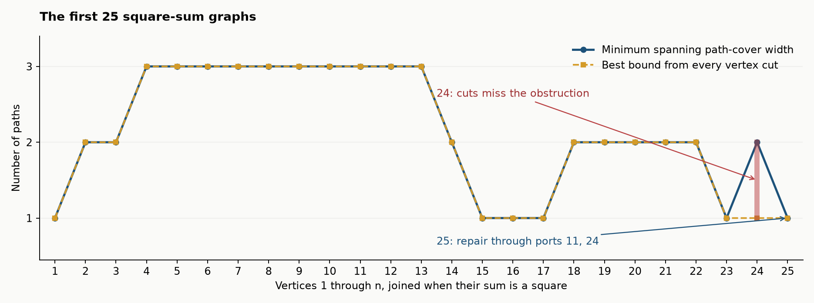

# Endpoint obstructions in the first25 square-sum graphs

**FINITE-EXACT: S1–S3; PROVED: the dynamic-programming recurrence.**
Q_n has vertices1,...,n and an undirected edge when their sum is a square.
No artificial tournament orientation is imposed. Paths may be singletons;
a cover is a vertex-disjoint collection of paths covering every vertex.

## S1. Minimum path-cover width

The exact widths for n=1,...,25 are

    1,2,2,3,3,3,3,3,3,3,3,3,3,2,1,1,1,2,2,2,2,2,1,2,1.

`square_covers.py` computes all2^25 induced-subset states in one pass.
For a vertex set A, let K(A) be its minimum width and E(A) the vertices
which can be endpoints of a component of some optimal cover. Set both
empty-state values to zero. For v∈A put

    c_v = K(A\{v}) + 1_[E(A\{v})∩N(v)=empty].
    K(A)=min_v c_v; E(A)={v:c_v=K(A)}.

For fixed v, extending an optimal predecessor cover gives width K if an
optimal endpoint is adjacent; otherwise a singleton gives width K+1.
A nonoptimal predecessor cannot improve this: deleting endpoint v from
any cover reduces the number of components by at most one. If extension
of a nonoptimal predecessor ties K+1, the singleton construction already
realizes that same endpoint and width. Every path cover has an endpoint,
so minimizing completes the recurrence. This stores support, not counts.

Independent controls enumerate all simple paths and all set partitions for
every labelled graph through5 and100 sampled graphs at each of6,7:
1,299 graphs, with complete equality of every subset's K and E.

## S2. The first gap in the component-cut bound

Every k-path cover satisfies

    components(Q_n−S) − |S| ≤ k

for every vertex set S. Removing |S| vertices can split the paths at most
|S| additional times. Exhaustive evaluation over all2^24 subsets proves:
the maximum cut bound equals the width at every n≤23, but at n=24 it
is1 while the true width is2. Q25 has a Hamilton path, so its maximum
bound is again1. Thus Q24 is the first such gap among these first25 graphs.

The stronger obstruction is very small. Vertex18 has degree1, so it must
be an endpoint. Fix each possible other endpoint v. Give endpoints degree1
and all other vertices degree2 in a prospective Hamilton path. Repeatedly:

1. reject if a degree demand is exceeded or can no longer be met;
2. forbid all remaining incident edges once a demand is met;
3. force all remaining incident edges when all are needed;
4. reject a forced cycle.

For all23 choices of v this closes without a single branch. Choices
v=2,9,11,22 fail by a forced cycle; all others fail by degree contradiction.
`square_endpoint_certificate.json.gz` stores the exact graph and every
terminal certificate. Separate literal Hamilton-path enumeration also
returns zero. A separate checker validates all378 recorded forced/forbidden
steps and every terminal contradiction, without searching for a path.
This supplies a structural obstruction beyond all cut tests.

## S3. Actual endpoint repair at25

Q23 has three unoriented Hamilton paths, with endpoint pairs
(2,18),(9,18),(18,22). The new vertex24 has neighbors1,12. No old path
ends there, and no compatible two-path spanning cover lets24 join them.

Vertex25 has neighbors11,24. Q25 has ten unoriented Hamilton paths, and
25 is internal in every one. Deleting25 produces exactly the ten compatible
two-path covers of Q24 whose facing endpoints are11 and24, modulo reversal
of the resulting concatenation. All ten actual covers are retained.

This illustrates the precise bridge to tournament entry: an aggregate
existence bound can pass while the requested endpoint pair is unavailable.
A new vertex succeeds when its actual neighbor set meets the retained
cover interface. The missing object is a renewable constructor supplying
the demanded interface, not merely a count of abstract covers.

The Hamilton counts 1,1,1,3,10 at sizes15,16,17,23,25 are inherited and
independently replayed here. The new refinements are the width sequence,
complete cut-bound comparison, forced-endpoint certificates and literal
repair interface. These finite results assert no all-size square-sum theorem.
