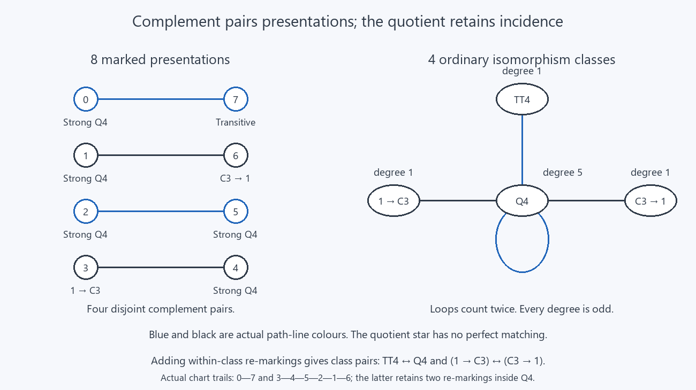

# Fibonacci components and the next binary digit of tournament counts

**PROVED scoped extensions; FINITE-EXACT checks; same-agent review using
independent counting algorithms.** The complete positive odd Hamilton-path
spectrum, conjecturally all values except7 and21, remains **OPEN**. This
packet gives an all-order three-bit formula for normalized A000568 and a
marked, bounded-width strong family obtained from the inherited Fibonacci
component language. It does not enumerate new unrestricted tournament classes.

The inheritance pass recovered an actual Fibonacci bijection, rather than
inferring one from similar numbers. In
[golden SCC words](../scc_basins_20261020d/arithmetic.md#2-a-genuine-golden-ratio-scc-language),
the tokens1,21,22 represent a singleton, C3, and strong Q4. A possible final
2 is a necessary terminal flag. The
[natural conflict-graph classification](../session81_counterexample_families_20261028/CONFLICT_IMAGES.md)
proves that this is exactly the family whose odd-cycle conflict graph is a
forest. Its Hamilton counts are exactly3^a5^b. Its ordinary class series is

    1/(1-x-x^3-x^4) = 1/[(1+x^2)(1-x-x^2)].

The present steps are:

1. [The counting theorem](PRECISION.md) determines
   A000568(n)/2^floor(n/2) modulo8 for every n>=3. At even orders it uses only
   factorization, totients and a Mobius product. It determines the exact
   2-adic valuation whenever n is even and v2(phi(n))<=3. The tempting
   extension to every even n fails first at40: actual valuation26, proposed23.
2. [The complement family](COMPLEMENTS.md) retains the golden word and its
   seven local presentation symbols, with series1/(1-x-x^3-5x^4). Every
   target at n>=5 is strong. Every target has backward-arc cutwidth at most4
   in the specified reversed path order, so the inherited joint-port
   compiler applies uniformly. The bound is sharp in that order.
3. The user's proposed pairing diagram has a precise version: complement
   pairs marked presentations. After quotienting to ordinary classes, the
   pairs become a multigraph with odd degrees. At n=4 it is a three-leaf
   star plus a loop; this graph has no perfect matching. Evenness therefore
   does not force pairs joined by a single native line. Incoming
   [odd-fibre cancellation](../tournament_joint_parity_20261102/parity.md#3-an-actual-involution-on-ordinary-classes)
   supplies an all-size class pairing by alternating complement and
   within-class re-marking. We integrate it and check both n4 trails.



The toothpick comparison inherits the incoming
[Session149 correction](../session149_tournament_spectrum_20261103/toothpick/CORRECTION.md):
standard seeded toothpicks have D2, not D4, symmetry; half-turn fixes one
toothpick, while converse fixes at least two tournament classes at every
n>=3. Their common orbit-parity identity does not supply an equivariant map.
The explicit diagram above uses actual complement incidence instead.

Incoming checkpoint a28303347b was read before publication. Its alternating
trail theorem is credited, and its order-five attachment hostile reinforces
the need to retain actual word positions. Session149's concurrent modulo4
law agrees with the older precision packet; the present formula proceeds
one bit further. The October29
[precision extension](../metagraph_scheduled_recursion_20261029/PRECISION.md)
already handles layered counts and the first reciprocal correction.

## Inheritance and scope

Anchor: Hamilton spectrum and class enumeration. Niche: the next normalized
binary digit, especially multiplicity denominators. Wildcard: golden words
as a uniform source of strong bounded-width targets. The live concept board
is SCC words / marked paths / complement incidence / low-bit Burnside sums /
literal-cycle conflicts / symmetry sidecars.

Closest mechanisms: the golden prefix codec, the bounded odd-cycle precision
theorem, and the strong-core cut. Canonical hostiles: the four-vertex star
against class matching; order40 against a valuation extrapolation; the
81/27 pair against scalar classification. The pair's literal control is
retained in [uniform prime transport](../uniform_prime_transport_20261103/README.md):
equal full ordered-run profiles do not determine automorphism groups.
No new twelve-vertex test is claimed here. The least-used sidecar is the
five-element Q4 presentation fibre, which becomes five distinct literal
complement outputs although its ordinary class is one symbol.

The inherited spectrum reduction
[THM-4094, two prime lanes](../../../01-canon/theorems/THM-4094-hamiltonian-matching-deficit-and-two-prime-lane-completeness.md)
still needs uniform strong realizations in the prime and7p lanes. The
golden complement family gives explicit examples and a bounded-width query
route, not coverage of those lanes. Fibonacci growth of a restricted class
language is not Fibonacci growth of A000568.

Run from the repository root:

```powershell
python -B -X utf8 05-knowledge/results/fibonacci_parity_precision_20261103/verify.py
python -B -O -X utf8 05-knowledge/results/fibonacci_parity_precision_20261103/verify.py
python -B -X utf8 05-knowledge/results/fibonacci_parity_precision_20261103/draw.py
```

The first two commands are standard-library checks; drawing uses Pillow.
The exact receipt is [results.json](results.json); [AUDIT.md](AUDIT.md)
states the checked universes and independence limits. Claims of external
priority are not made.
