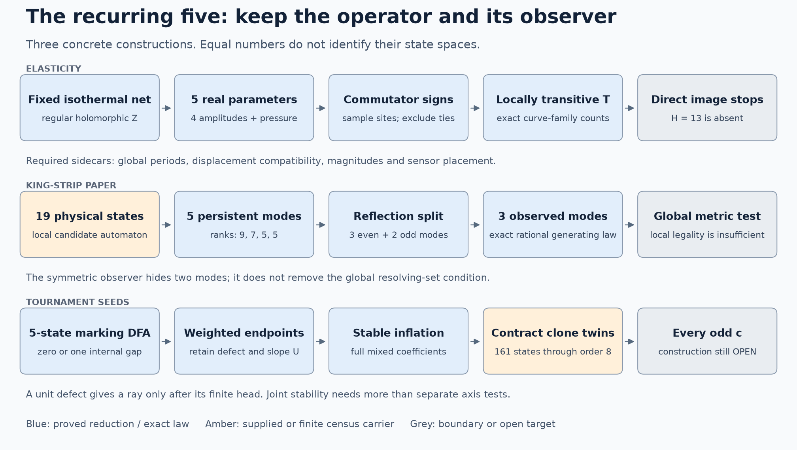

# Five, stress trajectories, and tournament continuation

**12 November 2026.** A long research session with exact constructions,
historical recovery and explicit obstructions. **Chan–Pak and the universal
odd-coefficient seed problem remain OPEN.** No classification of all
tournaments or all mathematical structures is claimed.

The main result is a more precise explanation of what keeps recurring:
small spaces or grammars survive constraints, but their **continuation
operators, observers and physical realization conditions** determine what
they can do. The repeated number five is a productive search instruction;
the actual maps decide which connections are mathematical.

## Results and scope

| Result | Status and scope | Read |
|---|---|---|
| Isothermal stress classification | Self-contained local four-plus-one normal form; explicit global stress and displacement period tests; sensor failures and translation algebra. The classical local theorem is credited to Neményi. | [STRESS](STRESS.md) |
| Actual stress-to-tournament construction | Determinant/commutator signs give locally transitive tournaments. Exact parabola and power-curve images have rational class-count generating functions. H13 is absent at every size in this direct image. | [SAMPLING](SAMPLING.md) |
| Endpoint-compatible recursive seeds | In the declared C3 interval chart, a unit seed exists exactly when the two marks have zero or one vertex between them. Complete all-length slope formulas and boundary corrections are proved. | [SEEDS §§1–3](SEEDS.md) |
| Complete round census through18 | 590 marked unit seeds: 171 transitive, 16 book-family, 392 interval-family and eleven exceptions. No higher reduced round core appears. All-order completeness is a conjecture. | [Classification receipt](seed_classification.json) |
| Arbitrary strong-core stable-port bank through8 | Order8 adds190 stable-port and127 stable-pair orbits, bringing the through8 totals to283 and176. All103 order8 complete stable-port sets are acyclic and jointly stable, certified for every positive inflation length. | [SEEDS §§6–7](SEEDS.md) |
| Stable-twin contraction and births | All-order contraction lemmas preserve a unit seed, and a jointly stable family when that hypothesis holds. The complete finite contraction graph has161 states and63 edges; terminal birth is unique through8. Birth counts are0,0,1,0,4,8,25,60. | [Contraction receipt](contraction_dag.json) |
| Infinite birth families | The98 stable-clone births through8 generate disjoint original-port inflation families, with exactly19n−49 members at every n>=8. A general weighted-quotient argument makes every finite clone bank rationally enumerable. | [BIRTHS](BIRTHS.md) |
| An infinite part of the metagraph | The original-port operation graph is79 rays and19 integer quadrants. For n>=9 it has38n−215 contraction edges and19n−166 two-child states. Pairwise joint stability on eligible blocks would imply global confluence. | [BIRTHS §§4,8](BIRTHS.md) |
| Complete order9 descendants |190 presentations yield122 distinct marked descendants and127 contraction edges. Births at9 are not enumerated. | [BIRTHS §4](BIRTHS.md) |
| Below-ray heads | Eight explicit tournament witnesses complete every exponent s>=1 on four specified rays c=393,1359,44825,236287. Existing broader coverage is credited; this is not a new global range claim. | [Head witnesses](heads.json) |
| Supplied graph paper | Reconstruct the nineteen-state necessary-condition automaton. Its persistent modes number five; reflection splits them3+2, and the actual symmetric observer sees three. Global metric checks through strip length10 remain separate. | [PAPERS](PAPERS.md) |
| Historical web | Frozen Git text-object inventory, version-aware lexical catalog, contextual prompt index, checked request attributions and lateral mechanism routes. Search counts are not counts of read sessions or proved results. | [HISTORY](HISTORY.md) |

## The central five-parameter calculation

For a fixed regular holomorphic isothermal coordinate Z(z), write
`h=(Z')²`, `p=(sigma_xx+sigma_yy)/2`, and
`q=(sigma_xx-sigma_yy)/2-i tau_xy`. Every local compatible stress with those
unordered principal axes has

    q=h[A|z|²+Bz+conj(B)conj(z)+C],
    p=p0-2 Re integral h(Az+conj(B)) dz,

with A,C,p0 real and B complex. There are exactly five real parameters.
On multiply connected domains periods can reduce the dimension; requiring a
single-valued displacement is stronger than requiring a single-valued stress.
At isotropic points the stress does not determine unique principal axes.

This produces a concrete tournament relation at chosen non-tied sample sites,
but loses magnitudes, pressure and period data. Its locally transitive image
therefore gives a constrained construction family, not a universal realization
theorem. This negative result is useful: it identifies where a seed extension
must leave the stress-derived family.

## What the new seed law buys

In C3[TT_(a+b+c+2),TT_1,TT_2], select long-block positions a and a+b+1.
For nonnegative a,b,c the unit-defect equation holds **iff b is0 or1**. Its
slope is

    U=6·2^a·3^c(2·2^b+3·3^b)−[a=0].

Reversing the two small blocks replaces6 by10 and the boundary correction
by3[a=0]. Prefix and suffix inflation give exact recursive moves; changing
the marked gap from0 to1 changes the relevant sum from5=2+3 to13=4+9.
The next gap fails the unit equation. This explains a recurrence of5 and13
through endpoint combinatorics rather than through a numerical coincidence.

These four interval families, the book family and transitive singleton marks
have proved generating functions. Adding the eleven observed exceptions
predicts the whole round census and both its count and slope moment through18.
**OPEN round classification conjecture:** there are no other marked unit seeds
in locally transitive tournaments. If true, their eventual number is5n−17.
The proved families alone have only O(log X) distinct odd parts <=X, so their
successful recursion cannot supply every odd c.

The **stable-port hypothesis** proposed here asserted that every strong
unit seed's individually stable unselected ports form a transitive set and
are jointly stable. **Subsequent resolution: its joint-stability clause is
REFUTED at order nine**, with defect `1-(2^a-2)(2^b-2)`; the acyclicity
clause remains OPEN. The full arbitrary-core through-eight results above
remain valid. [Exact obstruction and stronger contractible-block failure](../joint_stability_forbidden_20261112/README.md).

## How this helps the larger enumeration programme

For A000568, the classical Burnside formula already counts unlabelled
tournaments exactly. This packet's improvement is at the refined-family
level: closed sampling-family formulas, marked-state quotients, and a
contraction graph that removes predictable descendants while retaining their
interfaces. The98 birth families now have an exact all-order count,19n−49,
obtained from retained twin-block lengths and a finite disjointness certificate.
It does not claim a faster general A000568 algorithm or new terms.

For A135244 and A002496, the strongest recovered arithmetic bridge is already
proved in the repo: A135244(n)=(n−1)² iff n−1 is prime, and hence

    k²+1 prime iff A135244(k²+2)=(k²+1)².

The inequality behind it is elementary: if s(m)=n>=2, a composite m has a
proper divisor at least sqrt(m), so n>=1+sqrt(m); equality requires m=p².
See the [inverse-divisor packet](../infinite_birth_families_20261111/ARITHMETIC.md).
No infinitude of quadratic primes follows, and these primes, beyond2, are
1 mod4: their usual quadratic-residue Paley construction is an undirected
graph, not the Paley tournament used at prime powers3 mod4.

The historical pass searched78,446 text versions (56.6 GB), yielding36,903
matching blobs across8,486 discovery paths. The separate attribution pass
produced a193-entry five-related prompt index. These are retrieval counts,
not counts of distinct sessions read or mathematical claims verified.

The user's modular-table/Collatz correspondence, {24,25,26} Pell ports, prime
row information loss, summand/multiplicand births and 99·2^k+23 construction
were recovered in their corrected forms. [HISTORY](HISTORY.md) routes these
connections and the supplied record-composition paper's existing tournament
descendant. The remaining Chan–Pak obligation is constructive: supply every
required coefficient with compatible endpoints, renewable interfaces and
controlled finite heads. C_k(T)=1 removes a common divisor; it does not give
that selector.

## Audit and continuation

These are same-agent proofs with independent mathematical/computational
controls, not a new independent-agent review. Exact arithmetic, scope,
failed probes, source credit and replay limits are in [AUDIT](AUDIT.md).
[REPRODUCE](REPRODUCE.md) gives the commands; [RELEASE](RELEASE.md) records
the verification and publication boundary; [INCOMING](INCOMING.md) separates
concurrent results from this packet's contributions.

The most promising next experiment is a birth-first search with complete
mixed endpoint tensors, followed by operations changing a marked gap or the
strong core. A genuine coverage theorem must retain both absolute count and
the interface needed for its next step. Local density, a small grammar or
many successful finite seeds does not replace that theorem.
