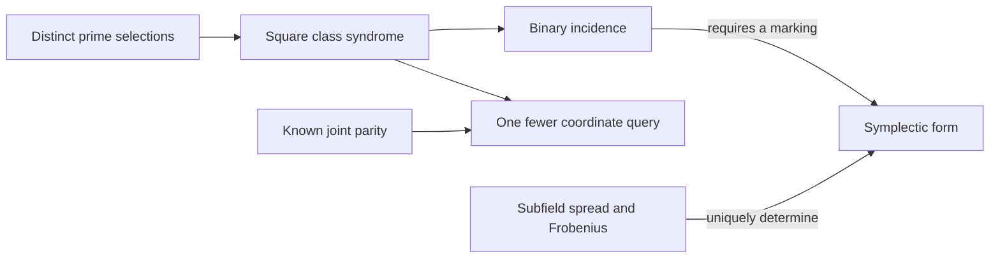

# Free information from arithmetic incidence and transport

2026-10-28. **PROVED elementary reconstruction statements; FINITE-EXACT
arithmetic realizations; CITED classical structures; OPEN extensions.**
This packet continues the [incidence](../incidence_attractors_20261028/README.md)
and [relation-system](../unifying_relations_20261028/README.md) packets.

The useful step beyond guarded observations is constructive: determine
which omitted information is forced by constraints already retained, and
prove the exact cost of whatever is still missing.



The last arrow requires the marked field in P3; binary incidence alone
does not choose the form.

Three concrete advances anchor the synthesis:

1. **A sharp one-bit saving.** In the seven-prime Hamming construction,
   Liouville parity jointly with selection bits for 2,19,59 determines one
   square-class check. Without that known parity the check needs four
   bits. These costs remain sharp for adaptive queries. For the full
   square-total predicate the sharp costs are seven versus six.
2. **An explicit fifteen-prime extension.** The bank
   `{2,5,7,13,19,29,41,59,83,89,139,251,419,839,5669}` realizes
   Hamming [15,11,3]: exactly 2048 of its 32768 subset products have square
   divisor sum. Its 35 dependent triples, seven through each point, contain
   a marked 15-line symplectic geometry with six partitions into five
   disjoint triples. This connects the earlier 5/7/15 occurrences by maps.
3. **A form reconstructed from transport.** For E=F_(2^(2m)), the unique
   nondegenerate alternating binary form that makes all F_(2^m)-lines
   isotropic and respects Frobenius is
   `B(x,y)=Tr_(E/F2)(x*y^(2^m))`. At F16, Frobenius alone leaves two
   forms and the subfield spread alone leaves three; together they leave
   exactly one. The absolute phase of a chosen normal basis remains marked.

The proofs also place signed-incidence/LCA reconstruction, Collatz parity
lifts, planar Jacobian degree bounds, and Hadwiger–Nelson metric realization
in a common constraint-and-transport framework. The boundaries are explicit:
an odd square-sum cycle fixes a rational root but may fail integrality;
Collatz prefixes have opposite next-bit lifts; a finite geometric quotient
can lose planar distances and colourings. No unrestricted tournament
classification, Collatz convergence, planar JC or plane-colouring bound
is asserted.

Read [the proofs](THEORY.md), [the recovered connections and proposed
problems](PROGRAMME.md), and [the audit](AUDIT.md). The 81/27 tournament
pair remains the inherited hostile control for joint-port proposals.

Reproduce from the repository root:

```text
python -B 05-knowledge/results/free_bits_signed_incidence_20261028/verify.py --replay
```

The producer and independently implemented audit also run under `-O`.
Their receipts cover all subset products in both banks, all 760 simple
signed graphs through four vertices, all 4092 parity words of lengths1..10
for the two Collatz signs, and the complete fifteen-point geometry.
