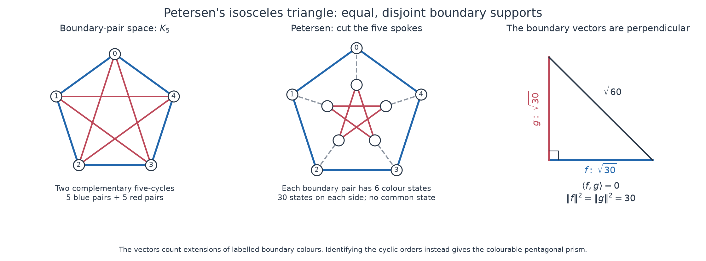

# Petersen, complete and bipartite graphs: an exact Pythagorean correspondence

**Session:** codex-graph-pythagorean-20261018.
**Status:** PROVED elementary identities and constructions, with independent
mathematical audits; FINITE-EXACT specified computations; CITED explicitly
identified external inputs; OPEN general theorem-transfer program.
No novelty claim, new Kuratowski proof, or new Tutte proof is made.

## 1. What survived the proposed analogy

There are two strong mathematical correspondences, with different maps.

1. **The literal graph triple has a 3,4,5 spectral invariant.** If
   `S(G)=J-I-2A(G)` is the Seidel matrix and `rho` means the largest absolute
   eigenvalue, then

   ```text
   rho(S(Petersen))=3,   rho(S(K5))=4,   rho(S(K3,3))=5.
   ```

   This extends to an infinite, explicitly constructed family along the
   hypotenuse/even-leg difference-one Pythagorean branch.
2. **Snarks have an exact isosceles boundary-state geometry.** Ordered
   partial-colouring vectors glue by an inner product. Their incompatibility
   gives orthogonality. A tensor construction makes the corresponding
   right triangle isosceles exactly when a cubic graph is uncolourable.
   Petersen already has equal-length orthogonal vectors without that
   extra tensor step, from its two five-cycle pieces.

These are distinct constructions. The first forgets colouring constraints;
the second retains them but has real, generally irrational side lengths.
No single isomorphism assigning all complete graphs, bipartite graphs and
snarks to the requested three arithmetic roles has been established.

## 2. Inheritance and attribution

The full [research board](graph_pythagorean_20261018_board.md) records the
Anchor / Niche / Wildcard portfolio and the concept comparisons.

- [THM-261: Petersen root orthogonality](../../01-canon/theorems/THM-261-petersen-root-orthogonality.md)
  supplied the exact `Petersen=KG(5,2)` map on the edges of K5.
- [THM-3333: Gaussian-square carrier](../../01-canon/theorems/THM-3333-gaussian-square-farey-pythagorean-triangular-light-cone.md),
  [THM-3334: parabolic spine](../../01-canon/theorems/THM-3334-berggren-parabolic-spine-gaussian-collision-torsor.md),
  and [THM-3357: Berggren branches](../../01-canon/theorems/THM-3357-berggren-three-branch-walsh-level-collapse-and-parent-circuit.md)
  supplied the arithmetic and its parity/branch distinctions.
- [THM-4116: ordered boundary gluing](../../01-canon/theorems/THM-4116-boundary-state-gluing-and-ap-odd-shell-tree-synchronizers.md)
  supplied the actual colouring-count inner product. The session extends
  that mechanism; it does not claim to invent it.
- [THM-4113: noncrossing half-Kempe states](../../01-canon/theorems/THM-4113-maximal-noncrossing-half-kempe-atlas.md)
  identifies cyclic boundary order as data that a planar proof must retain.
- MISTAKE-507 forbids confusing cubic three-edge-colouring with a Z/3Z
  flow, or a common pair index with an isomorphism of Lie algebras.
  MISTAKE-558 cautions against attributing a weaker obstruction to snarks.

Three parallel lanes read this inheritance, developed the arithmetic,
graph examples and boundary invariant, and then read one another's proofs.
An independent root implementation checked colouring counts using binary
cycle spaces, rather than either of the two edge-colouring engines.

## 3. Exact graph operations connecting all three objects

Write `D(G)=complement(L(G))`: its vertices are edges of G and adjacency
means disjointness. Then `D(K5)=Petersen`.

In Petersen's outer-pentagon / inner-pentagram drawing, contracting the
five spokes gives K5. Deleting outer vertex 0 gives a subdivision of
K3,3: suppress vertices 1,4,5 to obtain shores `{2,8,9}` and `{3,6,7}`.
The paths replacing three edges are `2-1-6`, `9-4-3`, `8-5-7`.

A different operation, Seidel switching, toggles every adjacency across
a selected vertex cut. In the two-subset model of Petersen, switch on the
three neighbours of `{0,1}`. That vertex becomes isolated, while the other
nine induce `D(K3,3)`. On edge labels `(a,i) in F3^2`, the map

```text
(a,i) -> (a+i,a-i)
```

is an isomorphism `D(K3,3) -> L(K3,3)`. Thus the structural chain is

```text
K5 --edge disjointness--> Petersen
Petersen --switch N(v)--> K1 disjoint_union L(K3,3).
```

These maps are explicit, including nonedges. They are not isomorphisms
between the three original graphs, whose orders differ. Switching changes
cubicity, and contraction/suppression can change colour-extension data.
The [graph audit](graph_pythagorean_20261018_graph_audit.md) and
[arithmetic audit](graph_pythagorean_20261018_arithmetic_audit.md) give proofs
and machine-checked maps.

## 4. The spectral 3,4,5 root and an infinite continuation

The exact Seidel spectra are

| Graph | Seidel eigenvalues with multiplicity | Radius |
|---|---|---:|
| Petersen | `3 (5), -3 (5)` | 3 |
| K5 | `-4 (1), 1 (4)` | 4 |
| K3,3 | `5 (1), -1 (5)` | 5 |

For Petersen, `A^2=2I-A+J` implies `S^2=9I`. Complete K_N has radius
N-1, giving a literal difference-one quantity. Complete bipartite K_p,q
switches to the empty graph, so its Seidel radius is p+q-1. It occupies
the hypotenuse position in this root; it is not the doubled Euclid leg
under this particular map.

For every odd prime power t, the arithmetic lane constructs a regular
graph H_t on t^2+1 vertices with degree t(t-1)/2 and

```text
S(H_t)^2=t^2 I.
```

The construction starts with the Paley graph over F_(t^2), appends an
isolated vertex, and switches a union of (t-1)/2 parallel independent
affine lines. An elementary quadratic-character sum proves the matrix
identity; all degree counts are proved as well. At t=3 this is Petersen.
With `h=(t^2+3)/4`, it gives

```text
(rho S(H_t), rho S(K_((t^2+1)/2)), rho S(K_(h,h)))
   = (t, (t^2-1)/2, (t^2+1)/2).
```

| t | H_t: order, degree | Complete graph | Bipartite graph | Radii |
|---:|---|---|---|---|
| 3 | 10, 3 (Petersen) | K5 | K3,3 | 3,4,5 |
| 5 | 26, 10 | K13 | K7,7 | 5,12,13 |
| 7 | 50, 21 | K25 | K13,13 | 7,24,25 |
| 11 | 122, 55 | K61 | K31,31 | 11,60,61 |

This is an infinite subfamily of the primitive unit-gap spine, not a
generation of every primitive triple. Beyond the root H_t is not cubic,
and the normalized triples tend to `(0,1,1)`, not the isosceles point.
Petersen is the unique simple cubic graph satisfying `S^2=(N-1)I`.
The phrase “graph with a conference Seidel matrix” here is distinct from
the usual strongly regular “conference graph” terminology.

**Decisive loss tests.** K3,3 and the empty six-vertex graph have the same
Seidel spectrum, but only the latter is planar. For every cubic graph of
order N>=14, `rho(S)=N-7`, independently of its colouring obstruction.
Thus the radius cannot distinguish the 20-vertex flower snark from the
20-vertex colourable dodecahedron. This invariant alone cannot prove
Kuratowski's theorem or classify snarks.

## 5. Complete versus bipartite: a faithful Euclid construction

Partition a complete graph into shores of sizes x>=y>0. In the orthonormal
shore basis, its loop-completed adjacency matrix J compresses to

```text
[[x, sqrt(xy)], [sqrt(xy), y]].
```

Its determinant is zero. Therefore `(x-y,2sqrt(xy),x+y)` is Pythagorean.
The second coordinate is twice the adjacency spectral radius of the cut
K_x,y. Primitive triples with the odd leg first correspond exactly to
`x=m^2>y=n^2`, with coprime opposite-parity m,n. The root is the marked
partition 4+1 in K5, whose cut is K4,1; the balanced 3+3 partition gives
the degenerate triple 0,6,6.

Alternatively, `|V(K_m)|+2|E(K_m)|=m^2`, while K_m,n has mn edges.
Euclid's formula is literally the difference of two completed-clique
counts, twice a complete-bipartite edge count, and their sum. Replacing
either clique by a proper subgraph destroys the identity, with exact
defect `4(F(G)F(H)-m^2n^2)<0`, where F=|V|+2|E|.

For odd complete graphs there is also the direct maximum-cut chart

```text
K_(2r+1) -> (|V|,2 MaxCut,2 MaxCut+1)
          = (2r+1,2r(r+1),2r^2+2r+1).
```

Here K3, not K5, maps to 3,4,5. The map must always be stated; the graph
name alone does not supply a canonical Pythagorean role.

## 6. Petersen's actual isosceles triangle

Cut the five spokes of Petersen. Each remaining piece is a five-cycle
with five labelled boundary edges. Its extension vector f is indexed by
the 3^5 boundary-colour words. Exactly 30 words extend, each uniquely.

At five cubic vertices the boundary counts of each colour are odd, so a
word has multiplicities (3,1,1). Its two singleton colours occur at adjacent
vertices of the five-cycle. Conversely every such singleton pair and its
six colour assignments gives one extension. Thus the support is encoded
by the five cycle edges, each with six colour states.

If two such pieces have cycles C,D on the common five boundary labels,

```text
number of labelled Tait colourings = 6 |E(C) intersect E(D)|.
```

Petersen uses complementary five-cycles inside E(K5). Their supports are
disjoint, so `<f,g>=0`, while `||f||^2=||g||^2=30`. The actual right
triangle has side lengths `sqrt(30),sqrt(30),sqrt(60)`: exactly isosceles.
This gives an elementary proof of Petersen's failure of three-edge-colouring.



Keeping the same two pieces but regluing to identify their cyclic orders gives
the pentagonal prism: f=g and 30 colourings. Among all twelve labelled
five-cycles D, their intersection sizes with C have histogram
`{0:1,2:5,3:5,5:1}`. The complementary choice alone is uncolourable.
The missing coordinate is the gluing permutation, not a size or density.

## 7. A graph invariant for the general cubic isosceles endpoint

For a nonempty finite simple cubic graph G, put

```text
n=|V|,  s=|E|-MaxCut(G),  C=# labelled proper three-edge-colourings,
q(G)=C^2 3^s / 6^n.
```

At a maximum cut, each induced side is a matching plus isolated
vertices. A side with i isolates and j edges has an indicator extension
vector with squared norm `6^i 12^j`. Hence both vectors are nonzero and
their product of squared norms is `M=6^n/3^s`, independent of which maximum cut is used.
The inherited gluing theorem gives `<f,g>=C`.

Put `U=f tensor g`, `V=g tensor f`. Then `U+V` and `U-V` are perpendicular
and their squared lengths are `2(M+C^2)` and `2(M-C^2)`. The squared
hypotenuse is 4M. Thus their normalized squared legs are

```text
((1-q)/2, (1+q)/2),
```

and the triangle is isosceles **if and only if G is uncolourable**. Calling
it a snark additionally requires the chosen bridgelessness/connectivity/
girth conventions. This theorem also detects bridge obstructions.

| G | C | s | q |
|---|---:|---:|---:|
| K4 | 6 | 2 | 1/4 |
| K3,3 | 12 | 0 | 1/324 |
| triangular prism | 6 | 2 | 1/144 |
| cube | 24 | 0 | 1/2916 |
| pentagonal prism | 30 | 2 | 25/186624 |
| Petersen | 0 | 3 | 0 |
| flower J5 | 0 | 3 | 0 |

This is an exact reformulation, not a cheaper colouring algorithm: C still
contains the original extension problem. The scalar forgets individual
boundary states and cyclic planar order.

## 8. Hostile limits, and retaining the missing scale

Approaching the endpoint is not specific to snarks. For prisms
`R_k=C_k square K2`, an elementary nine-state transfer matrix proves

```text
C(R_k)=2^k+3+5(-1)^k.
```

For even k these graphs are planar and bipartite, yet
`q(R_k)=(2^k+8)^2/6^(2k) -> 0`. Repeated triangle expansion of K4 is
another connected planar family with C=6 and q tending to zero.

The [inheritance proof](graph_pythagorean_20261018_inheritance.md) also
imports the explicitly identified Bessy--Havet colouring-count bound to
show q tends to zero for every growing connected simple cubic family,
and that q<=1/4 with equality only for K4. Consequently this particular
boundary-tensor triangle can never have shape 3:4:5, whose squared-leg
asymmetry is 7/25. The two charts are provably distinct.

A modest repair retains n: `r(G)=q(G)^(1/n)` is zero for uncolourable
graphs, while C>=6 gives `r>=36^(1/n)/6>1/6` for every colourable graph.
This derived rate removes dilution. It is not the original boundary
angle, and does not simplify finding C.

Another candidate, normalized distance from bipartiteness, fails in the
opposite way. For every odd k>=3 the flower graph satisfies
`MaxCut(J_k)=6k-3`. The usual flower snarks k>=5 therefore have fixed
defect 3 and relative defect tending to zero. Petersen and the colourable
dodecahedron also have the same maximum-cut fraction 4/5. The proof of
the flower cut formula is elementary; no asymptotic extrapolation is used.
The flower-snark designation is a **CITED** classical input: the exact
construction and odd k>=5 scope are recorded in da Silva--Lucchesi,
[*Flower-Snarks are Flow-Critical*, Section 1](https://www.servidores.ufscar.br/candida/publications/critical-flower-snarks.pdf),
attributing the family to Isaacs (1975). That designation is not proved
by our maximum-cut argument; J5's zero colouring count is independently checked.

The arithmetic isosceles branch instead follows
`(m,n)->(2m+n,m)` from (2,1), giving
`(3,4,5),(21,20,29),(119,120,169),...`, with consecutive legs.
This arithmetic recurrence does not by itself supply a graph operation
preserving cubicity or producing snarks. A nondegenerate integral
isosceles right triangle cannot exist, so any integral version must be
a limit rather than an attained endpoint.

## 9. Exact remaining proof obligation and literature scope

The useful next route is to retain ordered boundary supports and allowed
Kempe switches, and ask which reductions preserve or eliminate empty
compatibility. For the two-pentagon family this is completely solved by
the K5 edge-support identity. A larger pole family would need a finite
support description, a gluing law, and a minor-extraction or reducibility
argument. A scalar or a Pythagorean parametrization does not discharge
those obligations.

Kuratowski concerns subdivisions; the equivalent minor characterization
requires distinguishing K5/K3,3 minors. The Seidel counterexample above
rules out proving planarity from Seidel spectrum alone.

In the snark context, “Tutte” must distinguish cubic three-edge-colouring
from the general four-flow conjecture. The primary
[2026 apex-cubic preprint, introduction and Theorem 1.4](https://arxiv.org/html/2608.22870v1#S1)
claims the missing apex case and hence the cubic Petersen-minor theorem;
it explicitly leaves the general noncubic four-flow conjecture open.
Checked 2026-10-18; this session did not replay that paper's computer proof.
The repo's [existing source audit](../reference/CORE-PAPERS-APEX-CUBIC-2026-08-25.md)
retains its external-preprint status. None of our elementary results uses
that deep claim as a proof dependency.

## 10. Reproduction and audit

Run from the repository root:

```text
python3 04-computation/graph_pythagorean_20261018_arithmetic_probe.py
python3 04-computation/graph_pythagorean_20261018_graph_probe.py
python3 04-computation/graph_pythagorean_20261018_independent_audit.py
```

Each has a matching receipt; the [manifest](graph_pythagorean_20261018_manifest.json)
records source/output hashes and replay checks. Proofs cover their stated
infinite domains; the computations cover only the following declared universes:

- square-shore partitions through total order 200, 2,040 primitive Euclid
  pairs through m=100, exact switches and spectra, Paley-square t=3,5,7,11;
- nine named cubic graphs, all twelve five-cycle gluings, perfect-matching
  and recursive edge-colouring counts, flower transfer controls;
- independent F2^2 cycle-space counts on seven named controls, all three
  cubic members of the graph atlas through order seven, 24 seeded cubic
  samples of orders 8,10,12, six planar triangle expansions, every
  maximizing cut of those graphs, and independent Paley t=3,5,7 matrices.

No floating-point eigenvalue, approximate colour count, or finite sampling
result is used to prove an infinite assertion. Independent mathematical
audits identified terminology, gauge and norm-notation repairs, all applied
before completion; no
demonstrated false mathematical statement was left live.

The illustration is reproducible with
`python3 04-computation/graph_pythagorean_20261018_figure.py` in an environment
with Matplotlib. Its placement coordinates are illustrative and play no
role in the exact computations. The saved PNG was visually inspected.
