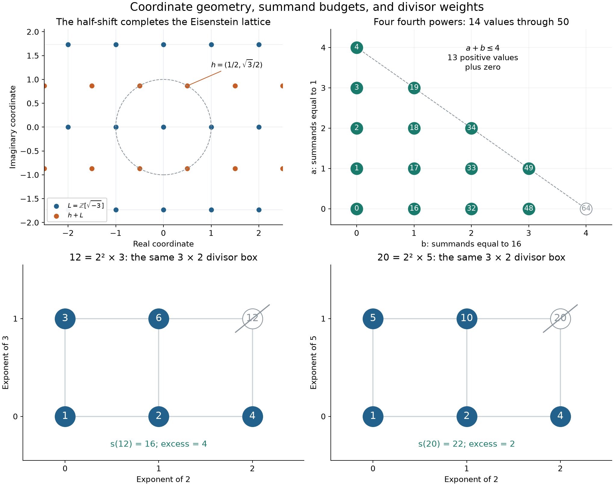

# Eisenstein coordinates and overlapping aliquot properties

2026-10-28. **PROVED elementary results and reformulations**, **CITED**
classical and repository inputs, and **FINITE-EXACT** controls with explicit
universes. The user's clarification identifies a useful overlap at20:
its five proper divisors sum to22, and its four nontrivial proper divisors
sum to21=20+1. Keeping divisor shape and additive excess separately makes
that overlap precise without discarding either property.

The main conclusions are:

- The half-shift description of the Eisenstein integers is exact in the
  rectangular basis `1,sqrt(-3)`. In ordinary Cartesian coordinates the
  shift is `(1/2,sqrt(3)/2)`.
- There are14 representable nonnegative values through50, including zero;
  equivalently13 positive values and37 exclusions in1..50. The missing50
  becomes representable over **the first rectangular grid already**:
  `50=2^4+2^4+(sqrt(-3))^4+(sqrt(-3))^4`. The value37 remains forbidden
  even over the full Eisenstein ring, by its residue5 modulo8.
- **20 is the unique integer with exactly five proper divisors and
  `s(n)=n+2`.** The full nondeficient list with five proper divisors is
  **12,18,20,28**, with excesses **4,3,2,0**.
- More generally, the complete two-distinct-prime family with `s(n)=n+2`
  is `n=2^a(2^(a+1)-3)`, where `a>=2` and `2^(a+1)-3` is prime.
  This is the classical near-perfect family with redundant divisor2;
  [the self-contained proof](PROOFS.md) is short.
- The1001 characterization is inherited from Session82 and checked again
  in its exact scope. Its first aliquot edge1001→343 is not square-sum;
  343→57 is. The separate square-sum adjacency1001—1001000 is not an
  aliquot edge in either direction.



## 1 The two grids retain a metric and a multiplication law

Set `omega=(-1+sqrt(-3))/2`, `L=Z[sqrt(-3)]` and
`h=(1+sqrt(-3))/2`. Then

```text
Z[omega] = L union (h+L).
```

For `z=a+b*omega=(u+v*sqrt(-3))/2`, the coordinate map is
`u=2a-b`, `v=b`; its image is exactly `u=v mod2`. Even u,v form L;
odd u,v form its shifted copy. The norm is
`a²-ab+b²=(u²+3v²)/4`. Thus the lattice is additively a coordinate grid,
while its rectangular metric has aspect ratio sqrt(3). Replacing that
metric by the square-grid metric changes lengths, angles and norms.

There is a direct connection with the requested5,10,25,50,100 family,
but it uses the **d=5 quadratic field**, not merely another drawing of
the Eisenstein field. The corrected
[THM-4825 / half-shifted grid and the class over2](../../../01-canon/theorems/THM-4825-the-half-shifted-second-grid-is-a-ring-or-the-order-two-class-over-two-the-two-grids-are-the-class-group-iff-d-is-5-13-or-37.md)
proves: for odd squarefree d, the analogous union is a ring when d=3 mod4;
for d=1 mod4 it is a fractional ideal representing the class over2.
For d>1 in the latter case, the two ideal classes exhaust the class group
exactly at d=5,13,37, using the **CITED** classical class-number-two list.
The centred coset alone is not an ideal.

In the d=5 case the two reduced forms are

```text
Q0(x,y)=x²+5y²,          Q1(x,y)=2x²+2xy+3y².
```

On the ramified family `2^a*5^b`, the ideal class is selected by a mod2.
Thus5,25,100 use Q0, while10,50 use Q1; explicit values are
`Q0(0,1)=5`, `Q0(5,0)=25`, `Q0(10,0)=100`,
`Q1(1,-2)=10`, `Q1(5,0)=50`.
These normalized ideal norms should not be confused with the ordinary
Euclidean norm of an unscaled point on the shifted grid.

Here13 and37 occur as **field parameters**. They also occur as ordinary
Eisenstein norms, `13=1²+3*2²` and `37=5²+3*2²`, and as excluded
fourth-power targets. Those are different maps, with different inputs.
The equal numbers alone do not identify the maps.

## 2 Four slots give the gaps and explain the exceptional fifty

Below81 the only integer fourth powers available are0,1,16. Write a target
as `n=16b+a`, with `a,b>=0` and `a+b<=4`. This gives

```text
0..4, 16..19, 32..34, 48..49,
```

with14 values including0. The complement in1..50 is
`5..15`, `20..31`, `35..47`, `{50}`, of lengths11,12,13,1.
The last singleton is a cutoff: the full next gap is50..63, of length14,
followed by64. Beyond64 there is a further gap65..80, of length16.
The complete budget proof is inherited from
[Session78 / fourth powers](../session78_fourth_power_aliquot_20261027/FOURTH_POWERS.md).

37 and50 fail for different reasons. Integer fourth powers are0 or1
modulo16, so37=5 mod16 is impossible with four terms at any height.
50 has allowed residue2 but requires five nonzero integer terms:
`16+16+16+1+1`. Over `L=Z[sqrt(-3)]`, however,

```text
50 = 16+16+9+9
   = 2^4+2^4+(1+2*omega)^4+(1+2*omega)^4.
```

Since `1+2*omega=sqrt(-3)`, no centred-coset summand is needed for this
repair. This respects [MISTAKE-690's correction](../../../01-canon/MISTAKES.md): adding the centred grid
is not responsible for every newly available residue.

For the full ring, the existing
[THM-4826 / norm shells and fourth powers](../../../01-canon/theorems/THM-4826-which-grid-carries-a-norm-shell-one-to-two-split-cubic-character-of-two-centred-units-complete-the-quartic-designs-four-eisenstein-fourth-powers-miss-five-mod-eight.md)
has a particularly simple budget reading. Modulo8 each fourth power is
one of `0,1,omega,omega²`. If their nonzero counts are r,s,t, then their
sum is `(r-t)+(s-t)omega`. With at most four terms, being rational modulo8
forces s=t, and `r+2t<=4`. Hence the possible rational residues are
the integers in[-2,4] modulo8: every residue except5.

The exact least term counts for residues0..7, modulo8 only, are

```text
residue:       0 1 2 3 4 5 6 7
least terms:   0 1 2 3 4 5 4 2.
```

Thus13 and37 remain excluded. Five terms remove this particular residue
obstruction; that is not a global representation theorem. The local-global
question for four Eisenstein fourth powers remains the separately scoped
[HYP-9429](../../hypotheses/HYP-9429-sums-of-four-eisenstein-fourth-powers-six-and-the-five-mod-eight-obstruction.md).
A failure to find a small representation is not global exclusion.

## 3 The aliquot classification has shape and excess coordinates

For `n=product p_i^a_i`, the divisor set is the exponent box
`product_i {0,...,a_i}`. Weight its lattice point e by `product p_i^e_i`.
Removing the top corner gives the proper divisors, and summing their
weights gives s(n). The prime labels and exponents are part of this model.

| Proper-divisor terms | Possible factorization shapes | Examples |
|---:|---|---|
|3|p³ or pq, p and q distinct primes|8;6,10,14,15,21,35,22|
|4|p⁴|16,81|
|5|p⁵ or p²q, p and q distinct|32;12,18,20,28,50|
|7|p⁷, p³q, or pqr with distinct primes|128;24;30,1001|
|8|p⁸ or p²q²|256;36,100|

This formalizes the analogy with cubes and fifth powers as a count of
proper-divisor terms. It is not polynomial degree. Prime powers form
chains, pq forms a2×2 box, and p²q forms a3×2 box. The number16 in the
clarification is a prime-power chain with four proper-divisor terms;
it does not have the literal three-term formula of a prime cube.

The user's second property of20 is retained **in addition** to its shape:

```text
s(20)=1+2+4+5+10=22=20+1+1,
       2+4+5+10=21=20+1.
```

Here20+1+1 is a numerical regrouping, not a list of three proper divisors:
20 itself is not proper and the divisor1 occurs only once. The invariant
that precisely captures the extra equality is the excess

```text
Delta(n)=s(n)-n=sigma(n)-2n.
```

**PROVED:** among numbers with five proper divisors, the entire
nondeficient set (`Delta>=0`) is

| n | Proper divisors | s(n) | Delta(n) | Additional identity |
|---:|---|---:|---:|---|
|12|1,2,3,4,6|16|4|removing4 leaves a sum of12|
|18|1,2,3,6,9|21|3|removing3 leaves a sum of18|
|20|1,2,4,5,10|22|2|removing2 leaves a sum of20|
|28|1,2,4,7,14|28|0|already perfect|

This proves the rarity of20's overlap. It also restores the implicit1
in the user's sums for12,18,28 and24. The analogous actual three-term
distinct-semiprime class satisfies `Delta(pq)=2-(p-1)(q-1)<=0`, with
equality only at6. Thus the excess-two equality is additional information,
not a consequence of having three proper-divisor terms.

The natural global objects are therefore overlapping properties:
prime-power chain, divisor-box shape, number of proper divisors, and excess.
The pair `(tau,Delta)` alone is still incomplete:24 and30 both have
`tau=8,Delta=12`, but their shapes are4×2 and2×2×2. Moreover12 divides24
but not30, so only24 has12 as a single redundant divisor.

The [Liouville–Möbius packet](../liouville_mobius_11_13_20261026/README.md)
uses exactly this chain-versus-Boolean-box distinction: mu kills repeated
prime directions, while lambda retains total exponent parity. For20,
mu=0 and lambda=-1; for30 both are-1. No conservation of these signs
under aliquot iteration is asserted.

## 4 The complete family behind twenty

**PROVED, classical special family with a self-contained proof:** if n
has exactly two distinct prime factors, then

```text
s(n)=n+2  iff  n=2^a(2^(a+1)-3),
                  a>=2 and 2^(a+1)-3 is prime.
```

The first values are20,104,464,1952,130304,522752. For example,
104=8*13 has s(104)=106. This gives another exact appearance of13, with
a stated arithmetic role. No infinitude of the prime parameters is claimed.
The additional value650=2*5²*13 has s(650)=652 but three distinct prime
factors; it is a hostile to extending the two-prime classification to
all integers. The complete census through one million finds exactly
`20,104,464,650,1952,130304,522752` with excess2.

**An exact connection with the fourth-power obstruction:** every odd prime
parameter q in this two-prime family satisfies `q=5 mod8`, because a>=2.
Consequently q cannot be a sum of four Eisenstein fourth powers. The
source104 supplies q=13. The prime37 also has residue5, but37+3=40 is
not a power of two, so37 is not a parameter of this family. This is a
proved one-way transfer from the aliquot equation to a representation
obstruction; the congruence alone does not characterize the family.

In standard terminology, an even n with excess2 is near-perfect with
redundant divisor2: omit that one divisor and the remaining proper
divisors sum to n. Replacing2 by1+1 does not create two distinct omitted
divisors. See the primary literature
[Aryan et al., On 2-Near Perfect Numbers, introduction](https://math.colgate.edu/~integers/y61/y61.pdf)
for the terminology and the earlier Pollack–Shevelev / Ren–Chen families.
The separate study of actual sums of cubes in
[Borah–Mahanta–Saikia](https://manjilsaikia.in/publ/papers/borah_mahanta_saikia.pdf)
does not identify a three-term divisor formula with three integer cubes.

These even excess-two sources cannot themselves yield square-sum aliquot
edges: `sigma(n)=2(n+1)` has2-adic valuation one and is not a square.
Thus20's role as the square root of `343+57=400` is different from20
having its own square-sum successor; `20+s(20)=42` is not square.

## 5 Recovering the eleven, twelve, thirteen and thirty-seven fibres

The inverse-fibre observation groups each positive source n under the
target s(n). The complete small fibres are

```text
F11={21}, F12={121}, F13={27,35}, F37={155,203,299,323}.
```

They are inherited from [Session78 / aliquot observations](../session78_fourth_power_aliquot_20261027/ALIQUOT.md)
and rechecked with the proved bound `n<=(t-1)²` for any composite source
of a target t>=2. A fibre at1 is instead infinite (all primes), and s(1)=0.

The requested5,10,25,50,100 have aliquot sums1,8,6,43,117.
Within the fixed odd-part25 doubling tower, the existing exact formula is

```text
s(2^a*25)=37*2^a-31.
```

Here37 is the odd coefficient `2*sigma(25)-25`, not a count of excluded
fourth-power targets. The carry is31. The fixed odd-part5 tower instead
has `s(2^a*5)=7*2^a-6`, with carry6. The full fibre13 exposes why the
carry matters:27 and35 share s=13 but double to sources54 and70 with
aliquot values66 and74. The retained coordinate repairs the operation.

Session82 gives two more precise13/37 appearances: minimum shared-source
obstructions for lifting paths through merged aliquot fibres. See
[FIBER_PORTS.md](../session82_decimal_aliquot_square_sum_20261028/FIBER_PORTS.md).
Those are predicates about labelled source compatibility, not another
proof that the fourth-power cutoff must split13/37. This continuation
does not repeat their full graph census.

## 6 The two different square edges at the 1001 anchor

The inherited [Session82 characterization](../session82_decimal_aliquot_square_sum_20261028/ANCHOR_CHARACTERIZATION.md)
is exact:1001 is the unique squarefree product of exactly three primes
whose aliquot successor is a prime cube with square divisor sum.
The classical Ljunggren square-repunit theorem forces that cube to be343;
its scope is explicitly stated by
[Bugeaud–Mignotte–Roy, page257](https://msp.org/pjm/2000/193-2/pjm-v193-n2-p.pdf).
The remaining factor-pair argument is elementary and is reproduced in
[PROOFS.md](PROOFS.md).

```text
1001=7*11*13  -> 343=7³ -> 57=3*19 -> 23 -> 1 -> 0.
```

The first arrow has total1344, not a square. The second has total400=20².
The complete inverse fibre of343 has19 sources;1001 is unique only in
the specified squarefree three-prime class. The checker exhausts the
proved bound116964 and reproduces all19 sources.

Separately, `1001+1001000=1001²`. This is an undirected square-sum edge,
and holds as the instance x=1001 of `x+x(x-1)=x²`. It is not an aliquot
edge: `s(1001)=343` and `s(1001000)=2143960`. The confirmed other orbit is

```text
1000001 -> 10003 -> 1437 -> 483 -> 285 -> 195
        -> 141 -> 51 -> 21 -> 11 -> 1 -> 0.
```

All these short edges are independently refactored in the new check.
No extension of the separate long1001000 orbit is claimed; its certified
prefix and unresolved endpoint remain in
[Session82 / orbit connections](../session82_decimal_aliquot_square_sum_20261028/ORBIT_CONNECTIONS.md).

## Scope, inheritance and reproduction

Anchor: the user's overlapping aliquot classes, with20 retained in both
descriptions. Niche: exact coset and divisor coordinates. Wildcard:50's
fourth-power repair on the first grid. The five-concept board is divisor
shape / additive excess / retained source / norm or residue / term budget.
The inherited mechanisms are Session78's divisor-sum formulas and budget
theorem, THM-4825/4826's corrected grid theory, and Session82's1001
classification. The hostile is650 against an unrestricted two-prime law;
the corrected near miss is14 nonnegative versus13 positive values. The
least-used sidecar is the full divisor-box evaluation polynomial.

The maps and their information losses are explicit in
[PROOFS.md](PROOFS.md). They do not identify a divisor box with a Euclidean
lattice merely because both admit coordinate pictures. No tournament is
forced on these objects. LRC(14), the global prime-untouchable conjecture,
and the Eisenstein integral local-global question remain open here.

From the repository root:

```text
python3 -B 05-knowledge/results/grid_aliquot_overlap_20261028/verify.py --replay
python3 agents/check_docs.py
```

The checker compares a literal additive divisor sieve with an independent
multiplicative least-prime evaluator for every n<=1,000,000, checks the
entire residue ring modulo8, and replays the small exact fibres and
orbits. Normal and optimized outputs must equal the frozen receipts.
The proofs received same-agent review and independent computational paths;
no independent-agent proof audit is claimed for this continuation.
The figure is a coordinate illustration, visually inspected; its source
`plot.py` requires matplotlib, while every mathematical check is standard
library only. The source pins record inherited claims and external inputs.
