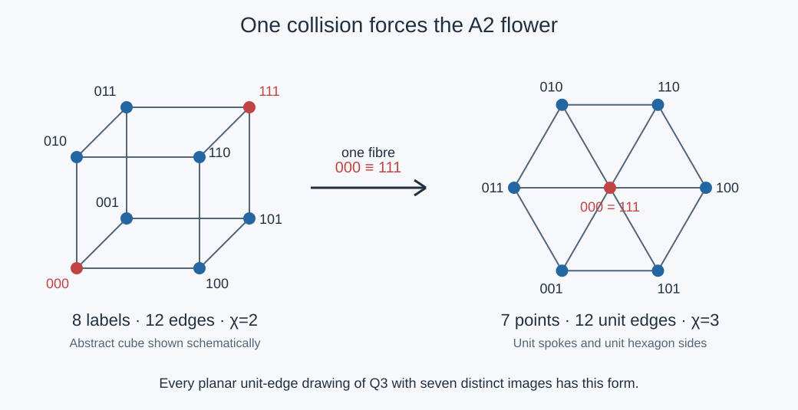

# Hadwiger–Nelson joins the six–seven–eight investigation

2026-10-25. The new work is a set of explicit connections and obstructions,
not an improved plane chromatic bound. Proofs, exact universes and independent
audits are linked below. Classical and concurrent results retain their credit.

## 1. Eight really can become seven, with six directions forced

The strongest metric result is a classification. If a drawing of the cube
Q3 in the Euclidean plane makes all twelve edges unit length and has exactly
seven distinct vertex images, the colliding vertices must be opposite.
After relabeling and an isometry the drawing is

    f(e)=e1*u+e2*v+e3*w,   |u|=|v|=|w|=1,   u+v+w=0.

Hence u,v,w are120 degrees apart. The image is precisely the center and
six unit neighbors of the triangular lattice. Conversely that drawing
works. The proof starts with arbitrary drawings, not a chosen additive
ansatz. A distance-two collision would force another collision; after an
opposite collision, every face is a genuine unit rhombus and forces the
displayed subset-sum form.

This gives the earlier Boolean empty/full quotient an actual Euclidean
metric. Complement becomes central inversion. Exactly D12 of the cube's
48 graph automorphisms descends; only two of its eight translations survive.

| Exact object | Vertices | Unit edges | Chromatic number |
|---|---:|---:|---:|
| Faithful rational planar cube | 8 | 12 | 2 |
| Its unique seven-image fold | 7 | 12 | 3 |
| Recovered Moser spindle | 7 | 11 | 4 |

The flower's induced graph is exactly the quotient graph. On the original
eight labels there are six extra unit nonedges, because the two center
labels coincide. This is why the quotient raises the chromatic number.
The spindle uses a different operation: two palette-three equality
diamonds joined by an exact unit hinge. Its rotated lattices have additive
rank four, whereas the flower lies in one rank-two lattice. Its equality
property does not survive at palette six.

Proof and exact controls: [metric result](metric_spindle/RESULT.md).
Independent alternative proof via two circles and three common neighbors:
[metric audit](audits/METRIC_AUDIT.md).

## 2. The hexagonal seven has a different, projective extension to eight

Session61 already carried the norm-seven Eisenstein quotient to a seven-vertex
triangulated torus. Choosing one triangle type gives a Fano design and
selects the special four-code Campedelli orbit of the hourglass. We recover
the next classical step: add infinity, attach it to every Fano triangle,
and also take complementary four-sets. These fourteen blocks form S(3,4,8).

Caldero–Germoni's equianharmonic construction identifies this with one
PSL2(F7) orbit of quadrangles in P1(F7). Keeping both chiral orbits gives
28 blocks and two completions per triple, so the orbit choice matters.
The primary source and direct finite rederivation are in the
[projective result](projective_eight/RESULT.md).

There is an explicit marked correspondence to our eight conic components:

    residue:   0  1  2  3  4  5  6  infinity
    conic:     7  3  5  4  6  1  2     0.

It uses the inherited basis(7,3,5), a reference conic and a chosen duality.
Complementary four-blocks become the seven Walsh partitions. But the design
forgets which three partitions are cube coordinates and actual K3 divisor
relations. A shear preserves every affine block while sending intersecting
conics to disjoint ones. The lost choice has28 possibilities: an unordered
basis among the seven binary directions.

This projective extension and the metric fold are different maps. One
adjoins a point and remembers four-block incidence; the other identifies
opposite cube vertices and remembers unit distances. Neither transfers
the torus K7's chromatic lower bound to the Euclidean plane.

A second numerical temptation also fails decisively. The28 sextic character
labels in the eight-root formula p_g=28+3 and the28 equianharmonic
quadrangles are inequivalent permutation representations: z->4z fixes one
six-subset but four quadrangles. The equal count does not supply a map.
See [projective audit](audits/PROJECTIVE_AUDIT.md).

## 3. Six paired colors require an eight-state frame and a four-state residual

Pair six named palette colors into three pairs. Choosing one endpoint from
each pair gives eight frames. The six colors themselves are the six cube
facets. The two Fano completions select the two parity halves of those frames.

The full palette symmetry is

    F2^3 semidirect S3 = C2 x S4.

The C2 factor records completion parity; S4 acts on four even-frame choices.
Thus after the completion bit is fixed, the missing information is an actual
four-state permutation problem. Two loop transports can each fix frames,
pass parity, and still have disjoint fixed-frame sets. A common frame is
required, not separate solvability for each loop.

Concurrent Session62 already proves the general local-coefficient formula:
on a connected gluing graph with b1 independent cycles, completion parity
forgets exactly

    2(b1-1)+dim(E^H)

obstruction bits, where E is the even two-dimensional space and H is the
pair-permutation monodromy. The invariant dimension is2,1,0 for trivial,
transposition, and three-cycle-containing monodromy. In particular parity
is sufficient for one cycle with three-cycle monodromy, but not generally
for two cycles. Our tetrahedral description and explicit two-loop hostile
make that boundary concrete. These are endpoint-choice sections; identifying
all palette labels globally is a stronger task.

See [palette proof](fano_eight/RESULT.md) and
[independent audit](audits/PALETTE_AUDIT.md). The projective eight also gives
an affine PSL2(F7) action with no common origin, a second concrete warning
that an abstract linear-group isomorphism does not remove affine gains.

## 4. The seven Walsh modes now have different, testable jobs

This is the useful synthesis with the earlier K3 matrix
M=-2I+2A(Q3):

| Mode weight | Number | Eigenvalue of M | Concrete role |
|---|---:|---:|---|
| 0 | 1 | 4 | Total mass / sum of components |
| 1 | 3 | 0 | Cube drawing coordinates; actual divisor relations |
| 2 | 3 | -4 | Pair interactions in the prescribed coloring interface |
| 3 | 1 | -8 | Completion parity; information absent from proper counting marginals |

The roles share a marked Fourier basis, not their geometric predicates.
Knowing all pairwise feasibility projections allows35 different joint
relations on the eight binary assignments. Six-, seven- and eight-state
relations can have exactly the same projections. Numerical counting
marginals are stronger: they leave just the cubic coefficient undetermined.
For Boolean tables, the only distinct pair with all proper counting
marginals equal is the even/odd parity pair.

The exact geometric control uses six colors with explicitly prescribed
external leaves. A32-vertex unit graph has boundary count

    w_F=4*1_NOT_ALL_EQUAL=3-chi12-chi13-chi23;

a19-vertex unit graph on the same three port positions has w_G=3 everywhere.
Both have mass24, zero singleton and cubic coefficients, balanced parity
and full pairwise feasibility shadows. Yet pinning all three ports to zero
gives zero extensions for F and three for G. All unwanted unit contacts
were excluded by exact coordinate checks. The difference lies precisely
in the three weight-two modes.

Their underlying unprescribed graphs need at most three colors. The fixed
exterior colors are essential. This is an exact failure witness for coarse
boundary summaries, not a new high-chromatic graph. Full count tables glue
by pointwise multiplication, equivalently Walsh convolution; all eight
coefficients are needed for arbitrary pinned continuation queries.
See [boundary result](cube_boundary/RESULT.md) and
[independent audit](audits/BOUNDARY_AUDIT.md).

## Research consequence and boundary

The inherited HN themes now supply a metric classification, a projective
completion, a full palette transport model, and an exact boundary test for
the six/seven/eight carriers. The next useful construction must retain
the actual joint boundary relation and realize its seams by unit segments.
A free deck action, a parity test, or the seven spectral labels alone does
not discharge that obligation. The plane six/seven decision and integer
square existence remain open here. No Lean claim or automatic continuation
is made.

The [README](README.md) lists reproduction, provenance and publication
checks; the [concept board](CONCEPT_BOARD.md) records the inherited hostiles
and why the portfolio moved toward these four tests.
