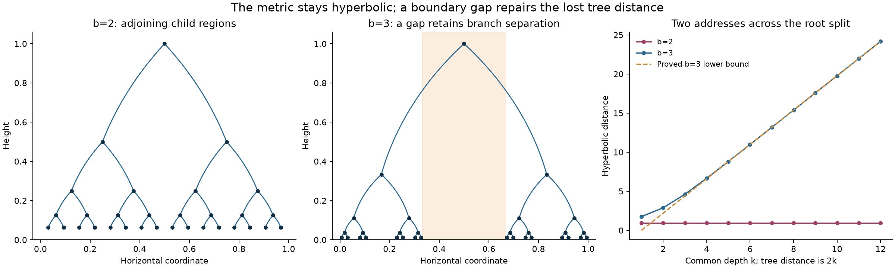

# Honeycomb capacity and recoverable geometry

2026-11-02. **PROVED elementary extensions, same-agent audit; CITED inputs;
FINITE-EXACT controls.** Full Collatz convergence, Hadwiger-Nelson and general
strong-atom metagraph classification remain open in this work.

The correction is immediate:704-694=10, not20. The faithful honeycomb model
survives because it permits unbounded route lengths and keeps original
vertices and clocks. It is not a nearest-neighbour placement of ordinary
Collatz steps.

The geometric comparison is [GAP_GEOMETRY.md](GAP_GEOMETRY.md).
Replacing adjacent dyadic child intervals by separated b-adic intervals,
b>2, upgrades the inherited drawing to a roughly isometric embedding:

    D log b-2log[b/(b-2)] <= d <= D log b+log4.

The all-depth proof retains properness, noncrossing and exact equal-length
tree adjacency. A boundary ultrametric and an explicit gap explain how LCA
information is recovered; triangle inequality remains intact.

Incoming Session141 independently proves a broader gap construction and
sharper edge-scale efficiency. We credit that overlap. Comparing its width
W and contraction q<1/2 with our sharp separation gives a further all-size
classification: at Wcrit=2 sqrt(q/(4-q)), the minimum-distance graph changes
from sibling matching, to a tree of triangles, to the binary tree. Requiring
exactly the tree forces edge length greater than arcosh(9/7), a sharp infimum
within this family. The incoming unrestricted separated construction can
approach log2. These differ because minimum-distance adjacency is additional
information, beyond coarse LCA distance. Neither bound is a new universal
Euclidean unit-distance obstruction.

[CAPACITY_AND_COLOUR.md](CAPACITY_AND_COLOUR.md) proves a sharp finite
sidecar-entropy bound. In the704-to694 example its minimum is20/704=5/176
bits for a uniform source. This is a precise secondary meaning of20, not
the vertex deficit. It also separates subdivision, induced Euclidean
unit-distance placement, extremal edge counts and chromatic number.

[ARITHMETIC_AND_COUNTS.md](ARITHMETIC_AND_COUNTS.md) recovers the unique
five-divisor overlap at20, then classifies all prime-guarded sigma collisions
between2^a p and2^b q. The first4p/2q pair is20/26, uniquely abundant on
the first side. A different complete chart explains16->15<-33. The1-2-4
divisor row, square25's20/24/26/33 incidence, and the older A5 counts are
kept with their actual maps.

The finite square graphs at15,20,24,25,26,33 are exactly three-colourable.
G15 is a unicyclic pseudoforest and therefore inherits a genuine induced
Euclidean unit-distance realization. G25 has degree-four vertices, blocking
a faithful subdivision into the degree-three honeycomb. Its unit-distance
realizability is not decided here.

[AUDIT.md](AUDIT.md) records sources, controls, reproduction and limits;
[verification.json](verification.json) retains the exact receipts.

Inheritance board: **metric capacity / LCA gap / joint incidence / source
clock / divisor shape / quotient entropy**. Anchor: repair the missing
large-scale metric property of the hyperbolic tree. Niche: small arithmetic
unit-distance guards and their port obstruction. Wildcard: the20/26 and16/33
divisor collisions. Closest mechanisms are Session140 geometry, the prior
square25 complement carrier, and the October28 divisor-overlap classification.
Canonical hostiles are dyadic cross-root crowding, C6-to-C3 contraction,
repeated-prime9, and the inherited81/27 port tensors. The recovered old sidecar
is the actual fibre/axis marking in the June icosahedral work.

## Next discriminating questions (OPEN)

1. Does G25 admit an induced Euclidean unit-distance realization? Its
   three-colouring is insufficient, and its absence of four-cycles leaves
   the rhombus initialization empty. A positive answer needs coordinates
   and every nonedge-distance guard; a negative answer needs a geometric
   obstruction, not the degree obstruction specific to the honeycomb.
2. What is the smallest subcubic replacement of G25's degree-four vertices
   preserving all twenty directed path responses and their four compatible
   overlaps? The first decisive test is the joint ordered-terminal table
   of each proposed cluster, including forbidden traversals and multiplicity.
3. Can a source-preserving Collatz inverse-tree embedding inherit the gap
   estimate with ordinary-step clocks, rather than binary branch depth?
   An explicit address/valuation map is required. The abstract tree theorem
   alone neither supplies this map nor absorbs the known cycle.
