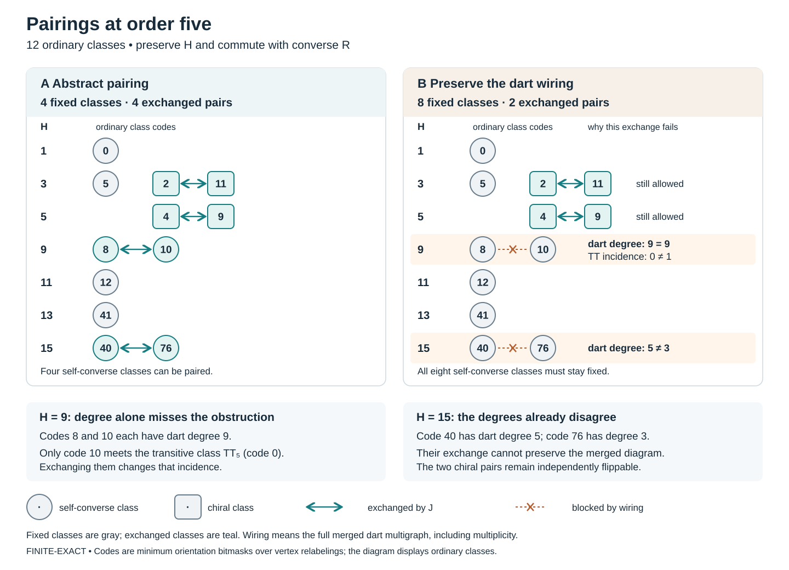

# Joint enumerators, exact pairings, and the memory of the merged metagraph

**PROVED IN NOTES** for the scoped all-order statements below, after independent
review; **FINITE-EXACT** for the stated censuses; **CITED / INHERITED** for the
identified inputs. The complete Hamiltonian spectrum, a compact recurrence
generating unrestricted metagraph wiring, and all-order black-core connectivity
remain **OPEN**. No solution of Chan–Pak is claimed.

This session continues the joint enumerator
`F_n(z)=sum_[T] z^H(T)` while keeping ordinary classes, converse classes,
physical darts, and score observations distinct. Its main result is a sharp
failure of score compression, with an exact algebraic repair. Its second result
shows why a pairing of class counts need not be a symmetry of the diagram.

## Pairing all classes requires the actual wiring

At order five the twelve ordinary classes admit an H-preserving involution
commuting with converse with only **four fixed classes**. Requiring its induced
action to preserve the actual merged dart multigraph raises the minimum to
**eight**. The ten-vertex weighted merged graph is vertex-rigid, even after
forgetting H. Its only compatible ordinary-class permutations independently
flip the two chiral pairs, giving `C2 x C2` and fixed-count polynomial
`x^8(1+x^2)^2`. The unique eight-fixed minimizer is converse, which has a literal
reflection lift preserving both colors. Parallel-edge permutations fixing all
vertices are not excluded by vertex rigidity.

The obstruction is visible in two exchanges: the self-converse H9 classes
have equal degree but different incidence with the transitive node; the H15
classes already have different degrees. [Proof and full finite classification](PAIRING_WIRING.md).



## Exact score walks need hidden memory at every order at least five

Let A be the literal dart matrix, D its degree matrix, P=D^-1 A, L the score-block
lift, and E conditional averaging with source weights D. Set Q=EPL and R=I-LE.
For score-observed moments F_k=EP^kL, define

```text
K_j = EPR (RPR)^j RPL,
F(z) = (I-zQ-z^2 K(z))^-1,
F_k = Q F_(k-1) + sum_(j=0..k-2) K_j F_(k-2-j).
```

The weighted two-step defect is a Gram matrix. It vanishes iff the score
partition is strongly lumpable, which is exactly the condition for Q alone to
give every subsequent walk moment. A triangle reversal in the staircase
neighbor of TT_n proves failure for **every n>=5**. Orders three and four are
positive controls. At order five the actual TT return after two steps is
`1/9`, while the score quotient predicts `1/18`.

The order-five hidden memory obeys the exact cubic recurrence

```text
186615 K_(j+3) = 6590 K_(j+2) + 16714 K_(j+1) - 2126 K_j.
```

Its TT diagonal has minimal recurrence order three. More generally, exact
weighted Krylov/Hankel ranks show that preserving all score-observed moments
in the specified linear model already requires all **10** merged-class
dimensions at order five and all **34** at order six. This is not an all-order
observability claim. [Proof, generating function, colored version and receipts](metagraph/PROOF.md).

## The dyadic clock is exact at fixed cutoff and precision

For fixed B>=3 and k>=1, put R=floor(log_3 B). Every ordinary and self-converse
H-fibre multiplicity with H<=B has period dividing

```text
2^(k-1+ceil(log_2(R+1)))  modulo 2^k, from vertex order n>=B.
```

The exact least eventual parity period of an individual fibre is determined
by its reduced pole at x=1 over F2. Numerator cancellation matters: H9 has
period four; the nonempty H15 fibre has identically zero parity.

On the complete H<=21 carrier, the optimal abstract pairing defect is

```text
Delta_21(n) = 2 + 2(n mod2) + (floor(n/2) mod2),  n>=4.
```

Thus its least period is four, with residues `2,4,3,5`. This is a cutoff result,
not the unrestricted defect at all orders. The H19 fibre instead has
`2(n-5)` ordinary classes and no self-converse class for n>=6, so its maximal
compatible free binary-action rank is `1+v2(n-5)`: the integer rank is unbounded
while every fixed cap is periodic. [P1–P4 and complete low-H inventory](pairings/PROOF.md).

The classical toothpick construction has a real dyadic corner recursion with
shared exposed ports and shifted birth clocks. Those ports do not identify
with tournament insertion ports; the prior stage-three and root-forgetting
hostiles remain live. Here the dyadic clock comes from finite strong cores
and binomial coefficients modulo powers of two. The [incoming reconciliation](INCOMING_RECONCILIATION.md)
also integrates Session315's different, compatible result: every odd residue
modulo every power of two has a strong self-converse realization, while exact
self-converse holes such as19 persist.

## Exact bridges to the geometric and arithmetic side lanes

The signed orbital criterion gives a precise obstruction in the K5/Petersen
pair construction. A reflection on an odd m-cycle has one fixed vertex, but
on its unordered pairs it fixes `(m-1)/2` vertices. For m>=5 two fixed vertices
forbid any tournament on which that reflection reverses all arcs. The cyclic
subgroup survives. At m=5 there are512 labelled C5-invariant tournament
completions on the ten pair-vertices, and zero with the required full signed
dihedral action. Every A5 action by tournament automorphisms and global
anti-automorphisms is trivial. The C3 x C3 action on the two parts of K3,3
instead has eight completions, all with H9.

For the eight levels `L={2,3,4,5,7,9,13,25}`, set r_N=24/(N-1) and
`F_N(q)=product_(N does not divide d)(1-q^d)^r_N`. The literal set
`{4,2,5,3,7,13}` consists exactly of those levels for which F_N has an integral
square root. In general the maximal dyadic root depth is v2(r_N); it is also
the exact dilation depth of parity support. A divisor-convolution recurrence
computes every coefficient. A modular cusp proves that these coefficients
cannot obey a fixed finite constant-matrix recurrence.

The recovered 23→24→26 route is an actual sequence of maps: Paley23 row code,
parity extension to Golay24, the guarded Leech construction, then addition of
a hyperbolic plane to obtain II_(25,1). The score lift on25 vertices has norm
`-2 c3(T)`, so only its transitive boundary gives the indicated null quotient.
The code and lattice maps forget tournament arcs. Ogg's supersingular prime
criterion, Monster/Baby Monster prime supports, and the McKay–Thompson
U(p) map are cited with their separate fields and quotients. Matching prime
sets supplies no missing tournament action. [Precise maps, proofs and primary sources](sporadic/BRIDGES.md).

There is also a concrete return to the earlier145 theme. In the same
[Conway–Sloane paper, pp.215–216](https://neilsloane.com/doc/Me91.pdf),
`t=(3,5,...,47,51;145)` in Z^(24,1) has norm-1 and its orthogonal lattice is
Leech. Its24 positive-coordinate squares sum to21024, exactly145^2-1.
Adding a leading1 gives a null vector in Z^(25,1), with Leech again obtained
by the orthogonal quotient. This is a cited lattice construction with a
checked norm identity. It supplies no map to the earlier residue290 series;
the equality290=2*145 alone cannot identify those objects.

## What the recurrence already achieves, and what remains

The [inherited scalar recurrence](../residue_290_transport_20261102/tournament/README.md)
already satisfies the literal earlier-values requirement:

```text
a_0=1,   n a_n=sum_(k=1..n) g_k a_(n-k).
```

Its g_k are computed independently by finite connected gcd-interaction sums
over odd cycle partitions, without using a_k. Its coefficient cost grows;
no cheap bounded-state kernel is proved. Session315 adds the exact
pointed-cycle recursion with its changing cycle-variable substitutions.
Neither scalar total determines H fibres or actual partner wiring.

The next concrete questions are: classify higher-order weighted vertex
symmetries; determine whether full score-walk observability persists; find a
smaller exact kernel for the scalar coefficients; and close a target-preserving
strong-core selector for unrestricted H. The new memory theorem rules out
score-only Markov closure, not every richer recurrence. The eta obstruction
rules out constant finite matrices, not nonlinear or growing-state algorithms.

See [audit and reproduction](AUDIT.md), [inheritance board](BOARD.md), and
[incoming source reconciliation](INCOMING_RECONCILIATION.md). Proof-status
promotions are reversible in [PROMOTIONS.json](PROMOTIONS.json); the closed
file manifest and source pins bind the final packet.
