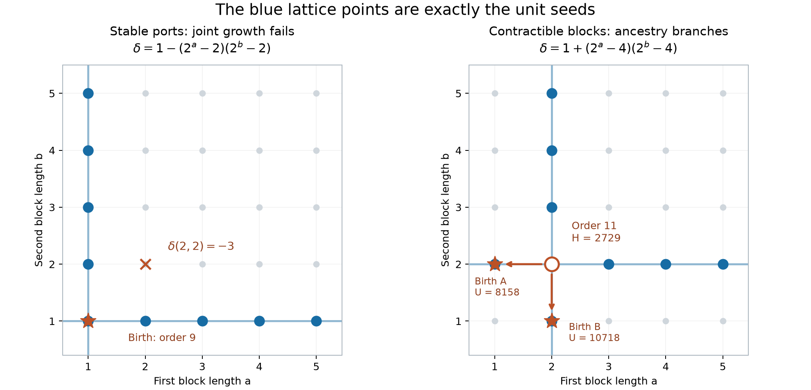

# Stable port obstructions and the forbidden Hamiltonian spectrum

**PROVED explicit infinite families / FINITE-EXACT classification through ten;
Chan–Pak OPEN. Extended session completed with reproducible receipts.**

Two different proposed composition principles fail on actual strong unit
seeds. Individual stable ports need not be jointly stable, first at order
nine in the complete strong bank. More decisively, even stable ports in
different contractible blocks need not be jointly stable: an order-eleven
seed contracts to two nonisomorphic terminal births. Thus global ordinary
stable-twin confluence is false. These are failures of a seed-generation
strategy, not counterexamples to the Hamiltonian spectrum conjecture.

## 1. Exact objects and conventions

Rows encode outgoing neighbours, vertices start at zero. H counts directed
Hamiltonian vertex sequences. For a selected set O, W is the number of
ordered two-path covers with the end of the first path and start of the
second both selected. The seed defect is delta=H-W. A unit seed has
delta=1. U is the inherited selected tail slope. A port is unselected;
its length m means replacement by a transitive module TT_m. Stability
means delta=1 for every positive integer length. Joint stability permits
all indicated lengths to vary independently.

An eligible contraction removes one vertex from an unselected transitive
twin block containing a stable port. A birth has a stable port and no
eligible contraction. We count ordinary marked isomorphism classes; converse
classes remain distinct. Canonical unselected twin quotients retain frozen
block lengths, as in the previous atlas.

## 2. J1 The first physical mixed obstruction

**PROVED, with a complete finite skeleton certificate.** Take

```
rows = [16,1,67,7,142,31,187,303,127]
O = {1,3}; ports = {5,8}.
```

This strong marked tournament has H=265, W=264, U=908. If the port lengths
are a,b, its exact defect is

```
delta(a,b) = 1 - (2^a-2)(2^b-2).                         (J1)
```

The signed Stirling skeleton has only coefficients a_(1,1)=1 and
a_(2,2)=-1. The lift factor for r visits to TT_m is r! S(m,r), so
F_1=1 and F_2=2^m-2 prove (J1) at every positive length. The complete
skeleton is computed by two different algorithms: signed words with one
selected cut, and separate path-end/path-start convolution. Direct
permutation counting at the base gives 265 and264; literal graph counts
on the entire 1..4 by1..4 grid agree. See [obstruction.py](obstruction.py)
and [its exact receipt](obstruction.json.gz).

Both axes are free. The exact positive unit locus is a=1 or b=1;
at (2,2), H=1177, W=1180 and delta=-3. Its stable-face complex has
two singleton facets and obstruction ideal <xy>. This realizes physically
the kind of mixed obstruction previously available only as a formal tensor.
The second marked type in the order-nine census is its converse.

The full slope for the displayed orientation is

```
U(a,b)=38+15*2^b+14*2^a+122*2^(a+b)+54*3^a*2^b.
U(a,1)=68+258*2^a+108*3^a;
U(1,b)=66+421*2^b.
```

These give valid seed-preserving rays; the two-dimensional grid is invalid.
The failure is the omitted mixed coefficient, not a parity or primality
obstruction.

## 3. J2 Contractible blocks can fail to commute

**PROVED explicit counterexample; FINITE-EXACT minimum strong order11.** Start
from the following marked quotient, which is not itself a unit seed:

```
Q = [2,100,49,7,75,409,173,31,223]
O = {1,4,5}; ports = {0,8}.
```

Its complete signed skeleton is

```
5 F_1(a)F_1(b)-2 F_1(a)F_2(b)-2 F_2(a)F_1(b)+F_2(a)F_2(b),
```

so its exact defect is

```
delta(a,b)=1+(2^a-4)(2^b-4).                             (J2)
```

Both directions are individually stable at a=b=2. The literal order-eleven
unit seed is

```
rows = [6,4,200,99,15,151,1843,347,63,1471,447]
selected mask = 100
stable ports = {0,1,9,10}
contractible blocks = {0,1}, {9,10}
H=2729; W=2728; U=22400.
```

Contracting the first or second block gives lengths (1,2) or (2,1).
Both are strong order-ten unit seeds with H=1347. In the first, only
the singleton port0 is stable; in the second, only the singleton port9
is stable. Neither has an eligible contraction. The two terminal births
are nonisomorphic and are converses of one another. Double contraction
would give delta(1,1)=5, so the local diamond cannot close. Joint growth
to (3,3) instead gives delta=17.

This identifies the missing coordinate: a stable direction can depend
on an unrelated block having the particular frozen length2. The positive
length identity along either line does not justify moving the other line.
The unit locus is exactly a=2 or b=2. It is two crossing rays, each with
a different terminal birth. Uniqueness of an ordinary birth root is false.
The previous conditional confluence theorem remains logically valid; its
universal pair-stability hypothesis is refuted.

## 4. Complete order-nine census

**FINITE-EXACT.** The universe is all191,536 ordinary tournament classes,
all nonempty selected sets, with actual marked automorphism orbits. The
source is the inherited full order-nine catalogue, checksum retained in
[unit_nine.json.gz](unit_nine.json.gz). No converse merging occurs.

There are178,133 strong tournament classes,15,427 strong unit-source
classes and16,443 strong marked unit seeds. Exactly324 have a stable port.
Every stable set is acyclic. Port counts are certified through the proved
run bound R=1+min(d+,d-); a full positive-length identity follows from R
successful lengths, rather than from the two-clone screen.

| Stable ports |0|1|2|3|4|5|7|
|---|---:|---:|---:|---:|---:|---:|---:|
| Marked seeds |16119|150|90|56|23|4|1|

There are202 births and122 descendants. The122 descendants agree by full
marked canonical keys with the independently generated previous layer.
The new birth ranks are150 with one stable port,44 with two, and8 with
three. Of the44 two-port births,42 are jointly stable and2 are the converse
pair (J1). All eight three-port births are jointly stable. Thus four
independent birth clocks first occur at order at least ten; Session288's
explicit order-ten four-clock core attains that minimum.

The complete through-nine birth sequence is
0,0,1,0,4,8,25,60,202, with total300.
Eighty port presentations pass the length-two screen but fail a later
length. They are retained as hostile controls, not counted as stable.

## 5. J3 Exact union of the 300 birth families

**PROVED all-length family count, based on the finite complete birth bank.**
The maximal stable faces give302 cylinders on276 marked twin quotients.
All quotient automorphisms are trivial. No cylinders from different births
intersect at any positive lengths. The two cylinders within each (J1)
birth intersect only at that birth. Fixed-length conflicts certify the
disjointness, without a length cutoff.

With G_8 the prior98-birth generating function, the exact new union is

```
G_9(z)=G_8(z)+154*z^9/(1-z)+42*z^9/(1-z)^2
                    +8*z^9/(1-z)^3-2*z^9.
```

Its order-nine coefficient is324, and for every n>=10 its coefficient is
4n^2+n-7. This is the union under the initially certified stable faces;
newly emergent ports are not included. It does not enumerate every larger
unit seed or every tournament. [birth_union.py](birth_union.py) checks the
canonical cylinder intersections and the exact rational-function identity.

## 6. Forbidden values and current research boundary

The completed continuation is in [FORBIDDEN.md](FORBIDDEN.md). It proves
entire rays1+c*2^s, s>=1, for every odd c<=53,557, apart from the targets7
and21. All3,954 lower heads are checked separately; the largest is43,131.
It also constructs every head and tail for two new infinite coefficient
families,49+495*2^a and5841*2^a−241, a>=1. The first starts at1039;
the second comes directly from the nonconfluent crossing. These are
scoped infinite constructions, not coverage of all odd coefficients.

The method then scales to the entire binary birth-clock library:
[FAMILY-COMPILER.md](FAMILY-COMPILER.md) proves complete head closure for
all540 normalized binary laws and identifies320 further higher-mode
odd-slope families with no head debt. Its exact coefficient-overlap graph
has540 vertices,257 edges and211 collision values; its distinct coefficient
count at height2^b is exactly540*b−6078 for every b>=21. This coefficient
graph is explicitly distinguished from the marked tournament metagraph.

Let F_n be the positive odd integers not attained by a tournament of at
most n vertices. Padding makes F_(n+1) a subset of F_n. The target is
intersection_n F_n={7,21}; every finite F_n is still infinite above the
finite maximum path count. Convergence must therefore mean stabilization
on each finite value interval, not equality to a finite set at one order.

The prime and7-times-prime reduction is inherited from
[THM-4094, Hamiltonian matching deficit and two-prime-lane completeness](../../../01-canon/theorems/THM-4094-hamiltonian-matching-deficit-and-two-prime-lane-completeness.md).
The exact minimal-order strong-component recursion is inherited from
[Session224, first-birth fibers](../session224_first_occurrence_20261107/proof/PROOF.md).
Neither scalar factorization nor a prime-wheel survivor supplies the
missing physical endpoint selector. The99*2^k+23 wheel remains a search
policy with explicit divisibility certificates, not a completeness proof.

The spectrum conjecture is Conjecture6.2 of
[Chan and Pak](https://arxiv.org/html/2308.10214v2#S6.SS5), who credit
bof and Gordon Royle for the2016 formulation. It remains OPEN here.

## 7. Complete order-ten classification and order-eleven descendants

**FINITE-EXACT.** The public ordinary catalogue contains9,733,056 classes,
of which9,355,949 are strong. All selected masks are checked, and actual
automorphisms are used for marked orbits. An independent C++ implementation
replays the entire catalogue, including every H-histogram entry, strength,
unit-source count and unit-mask count. It agrees with the Python engine.
The catalogue URL and SHA256 appear in [unit_ten.json.gz](unit_ten.json.gz).

| Aspect | order9 | order10 |
|---|---:|---:|
| Strong sources admitting a unit selection |15427|465023|
| Strong marked unit seeds |16443|478684|
| Seeds with stable ports |324|1253|
| Stable-clone births |202|850|
| Stable-clone descendants |122|403|
| Seeds with nonjoint full stable set |2|0|
| Cyclic stable sets |0|0|

The850 new births have independent clock ranks1,2,3,4 with multiplicities
734,84,30,2. The two rank-four births are converses. Every full stable set
at order10 is jointly stable, certified by its entire mixed tensor after
justified stable-block compression. This is not inferred from pair screens.
All403 descendants agree by marked canonical keys with the independently
generated one-clone extensions of the order-nine bank.

The resulting birth sequence through ten is
0,0,1,0,4,8,25,60,202,850, with total1,150. The stable-state sequence is
0,0,1,1,5,13,38,103,324,1253. These are new aspects of the marked seed
metagraph, not replacements for the underlying ordinary tournament counts.

Reversing one eligible contraction from the complete order-ten bank gives
the complete order-eleven **descendant** universe, without enumerating any
order-eleven births. Its2,214 presentations collapse to1,487 marked types.
Every port and reverse contraction is recertified. There are1,597 arcs to
order10. Exactly1,486 states have one terminal birth, and exactly one has
two: J2. That state is also the only nonjoint full stable set in this
declared descendant universe. The complete through-ten DAG has1,738
stable states and617 distinct contraction arcs.

The independent two-block probe permits the twice-contracted quotient to
be nonunit. It checks all order8 and9 quotients, finding34 certified
contractible pairs at target order10 and173 at target order11; only J2
fails. Together with the complete smaller banks this establishes the
minimum strong nonconfluence order11. [CROSSINGS.md](CROSSINGS.md) proves
strong ordinary nonconfluence at every larger order, not just a finite
screen failure. Strong confluence modulo converse remains a separate
question; ordinary roots must already be stored as a set.

## 8. Exact union of all1,150 initial birth families

**PROVED all-length union from a finite certified input.** There are1,152
maximal cylinders on1,077 rigid marked twin quotients. In addition to the
two J1 within-birth intersections, exactly one cross-birth intersection
exists, at the order-eleven J2 state. All intersections are decided by
fixed/free length coordinates, with no length cutoff. Thus

```
G_10(z)=G_9(z)+734*z^10/(1-z)+84*z^10/(1-z)^2
                 +30*z^10/(1-z)^3+2*z^10/(1-z)^4-z^11.
```

The coefficients at orders10,11,12,13,14 are1,253,1,487,1,767,2,092,2,465.
For every n>=12 the exact coefficient is

```
(n^3+33*n^2-319*n+2649)/3.
```

This counts the union under initially certified stable faces. It does not
assert that newly emergent ports are absent at all larger orders. At
order11 it equals the independently complete descendant census. The
unique overlap is essential: merely summing family series would overcount
the crossing and conceal its two different birth ancestors.

## 9. Hostile probes for the next mechanism

All tests here use full axis bounds, not length-two positives. Starting
from the known four-clock core, the following complete declared template
searches produce no extra independent clock: all1,024 one-vertex
extensions with all exterior selections;61,440 two-clock transitive
insertions; and655,360 extensions by one fixed exterior vertex and one
new clock. These exclude those templates, not five-clock births in general.

The J2 interior is a seven-vertex round tournament with two length-two
arcs reversed in a reflection-symmetric matching. A reflection-preserving
matching probe at interior orders7,9,11,13 examines18,56,250,972
presentations; it recovers J2 once and finds no larger crossing of that
form. The one-fixed-vertex extension of J2, even allowing every selection,
has no three-unit-corner survivor. These recorded stopping reasons direct
the search toward changed cores or more than one new exterior vertex.

The complete16,384 two-fixed-vertex decorations preserving J2's extreme
gates likewise have no crossing. A broader all-threshold search over all
ordinary quotients through9 examines22,003 extreme-port pairs and774,938
selections and finds only J2, at thresholds(2,2). It solves the power-of-two
roots of the entire bilinear tensor, so this result is not limited to
small inflation lengths. At quotient order10, the complete6,880-class
interior bank and all64 extreme-gate choices give440,320 presentations,
432,851 strong. None has a crossing with both thresholds at least2;
six three-corner candidates fail the fourth corner. This is a scoped
negative classification of the extreme-gated chart, not of all order12
seeds or of general higher-mode obstructions.



## Reproduction and dependencies

The original order-nine chain is census_nine.py unit;
census_nine.py stable; joint_nine.py. The order-ten continuation is
census_ten.py; audit_catalogue.py; stable_census.py10; joint_ten.py;
birth_union.py10; descendants_eleven.py. Use a space before each numeric
argument. The public ten-vertex input is cached outside the repository.
Normal and optimized replays use separate receipts. Detailed checks,
source pins and executable commands are in [AUDIT.md](AUDIT.md).

Inherited mechanisms: the previous atlas's endpoint tables and contraction
lemma; Session288's selected-endpoint run bound and signed acyclic-port
tensor. The new unrestricted and contractible counterexamples are checked
with independent split-cover kernels and literal graph counts. Finite
results are not promoted into a universal coverage theorem.
