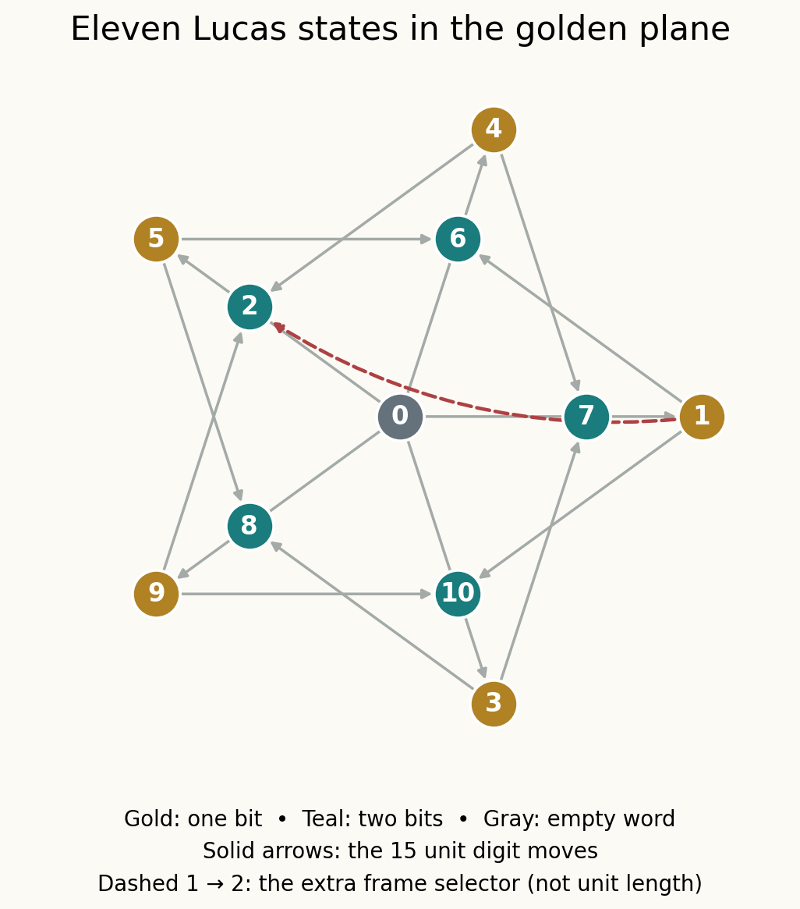

# Lucas mirrors, golden geometry, and marked gap spaces

Research session2026-10-28. **PROVED elementary results + exact finite
certificates; CITED classical inputs; OPEN major-problem applications.**
Same-agent audit. No independent-agent review or historical novelty claimed.



Labels are residues modulo11. Crossings and vertices lying inside drawn
segments do not create additional graph edges; the exact distance test
determines adjacency. The red arc records an observation, not a unit segment.

The main new assembled bridge is

    cyclic no-11 words -> golden unit-distance Lambda5 -> F11 labels
       -> Paley translation closure -> biplane with12 matching frames.

Word reflection becomes the fractional-linear map b->6/b **on the frame
space**, while it is3x^9-2x^4 on the eleven point labels. The fifteen native
Lucas arcs leave exactly two frames; one nonunit arc observation distinguishes
them. At period7 the analogous translation/mirror group is A29, proved using
a short3-cycle certificate and Jordan's theorem.

A second route upgrades the old safe-gap independent-set criterion to an
explicit equivariant homotopy equivalence. The static no-lonely-vertex gap
space is Ind(C_n) up to homotopy; for fourteen gaps it is S4. Keeping one
specified runner gives a contractible failure space instead. This prevents
the topology from being used after silently changing the target.

- [Lucas geometry, reflection, frames, and the A29 hostile](LUCAS_MIRRORS.md).
- [General threshold-space theorem and the marked LRC boundary](GAP_TOPOLOGY.md).
- [Oddness, Monster4/5/6 inheritance, dimensions, and next questions](SYNTHESIS.md).
- [Exact checker](check_bridges.py), [complete finite receipt](receipt.json),
  and [audit](AUDIT.md).

## Reproduce

From the repository root:

```bash
python3 05-knowledge/results/lucas_mirror_gap_spaces_20261028/check_bridges.py
python3 -O 05-knowledge/results/lucas_mirror_gap_spaces_20261028/check_bridges.py
```

Both runs perform2509 active checks, using only the Python standard library.
The universe includes every pair of the11 geometric points, every element
of the660-element generated group, all12 transported frames, a direct29-point
Jordan witness, rational threshold controls and cyclic word counts through17.
The full-parameter gap homotopies are proved in prose; finite samples do not
replace that proof.

Closest inherited mechanisms: THM-4592 with Session74's stronger all-period
proof; THM-370's exact safe-gap criterion; THM-4721's corrected signed-even
Walsh basis; the audited Monster-level filtration; Session91's source-tag,
metric and observer-norm refinements. Corrected near misses include
SC_n=A000568(n-1), the Baby Monster subgroup/index confusion, and identifying
an arithmetic cell permutation with a geometric isometry. Their corrections
remain in force.

No change to the truth status of Collatz, LRC(14), planar Jacobian,
Hadwiger–Nelson, or unrestricted tournament reconstruction is made.
