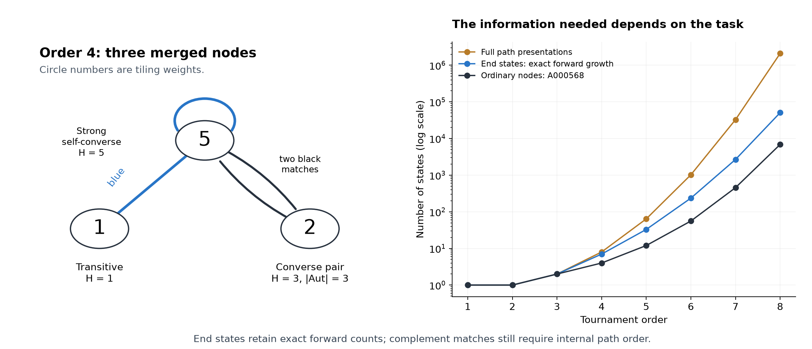

# Multi-core entry and the growth of tournament presentations

**PROVED scoped / FINITE-EXACT, 13 November 2026. Chan–Pak remains OPEN.**
The session supplies uniform core changes with actual entry into their next
families, and exact all-order growth rules for two useful metagraph quotients.
It also identifies an operation that cannot cross a specific ready-family gap.

The protected-interface chain

    462·2^k−5 → 1386·2^k−13 → 4158·2^k−37,       k≥1,

has H'=3H+2 at each step. Its graphs have orders k+10,k+11,k+12. The same
TT_k block and physical endpoint pair survive each change of core; every
completed graph is unit-ready and recognized in the next constructor family.
The bounded atlas contains 159 such +2 edges and 106 direct +4 replacements.
These are uniform finite-depth constructions, not unrestricted recursion.

The original 135·2^k+23 branch still lacks its general next entry. In fact,
405·2^k+71 is excluded from the entire one-clock outer-tail funnel language:
an analytic bound reduces all possible cores and words to a complete finite
check. Its first value 881 is ready, but **no homogeneous substitution of
any unit-ready 881 tournament can attain 1691**, even with arbitrary modules
at several vertices. This all-order operation obstruction uses the published
strong-order bound and the complete ready-source classification. Neither
number is forbidden as a Hamiltonian count.

The complete inflation exclusion extends to each of the first six adjacent
steps of that ray: 16 strong ready source classes reduce to 40 possible
module-size choices, all rejected. The stronger all-k extension is recorded
as an open, falsifiable hypothesis.

For enumeration, retaining the last vertex of a Hamiltonian path gives an
exact integer transfer between rooted tournament classes. Through order8,
the state counts are

    1, 1, 2, 7, 33, 236, 2681, 50709.

At order 8 this replaces 2,097,152 path presentations by 50,709 states for
forward counting and recovers all 6,880 ordinary classes. A further exact
quotient tracks strong-component sizes: each append merges a suffix or adds
a singleton, with explicit transition multiplicities. Burnside and SCC
identities give the state-count sequences at every order.

Complement incidence needs more information. Even among **strong**
tournaments, marking any fixed number of path vertices at both ends cannot
determine blue versus black. An aligned tournament/partner pair recovers
the entire internal Hamiltonian path. The earlier all-size incidence
pullback remains the full metagraph description; the smaller quotients
are sufficient only for their specified observables.

- [Family constructors, entry maps, and complete exclusions](FAMILIES.md)
- [Forward transfer, SCC suffix merging, and counting formulas](GROWTH.md)
- [Node weights and the boundary of colour compression](INCIDENCE.md)
- [Verification, source pins, and reproduction](AUDIT.md)
- [Concurrent results and precise overlap](INCOMING.md)

No new A000568 term, closure of the 473 residual repair families, or proof
of seeds for every admissible odd c is claimed. The conjecture itself is
[Chan–Pak, Conjecture6.2](https://www.math.ucla.edu/~pak/papers/DominoPermanent16.pdf),
with the earlier bof–Royle attribution explicitly retained there.
