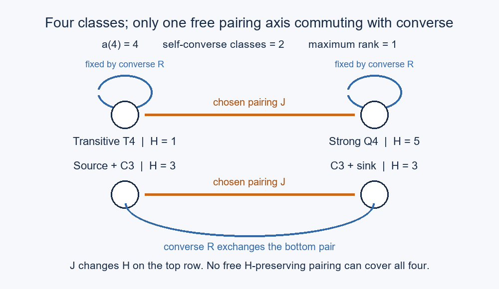

# Exactly how many pairing axes can preserve converse?

**PROVED P1–P4; FINITE-EXACT class controls through order6.**
Here “axis” means a generator of an elementary abelian group acting freely
on a finite set. It does not mean a Euclidean reflection or a native edge
flip. Converse is denoted R, and need not belong to that acting group.

## P1. A finite-action classification

Let X be a nonempty finite set with involution R. Put a=|X| and
c=|Fix(R)|. For d>=0, a free action of (Z/2)^d on X commuting with R exists
if and only if

    2^d divides a and c.                                      (1)

**Necessity.** The R-fixed locus and its complement are invariant under
every commuting transformation. A free group orbit has 2^d points, so
both loci have size divisible by2^d.

**Sufficiency.** For d=0 use the trivial action. Otherwise partition the
c fixed points into blocks of2^d, identify each block with F2^d, and use
translations. Partition the (a-c)/2 nontrivial R-pairs into blocks of
2^(d-1) pairs. Identify each resulting block with F2^d with R acting
as addition of the first basis vector. Again use translations. They
commute with R and act freely. Finite orderings make these choices
constructive. QED.

For c>0 the maximum d is min(v2(a),v2(c)); use v2(0)=infinity if c=0.
The construction's required choice is a numbering inside the blocks.
It preserves R and cardinality, but need not preserve adjacency,
Hamilton counts, scores, or any named port.

## P2. Specialization to tournament classes

Let a_n=A000568(n) and c_n be the number of self-converse classes.
The inherited twisted-Burnside reduction is

    c_(2m+epsilon)=F_m(2,epsilon),  epsilon in {0,1},           (2)

where F_m(r,s) counts r tournament layers with s binary vertex attributes
under common relabelling. This is established, with the endpoint-swap
monodromy correctly retained, in
[converse channels](../converse_tournament_count_channels_20261021/session22-converse-channels/README.md).
It is not a newly discovered equality of counts. The stronger actual fold
bijection is credited to Session132 by Session149.

The inherited [channel valuation theorem](../session89_consecutive_tournament_pairs_20261028/counting/LOW_BITS.md)
says:

    odd m: v2(F_m(r,s))=r(m-1)/2+s;
    even m>=4: v2(F_m(r,s))>=rm/2+2s;
    F_2(r,s)=2^(r+2s-1).

Together with the inherited exact odd-order v2(a_n), equation(1) gives

    d_n=(n-1)/2                    for every odd n>=3;
    d_n=n/2-1                      for every n=2 mod4;
    d_4=1;
    d_n>=n/2                       for n>=8 divisible by4;
    d_n=min(v2(a_n),v2(c_n))        in all cases.              (3)

For the first line, if m=(n-1)/2 is odd, v2(c_n)=m; if m is even>=4
it is at least m+2. At m=2 it is3, also at least m; m=1 is immediate.
For n=2m with m odd, v2(c_n)=m-1 while v2(a_n)>=m for n>=6; n=2
is its own boundary with a_2=c_2=1. For n divisible by4 and n>=8 both
valuations are at least n/2. This proves each claim without extrapolating
a finite table. No closed arithmetic formula for every higher valuation
at n=0 mod4 is asserted.

| n | a_n | c_n | d_n |
|---:|---:|---:|---:|
|3|2|2|1|
|4|4|2|1|
|5|12|8|2|
|6|56|12|2|
|7|456|88|3|
|8|6880|176|4|
|9|191536|2752|4|
|10|9733056|8784|4|

At order4 use two rows: transitive and strong Q4 on top, source+C3 and
C3+sink below. Converse fixes each top point and interchanges the bottom
points. Pairing across both rows is a free involution commuting with
converse. A free rank-two commuting action would force the two-point
fixed locus to be a union of four-point orbits, impossible. This is a
sharp distinction between divisibility by4 and two *compatible* axes.

## P3. Retaining an observable has an exact price

Let w:X->W satisfy w(Rx)=w(x). Put a_t=|w^-1(t)| and
c_t=|Fix(R) intersect w^-1(t)|. A free rank-d action commuting with R
and preserving w exists iff2^d divides both a_t and c_t for every t.
Apply P1 separately on each fibre to prove both directions.

For involutions J commuting with R and preserving w, the minimum possible
number of fixed points of J is exactly

    Delta_w = sum_t (c_t mod2).                              (4)

Necessity: Fix(R) intersect w^-1(t) is J-invariant, and every involution
on an odd set has a fixed point. Sufficiency: use R itself on all
nonfixed R-pairs; within each R-fixed w-fibre pair consecutive points,
leaving just one if its size is odd. These definitions commute with R.

Taking w=H yields Delta_H=2,2,4,6 at n=3,4,5,6 by complete class census.
For n=5 the unavoidable odd fixed fibres are H=1,3,11,13.
For every n>=3, Delta_H is even, because its parity is c_n mod2=0;
the H1 fibre forces it to be positive, so Delta_H>=2 at every such order.
For every n, H=1 contains only the transitive class. One direct proof:
if T is nontransitive it has a directed triangle; inserting the remaining
vertices into each of that triangle's three directed path orders gives
three distinct Hamilton orders (delete the added vertices to recover the
different triangle orders). Any path in a tournament admits insertion of
an extra vertex by the standard first-out-neighbour rule. Hence H(T)>=3.
The H1 obstruction is inherited from the incoming joint parity packet;
the exact minimum(4) strengthens its quantitative statement.

Neither small Delta_H nor small d_n determines individual extension
responses. The 81/27 control has the same H and same cyclic triples but
different named-port responses; it is replayed in receipt.json.

## P4. Native matching frames are a stronger demand

At n=5 fix matching edges(0,1),(2,3). The other eight bits are a frame.
Over all256 frames,136 give four distinct ordinary classes under the two
matching flips. They produce15 distinct four-class blocks. Exhaustively
checking all triples of those15 blocks gives no disjoint cover of all12
classes. Thus abstract free rank-two actions from P2 cannot all be
implemented as these fixed-frame flips.

The minimum number of full frame blocks covering all12 classes is **four**,
not five as the June
[almost-fixed-frame reflection](../../../07-reflections/almost-fixed-frame-and-the-coupling-s533.md)
reported. A witness in lexicographic unordered-edge bit order is:

| Frame base mask | Canonical class masks from its four matching settings |
|---:|---|
|2|0,2,4,5|
|270|0,5,8,40|
|842|0,5,9,11|
|282|10,12,41,76|

The two matching bits are zero in each base mask. The union has12 classes;
no three four-class blocks can cover12 unless disjoint, which the exhaustive
test excludes. Thus both optimality and the upper witness are certified.
The old code used a greedy cover and called it “MIN”; greedy output cannot
establish optimality. The non-tiling obstruction survives.

