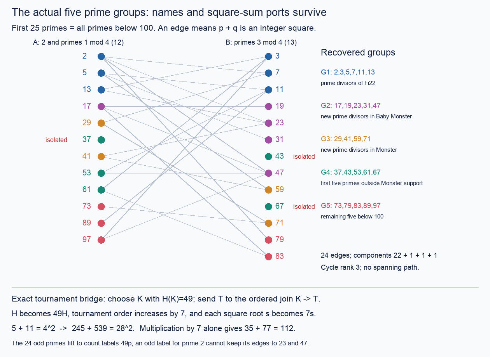

# Prime and 7p realization: source order, attachment ports, and five prime groups

**PROVED scoped construction and obstruction theorems / FINITE-EXACT
controls; independent agent audits. Full spectrum classification is OPEN.**
No new numerical coverage record or literature-priority claim is made.

The target remains

    {H(T): T a finite tournament} = positive odd integers minus {7,21}.

[THM-4094, two-prime-lane completeness reduction](../../../01-canon/theorems/THM-4094-hamiltonian-matching-deficit-and-two-prime-lane-completeness.md)
reduces this exactly to strong witnesses for every odd prime p other than7,
and for every7p with p an odd prime other than3. The inherited strong carry
atoms49,63,343 and ordered joins then supply every remaining allowed odd
integer. Prime2 is outside both odd-target lanes; p=7 remains in the7p lane
through49. The omitted values7 and21 are proved gaps, not construction
targets. The numerical finite bank and all-size constructive coverage are
different statements.

## What this session adds

1. **An all-context source-order operation.** Moving a zero-cut singleton
   after any nontrivial block with a nonempty cut strictly increases the
   marked child's H; moving a one-cut singleton before a block with a
   nonfull cut does likewise. This is proved for arbitrary actual blocks,
   prefixes and suffixes, not only symmetric blocks. The source keeps its
   H and full unmarked path-cover profile while its attachment response
   changes. [Realization R0–R1](realization.md).
2. **Explicit strong families with exact inverses.** For r>=1 the same
   named vertices and apex cut give pairs

       15*2^r-7 <-> 18*2^r-7,
        9*2^r-1 <-> 15*2^r-1.

   Only the three edges between a singleton and a triangle are reversed.
   Examples include35<->59,71<->119,287<->479: actual constructions linking
   some prime and7p values. The supplied family image has an exact
   power-of-two membership test and only O(log X) values below X. It misses
   prime13; there is no interval or all-prime conclusion.
   [Realization R2](realization.md#5-four-explicit-strong-dyadic-families-and-a-lane-exchange).
3. **A sharp budget for symmetry-breaking attachments.** If the retained
   source has k independently rotating triangle blocks, adding r arbitrary
   vertices forces

       3^max(k-2r,0) | H.

   Thus targets p or7p with p!=3 require r>=ceil(k/2) in this architecture.
   Rewiring edges only among the new vertices changes H by a multiple of
   3^max(k-2r+2,0). This permits strong examples attaining the exact lower
   valuation for every r>=1,k>=2r. The general theorem retains disjointly
   supported source automorphism groups and prime-wise weights.
   [Boundary B1–B4](BOUNDARY_BUDGET.md).
4. **A precise failure of one-step attachment data.** The complete named
   one-new-vertex H response can forget a circulation that two named births
   detect. Opposite orientations of a named triangle are invisible to every
   single cut. With two births, three distinct two-bit old-vertex signatures
   distinguish the child classes; repeated signatures do not. In12 cases
   the children even have equal H but different deletion-H decks. This
   separates source identity, response count and child isomorphism type.
   [Attachment theorem and exhaustive128-case control](attachment.md).
5. **A literal square-sum connection.** The recovered five groups partition
   all25 primes below100, with sizes6,5,4,5,5. Their graph has24 edges,
   components22+1+1+1 and isolated37,43,67. Every group fails equitable
   incidence, so named prime ports remain necessary. A realized H49 factor
   gives an actual square-preserving ordered-join map; all24 odd primes
   admit labels49p using the H343 carry at p=7. The vertex2 cannot be added
   with an odd H label while retaining any odd-square dilation of the odd
   prime labels: the edges23–2–47 already contradict residues modulo16.
   [Five groups, diagram, witnesses and map](prime_groups.md).

## Inheritance and live concept board

The closest proved mechanism is the actual marked-parent four-coordinate
block action in [BRANCHES §1](../prime_inverse_ports_20261102/BRANCHES.md),
alongside the full deletion-fiber requirement of THM-4094. The canonical
hostile is [the order-five equal-cover pair](../tournament_joint_parity_20261102/growth_obstruction.md).
The corrected near miss is [an algebraically legal inverse state with no
actual source](../spectrum_descent_jacobian_20261102/README.md). The least-used
sidecars here were the physical location of a source component and the
old-new incidences of an individual Hamiltonian word.

The assigned anchor is the prime/7p target. The niche is exact information
lost by quotienting source order and named attachment. The wildcard is the
five-group square-sum graph and its square-carry map. LRC(14), the workspace
anchor, remains OPEN and no result here is transferred to it.

| Live concept | Effect of the new results | Decisive stopping boundary |
|---|---|---|
| Actual prime/7p sources | Sparse formulas have decoded named witnesses | Prime13 is outside these four families |
| Source component order | Arbitrary-block strict relocation gives controlled variation | Monotonicity does not fill intervening values |
| Shared attachment ports | Two-birth signatures expose hidden triangle orientation | One-step scalar equality is not compositional |
| Symmetry and boundary budget | At most2r touched blocks explain the surviving divisor | Budget sufficiency is not target realization |
| Square sums and five prime colors | H49 carries the exact square relation on odd labels | Group quotient loses ports;23–2–47 blocks the even vertex |

These are connected by explicit maps, not by treating numerical labels as
the same object. In particular, square-sum adjacency is symmetric, while
tournament arcs are oriented. No cosmetic tournament is imposed on the
prime graph. Its five-color support quotient contains a triangle that
does not lift to the bipartite physical graph.

## The constructive interface that remains open

The order-five pair has equal H=3, automorphism order3, and every unmarked
spanning-cover count, yet different one-birth H distributions. A proof
using just those invariants cannot choose a correct attachment. The
two-birth triangle obstruction strengthens this: even the entire one-step
H response is not a closed recursive state.

A constructive proof must provide an actual source witness, retained
vertex names or an explicit relabeling, the shared cut for every new
vertex, and enough endpoint/incidence information to update the next
source. It must also retain ordered block placement and any symmetry
weights used for divisibility. Full graph data plus exact subset path DP
is sufficient; the inherited fixed-horizon endpoint/parity carriers can
compress specified growth schedules. Neither statement by itself supplies
an inverse choosing a source and ports for each target prime.

The next precise target is a family of actual marked blocks and cuts whose
decoded image covers both required lanes. The present operation provides
strict directions, exact increments, necessary attachment cost, and sparse
inverse images. An all-target existence theorem, interval-filling argument,
or terminating descent with actual-source closure is still required.

### Connection recovered from incoming concurrent work

After the first source snapshot, Session150 added the exact rooted rays
`alpha+beta*2^k` in its [gadget theorem](../session150_hamiltonian_spectrum_20261103/gadgets/RESULT.md)
and proved [fixed-root collapse and the finite-ray obstruction](../session150_hamiltonian_spectrum_20261103/prime_induction/RESULT.md).
Repeated births at one unchanged root only advance the same exponential
ray. More generally, any finite set of such rays misses both p and7p for
infinitely many primes p; that inherited proof uses an explicit reduced
residue class and Dirichlet's theorem. It applies directly to our four
families, even after finitely many exceptional seeds and ordered products
are allowed. Our prime13 hostile is the cheapest local test; the incoming
theorem gives the stronger all-size stopping reason. This is an obstruction
to this strategy, not to the full spectrum.

The concurrent [adaptive-root search](../session150_hamiltonian_spectrum_20261103/adaptive/RESULT.md)
retains actual graph witnesses while changing roots and exhausts its
triangle-seed growth language through count199, reaching every allowed
odd value from3 to199. This finite success escapes the fixed-root
obstruction. Our attachment theorem explains the additional obligation
for an eventual proof: transporting only an old scalar or even its complete
one-step response can lose the next named root/port response. The actual
source and compatible endpoint state must survive the adaptive step.

The incoming [fixed uniform-substitution obstruction](../session150_hamiltonian_spectrum_20261103/obstructions/RESULT.md)
also excludes a universal nonzero additive update from one fixed uniform
wrapper. It explicitly leaves adaptive, rooted and nonuniform interfaces
available. Thus both concurrent barriers point toward the same remaining
constructive interface, without converting the finite adaptive search into
an induction theorem.

Incoming Session150's [square-root lower bound](../session150_hamiltonian_spectrum_20261103/induction/RESULT.md)
and [triangle-wrapper transfer](../session150_hamiltonian_spectrum_20261103/transfer/TRANSFER.md)
are retained as different positive constructions. The concurrent
[uniform prime transport packet](../uniform_prime_transport_20261103/README.md)
supplies homogeneous-module obstructions and native rewrites; the present
source-order move is not silently declared a legal word in that native
move language. The [square-birth packet](../square_birth_windows_20261103/README.md)
supplies the physical root and parent clocks that the five colors forget.

## Files and verification

The four mathematical notes above give definitions, proofs, equalities,
failure boundaries, universes and reproduction commands. See
[AUDIT.md](AUDIT.md) for cross-agent proof review and independent algorithms,
[source_pins.json](source_pins.json) for inherited source identities, and
[manifest.json](manifest.json) for artifact hashes. Every executable check
uses explicit exceptions and runs under normal and optimized Python.

The diagram is an exact rendering of the enumerated graph:

