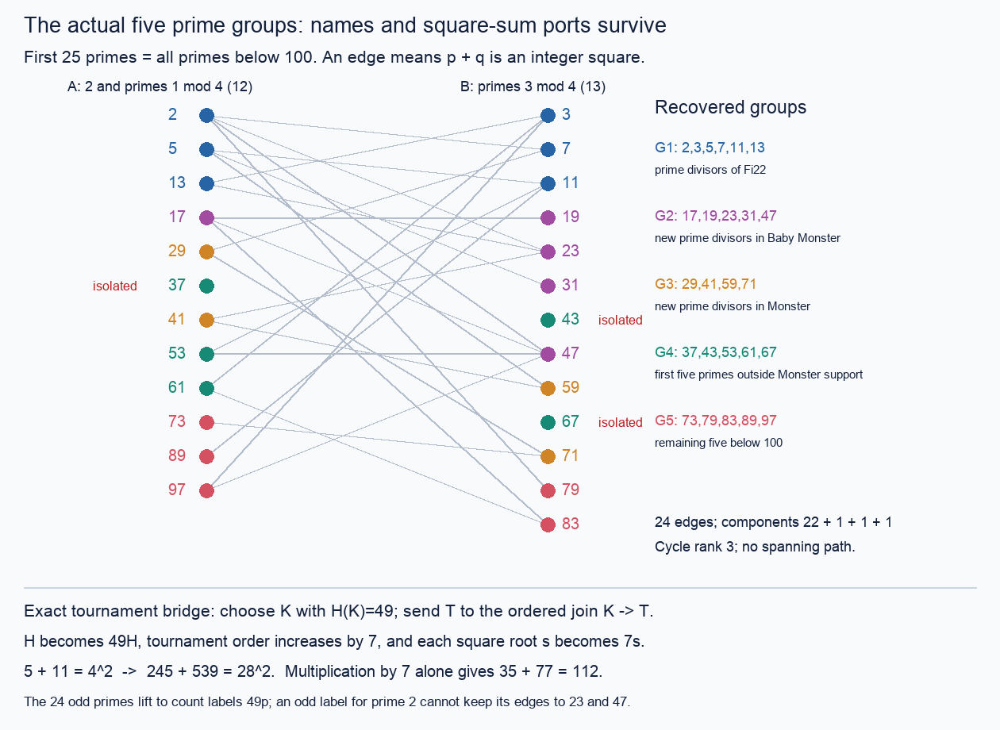

# The recovered five prime groups and an exact square-carry bridge

**Status:** CITED prime-support interpretations; INHERITED / FINITE-EXACT
prime graph; PROVED elementary port, scaling, and ordinary-tournament
embedding statements. This packet does not classify the full Hamiltonian
spectrum or identify these five groups with five tournament families.

The user's groups really are the following partition of all 25 primes below
100. They have sizes **6,5,4,5,5**, not five equal sizes.

| Group | Primes | Recovered meaning | Internal square-sum edges |
|---|---|---|---|
| G1 | 2,3,5,7,11,13 | prime divisors of `|Fi22|` | 2–7; 3–13; 5–11 |
| G2 | 17,19,23,31,47 | new prime divisors in `|B|` | 19–17–47; 23,31 isolated internally |
| G3 | 29,41,59,71 | new prime divisors in `|M|` | 29–71; 41–59 |
| G4 | 37,43,53,61,67 | first five remaining primes | none |
| G5 | 73,79,83,89,97 | last five remaining primes below 100 | none |

Here `B` is the Baby Monster and `M` the Monster. The first three groups are
successive differences of **prime-support sets**, not asserted subgroup
quotients or embeddings. The latter two groups are the split of the
remaining ten primes in increasing numerical order. No additional
moonshine classification of those two pentads is claimed.



## Exact recovery and correction lineage

The explicit user directive is preserved in
[the November 1 machine dictionary, §0](../machines_automata_fractran_tournaments_dictionary_20261101/README.md).
That source confirms the correction to the earlier duplicated `71`: **67
belongs to G4; 71 belongs to G3**. This packet does not infer a partition
from residues. The exact prime-support interpretation is inherited from
[Session32, Fischer support shells](../session32_square_monster_20261023/FISCHER_SUPPORT_SHELLS.md).
The [ATLAS Fi22 order](https://brauer.maths.qmul.ac.uk/Atlas/v3/group/Fi22/)
and [ATLAS Monster order and 2.B entry](https://brauer.maths.qmul.ac.uk/Atlas/v3/group/M/)
are primary controls for the cited group orders. In particular `2.B`, not
`B`, is the named Monster subgroup; MISTAKE-668 guards this distinction.

The union G1+G2+G3 is the 15-prime Ogg set, for which every supersingular
j-invariant is defined over the prime field; this is the `X_0(p)^+` list,
not the unquotiented `X_0(p)` genus-zero list. See
[Duncan–Ono, introduction and (1.1)](https://arxiv.org/html/1411.5354v2).
The deeper level `1|2|6` reading and its corrections are already in
[the audited square/Monster packet](../monster_levels_square_sum_7_21_20261022.md).
No modular claim is needed for the elementary bridge below.

Primary verification metadata (2026-11-02): the ATLAS Fi22 and Monster pages
and Duncan–Ono v2 were opened and read in this session. The direct ATLAS B
endpoint failed twice, so it is not represented as a fresh successful read.
The accessible Monster page lists `|2.B|=8309562962452852382355161088000000`;
dividing by two and factoring gives exactly the inherited Baby Monster
prime support. The executable independently factors all three cited group
orders and checks the first three shells against them.

Inheritance: the closest mechanism is the named root/parent birth law in
[square-birth GROWTH](../square_birth_windows_20261103/GROWTH.md); the hostile
is the non-adjacency-preserving rank-to-prime map; the corrected near miss
is the duplicated 71 and the interpretation of 24 edges as a tree; the
least-used sidecar is the physical prime port within each of the five
colors. The board is **five colors / individual prime ports / square roots /
prime-rank clock / SCC word / 7-adic carry**. The anchor is the combined
square-sum/tournament request, the niche is recovery of the actual five
groups, and the wildcard is an exact use of the H=49 carry atom.

## Three graphs and two clocks

The graphs `Q25`, `Q97`, and the graph on the first 25 **prime values** are
different. Their edge counts are respectively **32,258,24**. Each uses the
relation that the sum of the two distinct vertex values is a square.
The first two have all integer vertices through their indicated bounds;
the third has only prime vertices. These counts and the full first-25
birth ledger are inherited from
[square-birth LEDGER](../square_birth_windows_20261103/LEDGER.md) and freshly
replayed here by two independent edge enumerations.

The prime graph has component sizes `22,1,1,1`, isolated vertices
`37,43,67`, and cycle rank `24-25+4=3`. Thus its `25-1` edges do not form a
spanning tree, and it has no Hamiltonian path. The isolation is scoped to
this finite prefix: the respective first prime partners are `107,101,257`.
The 15 Ogg primes induce a 14-edge tree with bipartition sizes 6 and 9;
that imbalance separately forbids a Hamiltonian path. Neither graph is
identified with `Q15`, which does have a Hamiltonian path.

**PROVED, inherited elementary bipartition.** Put

```text
A={2} union {odd primes p: p=1 mod4},
B={primes p: p=3 mod4}.
```

Two odd primes with square sum must sum to an even square, hence to zero
modulo four, so lie in opposite parts. A square sum involving 2 is odd,
and its other prime is 3 modulo four. This proves bipartiteness at every
prime bound. Below 100 the part sizes are 12 and 13.

At prime-rank step `k`, the new vertex is the numerical prime `p_k`.
Its named birth ports are exactly

```text
D_prime(k)={s^2-p_k : p_k<s^2<2p_k and s^2-p_k is prime}.       (1)
```

The strict inequalities exclude zero parents, future parents and loops.
The prime-rank clock `k` and the integer-value clock `p_k` must remain
separate. Even on a fixed root chart the primality predicate can change:
`p_13=41` and `p_14=43` both have candidate roots `{7,8,9}`, but their prime
birth-port sets are `{23}` and empty. At root 8 the physical transport is
`23 -> 21`; primality is destroyed. The appearance of 21 here is a
compositeness obstruction, not a proof transported from the tournament
H=21 gap.

## The five colors are not an exact graph quotient for growth

Retain one incidence for each ordered physical edge endpoint. The resulting
five-by-five incidence matrix is

```text
       G1 G2 G3 G4 G5
G1      6  4  2  2  3
G2      4  4  1  1  2
G3      2  1  4  0  1
G4      2  1  0  0  1
G5      3  2  1  1  0 .                                  (2)
```

Diagonal entries count both endpoints of internal edges, so the sum of all
entries is 48. This preserves the total incidence mass, but not any given
vertex's available ports. For example, `37` and `53` have the same color
G4 while their neighbor-count vectors across the five groups are
`(0,0,0,0,0)` and `(1,1,0,0,0)`. Every one of the five color classes fails
the equitable-partition test. In particular the average total degree in
G4 is `4/5`, which cannot be assigned as the physical degree of each prime.

Unlike the reflection orbits in the toothpick packet, these five color
classes are not declared automorphism orbits. There is no orbit-transitivity
argument making their incidence fibers uniform. The exact survivor is the
per-prime table `per_prime_group_ports` in [prime_groups.json](prime_groups.json),
with every edge retaining both named prime endpoints and its root `s`.

The support quotient on the five colors even has a triangle G1–G2–G3–G1,
whereas the actual prime graph is bipartite and has no triangle. This is a
minimal closed-walk lifting obstruction: successive quotient edges need not
use the same physical prime at their meeting color. A graph or tournament
construction on five anonymous colors cannot silently supply that lift.

## An actual tournament construction preserving square-sum edges

Define a **secondary** simple graph on ordinary tournament classes by

```text
[T] adjacent to [U] iff H(T)+H(U) is an integer square.
```

This is a declared relation on numerical invariants of classes. It is not
the arc relation within either tournament, and no missing edges are filled
in or arbitrarily oriented.

**PROVED (square-carry embedding).** Let `K` be a fixed tournament with
`H(K)=c^2`, for a positive integer `c`. Then the ordered join

```text
J_K(T)=K -> T
```

is injective on ordinary isomorphism classes and induces an embedding of
this secondary graph, with exact transport

```text
H(J_K(T))=c^2 H(T),
|J_K(T)|=|K|+|T|,
square root s -> c s.                                    (3)
```

**Proof.** Every cross arc points from K to T, so any Hamiltonian order
consists of a Hamiltonian order of K followed by one of T. This gives a
bijection of path sets, not merely equality of counts. The ordinary class
is determined by its unique ordered SCC word. Prefixing a fixed SCC word
is cancellative, proving class injectivity. Finally `c^2(a+b)` is a square
iff `a+b` is a square: if `c^2(a+b)=r^2`, divisibility valuations force
`c|r`. Thus the secondary relation is both preserved and reflected. ∎

The SCC mechanism is inherited from
[THM-1862, order-join reduction](../../../01-canon/theorems/THM-1862-order-join-reduction-principle.md).
For the requested prime/7p theme, choose the inherited carry atom **H=49**
from [THM-4094, two-prime-lane reduction](../../../01-canon/theorems/THM-4094-hamiltonian-matching-deficit-and-two-prime-lane-completeness.md).
The present executable supplies this explicit seven-vertex strong anchor
(rows are adjacency rows, in named order 0 through 6):

```text
0100111
0001000
1100000
1010000
0111000
0111100
0111110
```

Subset dynamic programming and enumeration of all `7!` vertex orders both
give H=49. It comes from mask 185 of the inherited order-seven candidate
bank; the actual matrix and its verification, not the bank's interpretation,
are the certificate. For this K, the numerical H clock multiplies by 49,
the square-root clock multiplies by 7, and the tournament-order clock adds
7. The number of vertices of any finite secondary graph being embedded
stays unchanged.

A direct control uses actual tournaments with H=5 and H=11. Their joins
have orders 11 and 12 and H=245 and H=539, verified independently by subset
DP on the resulting matrices. Thus the edge

```text
5+11=4^2  ->  245+539=28^2
```

is carried by an actual construction. Multiplication by 7 alone gives
`35+77=112`, a non-square. More generally, multiplying both endpoints of
**any** square-sum edge by a positive nonsquare integer destroys that edge,
since a nonsquare times `s^2` remains nonsquare. A sevenfold H carry cannot
be supplied by ordered join with a fixed H=7 factor either: such a
tournament does not exist.

This makes the square factor, rather than a superficial occurrence of 7,
the decisive common coordinate. It does not solve the strong H=7p lane:
our nontrivial ordered joins are not strong, and their values are 49p.

## Exactly how much of the first-25 prime graph lifts

The executable recovers and independently checks a strong tournament of
H=p for every prime `p<100` except `2,7`; all 23 extracted matrices have
order at most seven. It obtains them from actual order-seven candidates,
then removes singleton SCCs with a recorded vertex transport. This is a
fresh certificate recovery inside an already proved finite bank, not a
new range theorem.

For these p, (3) gives a witness with H=49p. The remaining odd prime 7 is
handled by the inherited **343** carry atom. The explicit order-eight
mask `136003753` in
[Session150's carry verifier](../session150_hamiltonian_spectrum_20261103/status/verify_witnesses.py)
is replayed here by DP and all `8!` orders and gives a strong H=343
witness. Therefore **all 24 odd primes below 100** admit actual tournament
classes with labels `49p`, and the whole square-sum graph induced on those
24 primes embeds in the secondary H-count graph. The color attached to p
can be retained as an external decoration; this is not a prime-support
classification of the tournaments themselves.

**PROVED obstruction at the even prime, supplied by the parent audit.**
Two odd integer values differing by 8 modulo 16 have no common **odd**
square-sum neighbor. Indeed, adding an odd neighbor makes both sums even;
even squares modulo 16 are only 0 and 4, whose possible differences are
0,4,12, never 8.

In the original prime graph, 2 is adjacent to both 23 and 47, with sums
25 and 49. After multiplying the odd-prime labels by any **odd square**
`c^2`, their difference is

```text
(47-23)c^2 = 24c^2 = 8 mod16.
```

Every tournament H-value is odd. Consequently **no choice whatsoever of a
tournament H-value for vertex 2** can preserve both of those edges while
retaining the `c^2 p` labels on the odd primes. This holds for our c=7
construction and for every odd-square dilation, even before asking whether
that proposed H is attained. This is a scoped obstruction to the declared
map, not a claim that no other graph embedding of 25 vertices could exist.

An independent finite factor control reaches the same conclusion for c=7:
requiring an odd positive h with `h+343` and `h+1127` square gives only
`h=8873`; then `h+2303=11176` is not square. The modulo-16 proof is the
stronger all-odd-square statement and is the load-bearing argument.

Direct prime labels p themselves also fail at 2 (Rédei parity) and 7
(the global gap). Labels 7p fail at 2 and 3 (evenness and H=21). All of these
exceptions must be retained when interpreting the inherited two infinite
lanes, whose actual domains are odd prime `p!=7` and odd prime `p!=3`,
respectively. Their all-order closure remains OPEN.

## Reproducibility and connection contract

```bash
python3 -I -B 05-knowledge/results/prime_lane_ports_five_groups_20261102/prime_groups_probe.py
python3 -I -B -O 05-knowledge/results/prime_lane_ports_five_groups_20261102/prime_groups_probe.py
```

Normal and optimized receipts agree. The mathematical computation uses
only the standard library; optional Pillow renders the PNG from the same
primitives as the editable [SVG](prime_groups.svg). Both edge-first and
root-first enumeration give exactly the same physical graph. Controls
cover the 25-prime partition, Ogg tree, port failures, root-chart primality
failure, strong prime witnesses, literal H49/H343 counts, actual joined
matrices, and both arithmetic scaling directions. All checks remain active
under `-O`.

**Source:** named prime values with group colors, integer roots, and actual
tournament witnesses for the specified H labels. **Target:** a secondary
square-sum graph on ordinary tournament classes. **Map:** multiply H by a
realized square through ordered join, plus the explicitly named 343 carry
at p=7. **Preserved:** adjacency and nonadjacency among odd-prime values,
root labels under scaling, source colors as annotations, and exact product
of path sets. **Lost:** primality of the target numerical labels, strong
connectivity of ordered joins, and any asserted equality between prime
rank, arithmetic value, root, and tournament order. **Needed sidecars:**
the witness matrices, named SCC transport, and per-prime physical ports.
**Cheapest decisive hostiles:** G4's 37/53 port mismatch; the 41→43 root-chart
prime loss; and 23–2–47 modulo sixteen.
