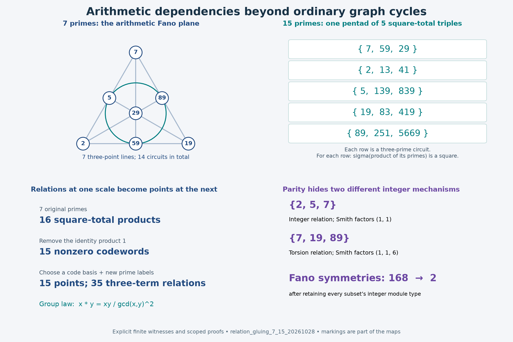

# From seven arithmetic primes to relations, gluing, and fifteen points

2026-10-28. **PROVED elementary statements / CITED inherited and classical
mechanisms / FINITE-EXACT enumerations / OPEN applications.** Same-agent
review with separate computational paths; no external referee or literature
priority claim. [Proofs](THEOREMS.md), [connection atlas](ATLAS.md),
[sources and reproduction](SOURCES.md), [exact receipt](normal.json).

The strongest unifying object found here is a **presentation by generators
and relations, together with its actual gluing maps**. For arithmetic it
retains prime-power choices and integer valuations. For binary dependence
it specializes to a matroid and code. Changing coefficients exposes
torsion, while composition supplies exact correction terms. This gives
constructions and proofs beyond merely saying what an observer must retain.

An ordinary graph's cycle space cannot represent the arithmetic Fano
matroid. A graph carrying arbitrary local constraints can still represent
it: Tanner graphs and exact tree realizations are classical examples.
The extension is in the allowed relations and their composition laws.



## What this session establishes

1. **Dependencies have exact gluing laws.** For linear maps into a common
   module, the kernel of the joined map is an extension of the two old
   kernels by the intersection of their images. On a binary tree, these
   quotient spaces locate new dependencies at lowest common ancestors.
   This works over rings; a splitting is not automatic. [T1](THEOREMS.md#t1-exact-gluing-describes-where-dependencies-are-created)
2. **The projective binary configuration has optimal separator dimension
   r-1.** Thus the seven-point Fano code needs at most four interface values
   per cut in a suitable tree, and the fifteen-point code needs eight.
   Exactly693 of the 10395 rooted binary Fano leaf trees are optimal:
   precisely one fifteenth. This concerns separated constraint realizations,
   not all algorithms. [T2–T2a](THEOREMS.md#t2-projective-binary-dependencies-have-exact-tree-width)
3. **The seven-prime example extends explicitly to fifteen primes.**
   Its square-total selections form Hamming[15,11,3], with 2048 words and
   308 minimal dependent supports. The fifteen nonzero words of the old
   Hamming[7,4,3] code can themselves become these fifteen new points,
   preserving a precise three-term relation. [T3–T3c](THEOREMS.md#t3-a-prime-realization-joins-the-seven-and-fifteen-geometries)
4. **Integer data distinguish dependencies hidden by parity.** One Fano
   line lifts from an integer kernel; another arises from the 2-torsion of
   Z/6. Decorating all subsets by their integer quotient-module types
   reduces the Fano symmetry group from 168 to 2. [T4–T4a](THEOREMS.md#t4-changing-coefficients-can-create-dependencies-from-torsion)
5. **Overlapping arithmetic factors can be composed exactly.** An explicit
   valuation correction repairs the coprime product law and satisfies an
   associative cocycle identity. Thus the earlier collision between atoms 2
   and 4 can be calculated instead of excluded. [T5](THEOREMS.md#t5-every-integer-has-a-prime-power-presentation-and-overlap-can-be-fused)
6. **The number-field extension needs units and ideal classes.** The
   classical Selmer exact sequence identifies what prime-ideal parity
   misses. In the two-grid fields for 5,13,37, the nonsquare element2 has
   even ideal valuations and detects the nonprincipal grid class. This
   is a precise connection to the earlier grid work. [T7](THEOREMS.md#t7-beyond-integer-valuations-units-ideal-classes-and-selmer-groups)

These organize classical linear algebra, coding theory, integer-module
theory, and factorized counting around explicit new applications. The
scope of each proof and each finite enumeration is stated separately.

## The concrete seven-to-fifteen bridge

Order the original primes as

```text
primes:             7  2  5 19 89 59 29
squareclass(p+1):    2  3  6  5 10 15 30.
```

These are the seven nonzero vectors on valuation coordinates(2,3,5).
Adjoin coordinate7 and these eight primes:

```text
251, 13, 83, 41, 139, 5669, 419, 839.
```

The resulting fifteen columns are every nonzero vector of F2^4. Every
subset is a legitimate product of distinct primes, so the square-total
test is exact on all 32768 subsets. The empty subset represents the unit.

There are35 three-prime circuits. Choosing the six-label symplectic model
splits them into 15 perfect matchings and 20 triangles. One of its six
pentads gives five disjoint arithmetic triples:

```text
{7,59,29}, {2,13,41}, {5,139,839},
{19,83,419}, {89,251,5669}.
```

Each triple's product has square divisor sum. This is an explicit map
from the earlier duad/syntheme/pentad geometry into arithmetic. The
symplectic form and marking are additional choices, not dictated by the
number15 or by the square-class code alone.

The old sixteen square-total products form a group under

```text
x star y = x*y / gcd(x,y)^2.
```

After choosing a basis, its fifteen nonidentity elements label the fifteen
new prime points. A three-term group law becomes a square-total triple in
the new bank. This is a concrete instance of relations becoming objects
at the next scale; it does not preserve arithmetic magnitude.

## Lowest common ancestors: three different questions

| Question | Seven Fano points | Fifteen projective points |
|---|---:|---:|
|Dimension of the square-total code|4|11|
|Independent parity checks|3|4|
|Optimal maximum separator dimension|2|3|
|Possible values at that separator|4|8|
|Trees needed to display all three-point lines as literal clusters|7|7|

For the 15 isotropic lines alone the last count is4. A literal node cluster,
an interface state, an independent equation, and a free code coordinate
are distinct resources. The proofs prevent a shared numeral from
silently changing meaning.

The incoming [Session85 LCA theorem](../session85_arithmetic_codes_free_bits_20261028/LINEAR_GLUING_INFORMATION.md)
counts independent rows and missing projection constraints. Our T1 counts
kernel directions and supplies the ring extension. Both are retained;
neither is used as a claim that arbitrary tournament constraints are linear.

## Arithmetic beyond a coprimality guard

Write S_p(e)=1+p+...+p^e. The prime-power presentation retains e_p and
therefore evaluates sigma, tau, F,U,S, abundance, Liouville and Möbius
on the same actual integer. For unrestricted multiplication define

```text
d_p(a,b)=v(S_p(a+b))-v(S_p(a))-v(S_p(b)),
v(sigma(nm))=v(sigma(n))+v(sigma(m))+sum_p d_p(v_p(n),v_p(m)).
```

Here v is the full integer valuation vector; negative coordinates in
the correction are allowed. Only shared primes contribute. Cancellation
proves the cocycle law, so different parenthesizations agree.

For2 and 4 the correction is5/7, or square class35. The earlier formal
square1764 for atoms{2,4,5,13} becomes actual sigma(520)=1260=36*35.
This explains the failure mechanism and repairs the operation itself.
The cocycle is a coboundary; no nontrivial cohomology class is asserted.

The previous [FUS and abundance classification](../session84_guarded_unification_20261028/BALANCE_AND_EXCESS.md)
and [Berggren semiprime map](../session84_guarded_unification_20261028/BERGGREN_SEMIPRIME_BRIDGE.md)
remain inherited results. The new presentation incorporates their inputs
and exact arithmetic evaluations; it does not replace their proofs with
an analogy or a rank calculation.

## What the integral lift changes

| Fano line | Integer Smith factors | Source of its mod 2 dependence |
|---|---|---|
|{2,5,7}|1,1|An integer kernel direction|
|{7,19,89}|1,1,6|The2-torsion of the cokernel|

The same torsion mechanism explains why a signless triangle gains a
cycle after reduction modulo2. The full seven-column cokernel is trivial,
so retaining only that one module misses the distinction. The family
of subset quotient modules is the relevant classical object, a
representable matroid over Z. Its presented maps carry more information
than the list of abstract module types alone.

Of the 168 binary Fano symmetries, exactly two preserve all these integer
types. The nonidentity one exchanges19 with 89 and 59 with 29. It has an
explicit signed integral lift, but does not preserve positive arithmetic
labels or sigma magnitudes. This is comparable to the decorated-stabilizer
mechanism behind the 81/27 tournament pair, without identifying the actions.

## Where the framework applies, and where work remains

The [atlas](ATLAS.md) records explicit maps and hostile tests for norm-seven
Eisenstein charts; Fano tournament flip codes; tetrahedral and six-label
geometry; FUS and aliquot multiplication; signed graph incidence;
Berggren addresses; LRC finite kernels; and boundary discriminant modules.
It also distinguishes a Gaussian norm-five quotient from a five-line
spread and from a five-tree cluster cover.

The practical program is to assemble actual solution sets with their
relations, carry their integer or finite-field structure, and identify
the exact obstruction when coefficients or interfaces change. Positivity,
injective labels, primality, orientations and shared-variable identities
remain explicit equations or constraints. Graceful-tree existence,
square-sum Hamiltonicity, LRC(14), and the broad dynamical conjectures
are not consequences of these representations.

## Verification

[check.py](check.py) checks all 32768 fifteen-prime selections, all 10395
Fano leaf trees,65536 binary matrix/cut cases,729 small integer matrices
at characteristics 2,3,5,127 arithmetic submatrices,168 Fano symmetries,
the complete spread geometry,6400 unrestricted products and 1296
prime-power choices. [audit.py](audit.py) checks the integral symmetry
result via gcds of minors and all 5040 permutations, plus the relation
lift and explicit geometric certificates without importing the producer.
Normal and optimized runs must agree byte for byte. See [SOURCES.md](SOURCES.md)
for the actual recorded run status and exact replay commands.

## Concurrent integration

The identical fifteen-prime bank and several complementary reconstruction
results arrived while this session was in progress. They are explicitly
credited in [INCOMING.md](INCOMING.md), including Session85's stronger
Fano–Paley transport and the marked-form reconstruction. The integer
symmetry census, projective tree count and coefficient/fusion synthesis
retain their separate proofs and receipts.
