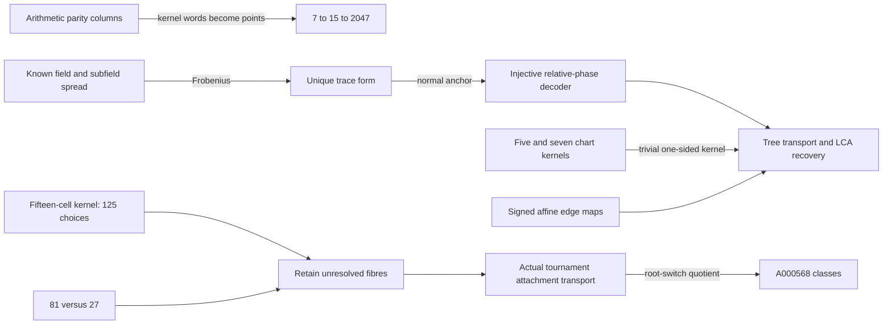

# Beyond seven and fifteen: relation towers and closed port transport

2026-10-28. **PROVED** elementary deductions / **CITED** inherited
mechanisms / **FINITE-EXACT** computation. Same-agent proof review and
alternate computational paths; no independent-agent audit or priority claim.

The useful unification is **composition of actual transport maps**. Once
an edge relation is injective, a spanning tree can replace all pair data;
LCA paths recover the omitted pairs. A nontrivial compatibility fibre is
the precise obstruction. This separates recoverable redundancy from
information discarded before composition.

The new results and explicit boundaries are in [THEORY.md](THEORY.md):

- **T1:** relations become objects through7 ->15 ->2047, then
  2^2036-1. The2047 stage has698027 triple relations. An explicit2047-prime
  bank realizes Hamming[2047,2036,3]; every prime has an exact recursive
  certificate. Its2^2036 square-total subsets are a theorem, not an
  enumerated universe of that size.
- **T2–T3:** for fixed normal Frobenius port orbits in F_(2^r), r even,
  a tree of k-1 relative phases is a smallest closed carrier with
  r^(k-1) states for the specified relative-query language. Pair profiles
  are derived through LCA paths. Full period without normality fails in
  explicit F64 and F256 examples. Worst-case correlation-bit probe cost
  is r-1 despite only r possible relative phases.
- **T4:** fixed signed edge equations reduce square-sum and graceful
  label feasibility to an integer root interval, chord constraints and
  forbidden collision roots. This is an exact conditional solver; it
  does not choose the edge labels/signs needed to settle either general
  existence problem.
- **T5:** the inherited all-order root-switch construction is now
  implemented through order9: **191536 classes from1716608 pointed
  states**, with trace1723824. Every order-nine representative is saved.
  Full Hamilton-path-orbit histograms agree with the independent native
  metagraph census through8. No child canonicalization or sequence
  values enter generation; Burnside is an independent check.
- **T6:** recovered five/seven-cell partial-bijection theorems supply an
  actual tournament use of transport. Their extension to arbitrary
  regular-fifteen cells fails: C3[T5,T5,T5] with block diag(J5,J5,J5)
  has a **125-element one-sided chart kernel**. The81/27 pair retains
  the separate child-type obstruction.

| Exact field test | F64 | F256 |
|---|---:|---:|
| Alternating forms invariant under Frobenius |8|16|
| Nondegenerate among those |2|8|
| Forms vanishing on every subfield line |8|16|
| Nondegenerate among those |7|15|
| Nondegenerate forms satisfying both constraints |1|1|
| Normal elements / full-period elements |24 /54|128 /240|
| Worst minimum individual correlation-bit queries |5|7|

F4 and F16 are positive controls. The form computation solves constraints
in the **entire** alternating-form space, dimensions15 and28, rather
than testing only a preselected trace-form family. F64 also exhausts all
32768 forms independently of the nullspace enumeration.

The all-order reconstruction of A000568 from metagraph relations was
already proved in Session67, and the parent-only recurrence in Session79.
This session supplies a larger constructive replay and a saved order-nine
bank, not a claim that a finite run recreates infinitely many terms.
[A000568](https://oeis.org/A000568) identifies the classical sequence.
The current counts for orders0..9 are
1,1,1,2,4,12,56,456,6880,191536. Practical generation beyond9 and a
smaller universal attachment carrier remain open targets. All named
re-marking queries already reconstruct the full tournament; that is an
inherited lower boundary, not a newly open question.

See [INHERITANCE.md](INHERITANCE.md) for the5/7/15 atlas, random pulls,
source pins and concept board; [AUDIT.md](AUDIT.md) for exact universes,
hostiles and reproduction commands. The prime and tournament banks are
[prime_bank.json](prime_bank.json) and
[tournament_bank.json.gz](tournament_bank.json.gz).
