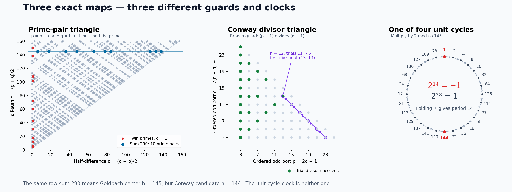

# 290: prime-pair triangles, signed clocks and lattice changes

**PROVED scoped results; independent audits PASS. FINITE-EXACT controls are
separated below.** This session connects the290 prime-arrival/MRB work to
actual odd-pair and machine coordinates, and recovers the earlier scalar
A000568, ROOT and black-core targets against the current repository.



## The numerical connections that survive exact maps

| Result | Mechanism and scope |
|---|---|
| 56 unit-pair orbits, ten prime pairs of290 | Folding p and290−p gives phi(290)/2=56, including(1,289). Coprimality is only a sieve; ten pairs pass primality. [M1](machines/RESULT.md) |
| Goldbach rows and twin-prime columns | (p,q)↦((p+q)/2,(q−p)/2). The column d1 gives twin primes; distinct prime pairs give a primitive Pythagorean triple with odd leg pq. [M1](machines/RESULT.md) |
| A rank45 weighted sieve at145 | The complete kernel1[gcd(h²−d²,145)=1] has local-sign quotient K3 tensor K15. Its unweighted degree is28; actual row masses are112,108,84,81. The full weighted spectrum is explicit. [M2](machines/RESULT.md) |
| An ordered PRIMEGAME triangle | A division trial(n,d) maps to(2d+1,2(n−d)+1); divisibility becomes(p−1)|(q−1). The same row sum290 represents candidate144 here, not Goldbach center145. Preserve priority and the literal phase cost. [M3–M4](machines/RESULT.md) |
| Four signed28-cycles at145 | 2^14=−1 and2^28=1 modulo145. Folding± leaves four14-cycles; the even and odd function sectors have polynomials(X^14−1)^4 and(X^14+1)^4. [O1–O2](orientations/NOTE.md) |
| The MRB coefficient and a convergent signed replacement | The supplied divergence is inherited and correct: −28/145 log²M+O(1). The difference of±1 residue indicators converges, with tail bounded by f(M+1), f(n)=n^(1/n)−1. [O3](orientations/NOTE.md) |
| A quadratic trace map with a signed multiplier | ζ^r+ζ^(−r) transports doubled residues to D(t)=t²−2. The145 trace cycles have exact period14 and multiplier−16384. The7 trace cycle has period3 and multiplier8; the inherited affine reversal reaches the chosen−7/4 cycle. [O4](orientations/NOTE.md) |
| Different lattices at145/290 | Eisenstein290 is F4×F25×F841, with540-element norm fibres. Gaussian145 splits into two scalar ports, but290 gains a nilpotent prime2 layer; its unit-norm fibres have224 elements. [E6–E7](root_lattice/PROOF.md) |

The appearance of29 in−29/16 has an exact local explanation in the chosen
quadratic-cycle family: c=−(eta²+7)/4 and reversal eta↦−eta−1. Its fixed
trace eta=−1/2 gives16c=−28−1. The rational cycle
−7/4→5/4→−1/4 has multiplier35/8. It is not the145 trace dynamics:
period14 and period3 already obstruct an affine cycle conjugacy.

The145 prime-pair row and the145 doubling wheel are therefore useful different
representations of the same arithmetic modulus, with explicitly different
predicates. The first prime±1 modulo290 is1451, as inherited from
[PRIME-MRB](../jacobian_eth_prime_wait_20261102/PRIME-MRB.md); neither the ten
Goldbach pairs nor the28-step doubling orbit determines that arrival clock.

## Continuing the earlier targets

[The scalar lane](tournament/README.md) proves an explicit noncircular recurrence

    a_0=1,    a_n=(1/n) sum_(k=1..n) g_k a_(n−k),

where g_k is evaluated solely by finite arithmetic on odd integer partitions
and connected gcd interactions. Its only A000568 inputs are earlier values.
The coefficients still require a growing cycle calculation, so a cheaper
scalar algorithm remains open. The exact unit-tail response rank grows with
core mass; the first loss of a single scalar is at mass9.

[Incoming reconciliation](INCOMING_RECONCILIATION.md) incorporates Session146's
finite PRIMEGAME/TM/CA compiler and order-ten carrier obstruction. The new
Eisenstein collision classification also turns our lattice distinction into
a concrete consequence: the integer cubic C_q(t)=q^3+1-t^3+3qt is injective
for q=145 and290, while q=28 has exactly two three-point fibres.

The former pending regular black-distance proof is already independently
published in Session75 and strengthened by THM4819: a regular2m+1>=7 tournament
can reach a prescribed singleton in either native role, joined to a strong
core, in exactly m black moves. This packet routes those results and freshly
replays all382 black first paths on the three regular order7 classes. It does
not rebrand the current theorem as a new discovery or infer global black-core
connectivity. Individual attachments still need the inherited four-marker,
support-image and actual shared-port guards.

[The ROOT/lattice lane](root_lattice/PROOF.md) reconstructs an all-depth moment
bound for the original U occupation law and the unique ROOT-normalized mode
h with Dh=0 and finite squared norm<55. This pinpoints a missing boundary
coordinate, without changing source weights. In the distinct primitive P
carrier, a common legal branch word shifts a pair's dyadic owner by exactly
its literal braid clock. Cross-word/arrival interactions and the uniform P
debt bound remain open. The norm-seven paired-color observer is exact, but
the precision49 test and inert/ramified290 controls prevent unjustified reuse.

At seven, residue doubling has two oriented3-cycles exchanged by inversion.
This is also the exponent description of the two irreducible cubic factors
of Phi7 over F2, whose roots lie in F8; see [Conrad, Example5.6](https://kconrad.math.uconn.edu/blurbs/galoistheory/cyclotomic.pdf). The choice of a marking remains
necessary. Characteristic2 does not retain a minus-sign scalar, so the signed
observer needs its separate sign coordinate. Repeated7-adic precision adds
no new prime to the growing sieve. The abc height and prime-support guards,
F1 interpretations and conjectural reductions remain separate obligations.

## What is unified, and what is not

The recurring successful move is to specify the operation before compressing
its state. The sieve can forget local signs if it retains their fibre weights;
MRB's antisymmetric readout cannot. Gaussian two-color data may fail to recover
the full ring yet still support a selected shear, while PRIMEGAME loses its
branch if ordered ports or v2 are removed. These are exact, different answers
to which information a particular next operation needs.

The current proof and code do not equate Goldbach, abc, RH, Collatz, P versus
NP or black-core connectivity. The next concrete interfaces are cheaper g_k,
native cross-prefix P debt, and realizing transitions between terminal strong
cores with their joint path incidence. Finite residue masks remain useful
instruments with explicit height and realization guards.

## Reproduction and review

[Audit ledger](AUDIT.md), [research board](BOARD.md), [closed packet manifest](MANIFEST.json).
Run from the repository root:

```sh
python3 -I -B 05-knowledge/results/residue_290_transport_20261102/verify_packet.py
python3 agents/check_docs.py
```

The verifier checks all packet hashes, historical source pins, exact promotion
inverses and all eight programs in normal and optimized mode. It does not
reinterpret finite checks as all-order proofs. The figure was rendered and
visually checked; its script uses matplotlib only for presentation.
