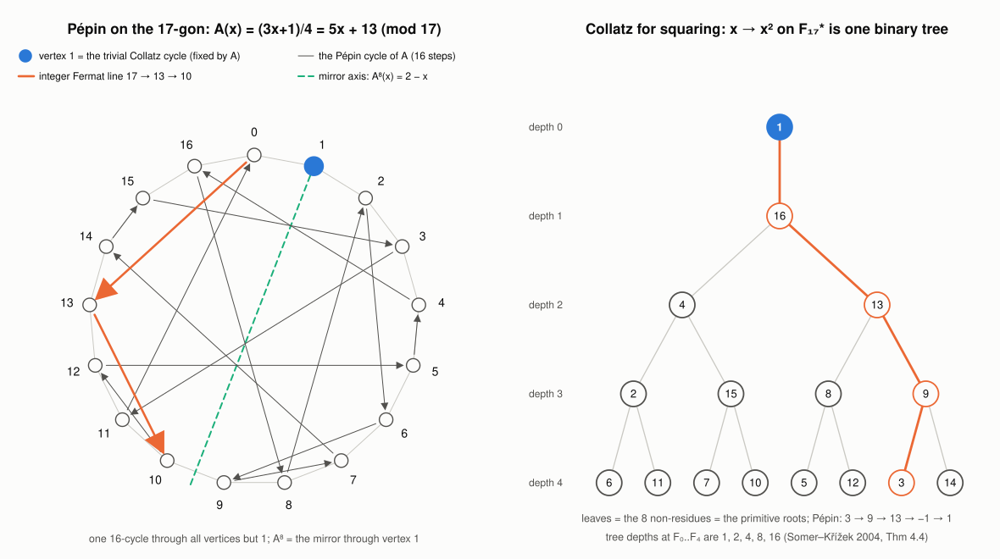

# S58: is {3, 5, 17, 257, 65537} complete? Pépin as a Collatz map, Collatz on the constructible polygons, and the three fives

**opus-2026-10-26-S58.** Owner dispatch:
- creative and tricky arguments that `{3, 5, 17, 257, 65537}` is comprehensive;
- `{1, 2, 4, 8, 16}` and `{0, 1, 2, 3, 4}` as groups of five, compared with the repository's other fives;
- Pépin's theorem reworked about Collatz with maximal creativity, geometrically, through graph theory and topology,
  and through the constructible orders `3, 4, 5, 6, 8, 10, 12, 15, 16, 17, 20, 24, 30, 32, 34, ...`.

**Status (typed).**
- **PROVED:**
  - THM-4800: Pépin as the valuation-two Collatz branch `A(x) = (3x+1)/4`, with its trivial-cycle fixed point; the
    half-turn about 1; the Fermat line as the initial arc of the Pépin cycle; the mirror line; Paley; the Mersenne
    counterpart.
  - THM-4801: Collatz meets the constructible polygons. The trunk five; the initial-segment principle; the
    Collatz-closed family `2^a {1, 3, 5, 85, 21845, 1431655765}`.
  - The no-go facts of section 1.2 are classical.
- **HEURISTIC, tested:** HYP-9410. The random model behind "no sixth Fermat prime" was calibrated on Collatz's own
  neighbours of `F_m` and `M_p`. One pre-registered test failed; the post-hoc explanation (algebraic factorisations)
  then passed two out-of-sample tests.
- **KNOWN, cited and used:**
  - Somer–Křížek 2004: the squaring map on units mod `n` has no cycle longer than 1 iff `n` is constructible; `F_m`
    is composite iff the squaring digraph mod `F_m` has a longer cycle; the depth formula.
  - Boklan–Conway 2016: fewer than `2^-30` further Fermat primes expected.
  - Even the infinitude of composite Fermat numbers is open.
- **OPEN:** completeness of the five Fermat primes; nothing here proves it, and the note says why each route stops.
- **Inherited and not redone:**
  - klein's packet [fermat_five_pepin_collatz_20261025](../fermat_five_pepin_collatz_20261025/README.md): THM-4793
    (the Fermat line, exact merges, Pépin for `x -> 3x+1`), the five-ladder, seven reformulations;
  - the S10 note [gilbreath_fermat_platonic_20260926](../gilbreath_fermat_platonic_20260926.md): Sierpiński rows,
    Bernoulli denominators, Platonic ≠ Fermat;
  - the fives inventory of [collatz_doubling_tower_brocard_20260927](../collatz_doubling_tower_brocard_20260927.md);
  - the squares/doubles foundry Lemma 1(b): the Collatz parity graph is the square-root graph on `F_p^*` at Fermat
    primes;
  - THM-871 and THM-4644 (rigid circulants at Fermat primes);
  - THM-4749 (the Fermat products).



## 1. Is {3, 5, 17, 257, 65537} complete?

### 1.1 What is known (CITED)

- `F_5, ..., F_32` are composite.
- Every prime factor of `F_n` (`n >= 2`) is `1 (mod 2^(n+2))` (Euler–Lucas).
- No sixth Fermat prime is known. Whether infinitely many Fermat numbers are composite is **also** open (nLab;
  Tyszka 2023 derives it only from a hypothesis). So the claim "all `F_n`, `n >= 5`, are composite" is far beyond
  current technique; even "infinitely many are" is.
- Boklan–Conway (arXiv:1605.01371) model `P(F_n prime) <= 4/2^n`, using the progressions mod `2^(2n)` versus
  `2^(n+2)`, and sum to `2^-30` over `n >= 33`. The cruder `2/ln F_n` gives `6.7e-10`.

### 1.2 Why every uniform compositeness mechanism misses the Fermat numbers (PROVED; classical facts, assembled)

Infinite families have been proved composite only by three uniform mechanisms. None applies to Fermat numbers.
- **Covering congruences**, the Sierpiński mechanism for `k 2^n + 1`. A prime `q` divides `F_m` iff
  `ord_q(2) = 2^(m+1)`, so **each prime divides at most one Fermat number**, which is Goldbach's coprimality. A
  covering set of `N` primes therefore covers at most `N` indices; no finite (or density) covering exists.
- **Algebraic factorisation.** `F_m = Phi_(2^(m+1))(2)` and `x^(2^m) + 1` is irreducible.
- **Aurifeuillean factorisation.** The identity `4u^4 + 1 = (2u^2 + 2u + 1)(2u^2 - 2u + 1)` splits `2^(4k+2) + 1`,
  but Fermat exponents `2^m` are `0 (mod 4)` for `m >= 2`.

A proof of completeness therefore needs a mechanism not yet known. The calibration of section 4 shows the contrast is
real. Collatz's neighbours of `F_m`, the numbers `3^j 2^b +- 1`, *do* carry algebraic and Aurifeuillean
factorisations, and these shift their prime counts measurably (3–6%). The genuine Fermat line and `F_m` carry none.

### 1.3 Structures that are finite for free, and structures that carry the problem (THM-4801 (2))

A family that needs an *initial run* `F_0, ..., F_(j-1)` of Fermat numbers to be prime is unconditionally finite,
because the run breaks at Euler's `641 | F_5`:
- the Collatz trunk `(4^k-1)/3`: constructible iff `k` is one of `1, 2, 4, 8, 16`;
- `2^k - 1`: constructible iff `k` is one of `1, 2, 4, 8, 16, 32`;
- the products `2^(2^j) - 1`.

A family that tests Fermat numbers *one at a time* carries the whole open problem:
- `2^k + 1` (constructible iff `k` is one of `1, 2, 4, 8, 16`, which is *equivalent* to completeness);
- the prime rows `2^i` of the binary Sierpiński triangle;
- Pépin;
- Paley graphs; rigid circulants; Bernoulli denominators.

This is the precise sense in which the five is forced in some places and conjectural in others.

### 1.4 New exact reformulations (each equivalent to completeness or implied by it)

- **Collatz half-turn** (THM-4800). For every `m >= 5`, the `2^(2^m - 1)`-th iterate of the Collatz map
  `(3x+1)/4` mod `F_m` is *not* the mirror `x -> 2 - x` through the trivial cycle.
- **Squaring-Collatz depth** (Somer–Křížek Thm 4.1/4.4). Every odd constructible `n` has squaring-tree depth at most
  16. Depths at the five primes are `1, 2, 4, 8, 16`; a sixth Fermat prime `F_m` would add depth `2^m`.
- **Collatz-closed polygons** (THM-4801 (3)). Implied by completeness and unconditional below `2^(2^33)`: the only
  constructible `n` whose whole Collatz orbit stays constructible are `2^a` times `1, 3, 5, 85, 21845, 1431655765`.
- **Furstenberg's ×2, ×3 on the circle.** The point `1/F_m` always has doubling period `2^(m+1)`. Its tripling
  period is maximal, `2^(2^m)`, iff `F_m` is prime (Pépin). Completeness says this happens for no `m >= 5`.

### 1.5 Why "tricky" structural proofs cannot work here (OBSERVATION)

Completeness proofs for other fives work through over-determination:
- the Platonic solids: the angle defect, `(p-2)(q-2) < 4`;
- the Moore graphs of diameter 2: Hoffman–Singleton's eigenvalue integrality leaves degrees `2, 3, 7, 57`.

Every structure attached to a single Fermat prime is self-consistent for every `m`. The regular `F_m`-gon, the
cyclic 2-group `F_(F_m)^*`, the Paley graph `P(F_m)`, the rigid circulant tournaments, the Pépin cycle, and a depth
`2^m` squaring tree all exist abstractly if `2^(2^m) + 1` happens to be prime. No integrality or Euler-characteristic
constraint couples different `m`. So the obstruction must be arithmetic: a factor of `2^(2^m) + 1`. The only uniform
sources of factors are excluded by 1.2.

### 1.6 Verdict

No proof, and none is in reach. What is exact:
- the no-go of 1.2;
- the split of 1.3 into unconditional finiteness versus the open problem;
- the new reformulations of 1.4.

The quantitative argument, the random model, gives fewer than `10^-9` further Fermat primes expected. It is
validated, after the algebraic correction it needs only for two-parameter numbers, on Collatz's own Fermat and
Mersenne lines: 2 of 3 pre-registered tests passed, plus 2 of 2 out-of-sample tests of the correction.

## 2. Pépin reworked about Collatz (THM-4800)

klein's THM-4793 reads Pépin through the odd branch `x -> 3x+1` mod `F_m` and finds the integer Fermat line
"prime-blind". The right Collatz carrier is the **valuation-two branch** `A(x) = (3x+1)/4`, the Syracuse step on
`x = 1 (mod 8)`.
- **The trivial cycle is its fixed point.** `A(1) = 1`.
- **The Fermat line is an `A`-orbit.** `S^k(F_m) = A^k(F_m) = 3^k 2^(2^m - 2k) + 1`.
- **Pépin is a cycle type.** For `m >= 1`, `F_m` is prime iff `A` has exactly two cycles on `Z/F_m`: the trivial
  fixed point and one Hamiltonian cycle of length `2^(2^m)` through `0 = F_m`.
- **Pépin is a half-turn.** `F_m` is prime iff `A^((F_m - 1)/2)` is the reflection `x -> 2 - x`, the half-turn
  about the trivial cycle.
- **The line is the visible arc of the cycle.** `A^k(F_m) = A^k(0) (mod F_m)`. The integer Fermat line is the first
  `2^(m-1)` points of the Pépin cycle.
- **The line is prime-blind; the cycle it starts is not.**
  - Composite `F_5`, `F_6`, `F_7` shatter the cycle into 410, 1822 and 518 cycles.
  - `ord(3/4)` falls short of `2^(2^m)` by 8.59, 10.81 and 9.00 bits.
- **The mirror.** `A(2 - x) = 2 - A(x)`. The mirror image of `F_m` is `2 - F_m = 1 - 2^(2^m)`, the negated
  Mersenne-type number, whose valuation-two run is the Fermat line reflected through 1. Modulo `F_m`, Pépin's
  half-turn sends `F_m` to this mirror point.
- **Adelic reading.** The multiplier `3/4` has `|3/4|_inf = 3/4`, `|3/4|_2 = 4` and `|3/4|_3 = 1/3` (product formula).
  - In the reals the line descends toward 1.
  - In `Z_2` it is repelled from 1. It starts `2^(-2^m)`-close to 1, so it escapes after `2^(m-1)` steps; that is the
    valuation-three exit.
  - Modulo `F_m`, `A` is a permutation, and Pépin asks for its period.
- **Geometry** (figure). On the regular 17-gon, `A(x) = 5x + 13` fixes vertex 1 and threads the other 16 vertices in
  one cycle: `0, 13, 10, 12, 5, 4, 16, 8, 2, 6, 9, 7, 14, 15, 3, 11`. Its eighth iterate is the *mirror symmetry of
  the polygon through vertex 1*.
- **Graph theory.** For prime `F_m`, `A` is a self-complementing permutation of the Paley graph `P(F_m)` (since `3/4`
  is a non-residue), and Pépin says it is **cyclic**.
- **Topology.** On `R/Z`, the Fermat point `1/F_m` sits in Furstenberg's ×2, ×3 system, as in 1.4.
- **Mersenne counterpart.**
  - The valuation-one branch `B(x) = (3x+1)/2` fixes `-1`, the negative trivial cycle, and carries THM-4556's
    Mersenne line.
  - Modulo a Mersenne prime, `B^((M_p - 1)/2)` is the reflection about `-1`. This follows from Euler's criterion,
    since `3/2` is a non-residue (`M_p = 7 (mod 24)`).
  - The half-turn is necessary, not sufficient. `3/2` is a primitive root for 7 of the 11 Mersenne primes with
    `p <= 127`, and `B` has 10, 4, 10 and 4 cycles at `p = 13, 31, 61, 127`.
  - Lucas–Lehmer lives instead in the norm-one torus of order `M_p + 1 = 2^p`, the non-split twin of
    `F_(F_m)^*` (order `2^(2^m)`).
  - So the Fermat line (valuation two, contraction `3/4`) sees a split 2-power torus, and only it gives a primality
    test.
- **Squaring-Collatz** (KNOWN, Somer–Křížek 2004).
  - The squaring map on units mod `n` has no cycle except `{1}` iff `phi(n)` is a power of 2, i.e. iff the
    `n`-gon is constructible (their Thm 4.1, which they connect to Gauss).
  - `F_m` is composite iff a longer squaring cycle exists mod `F_m` (Cor. 4.3).
  - The components have `nu_2(lambda(n)) + 1` levels (Thm 4.4). Pépin then says `3` is a deepest leaf; the right
    panel of the figure shows `3 -> 9 -> 13 -> -1 -> 1`.
  - This was the "Collatz for squaring" reading proposed here; it is credited, not claimed.

## 3. Collatz on the constructible polygons (THM-4801)

The owner's list `3, 4, 5, 6, 8, 10, 12, 15, 16, 17, 20, 24, 30, 32, 34, ...` is the set of constructible orders
(`phi(n)` a power of 2; OEIS A003401).
- **Halving preserves constructibility; tripling-plus-one rarely does.** The odd constructible `n` with `3n + 1`
  constructible are exactly `1, 3, 5, 85, 21845, 1431655765`, and their whole orbits stay constructible:
  - `3 -> 10 -> 5 -> 16 -> ... -> 1`;
  - `t -> 2^(2^j) -> ... -> 1` for the trunk numbers.
- **The trunk five** `1, 5, 85, 21845, 1431655765` are `F_1 ... F_(j-1)`. On them the Collatz step is Goldbach's
  identity `F_0 F_1 ... F_(j-1) = F_j - 2` shifted by one, because Collatz's multiplier `3` is `F_0`. Their indices
  `k = 1, 2, 4, 8, 16` are the owner's second floor.
- **The geometric reading.** A Collatz walk on regular polygons stays ruler-and-compass constructible forever exactly
  from the `2^a`-multiples of six odd roots. Five of the roots are the trunk five; the sixth, the triangle, enters the
  trunk at the pentagon.

## 4. Calibrating the heuristic on Collatz's own Fermat and Mersenne lines (HYP-9410)

Pre-registered before any primality test ([PREREGISTRATION.md](PREREGISTRATION.md)). Values `3^j 2^(m-2j) + 1` and
`3^k 2^(p-k) - 1` were sieved exactly to `2^16`, and each survivor was given probability `e^gamma ln Q / ln x` (exact
Mertens product).

| id | family | predicted | observed | outcome |
|---|---|---|---|---|
| L-P1 | Fermat-type lines `m = 8..1200` | 2707.11 ± 49.51 | 2548 | **FAIL** (z = -3.2) |
| L-P2 | Mersenne-type lines `p = 8..400` | 1087.58 ± 30.11 | 1034 | pass (-1.8) |
| L-P3 | genuine Fermat lines `e = 3..12` | 22.91 ± 4.43 | 17 | pass (-1.3) |

All came in low.
- **Post-hoc explanation.** The algebraic and Aurifeuillean factorisations of two-parameter numbers are invisible to
  the sieve:
  - `w^r + 1` when an odd `r` divides `gcd(j, m)`;
  - `4u^4 + 1` when `j = 0 (mod 4)` and `m = 2 (mod 4)`;
  - `w^r - 1` when `gcd(k, p) > 1`.
- **Corrected z-scores:** -1.47, +0.51 and -1.33. The genuine Fermat lines are untouched: they have no such values,
  by the gcd argument.
- **Out of sample** ([PREREGISTRATION-2.md](PREREGISTRATION-2.md)):
  - L-P4, `m = 1201..1500`: 677 observed against 671.98 ± 25.61; pass (the uncorrected model gave 697.27);
  - L-P5, `p = 401..520`: 323 against 324.06 ± 17.55; pass (the uncorrected model gave 348.07).
- **Reading.** The model that says "no sixth Fermat prime" needs an algebraic correction only on numbers that have
  algebraic factorisations, and Fermat numbers have none.
- **Exact by-product.** No point of a genuine Fermat line, nor `F_e` itself, is divisible by 7. The reason:
  `3/4 = -1 (mod 7)`.

## 5. The three fives and the repository's other fives

**One object, several readings.** klein's ladder is `i -> 2^i -> F_i = 2^(2^i) + 1`, with `F_i = H(NT_(2^i + 2))`.
This session adds the following readings of the owner's sets.

- **`{1, 2, 4, 8, 16}`:**
  - **(a)** the squaring-tree depths of `F_(F_i)^*` (Somer–Křížek), the same as klein's square-root tower heights;
  - **(b)** the `k` with `2^k + 1` constructible (equivalent to completeness);
  - **(c)** the trunk indices `k` with `(4^k - 1)/3` constructible (unconditional);
  - **(d)** the Cayley–Dickson reading, which needs care. THM-871's rungs are `dim + 1`: `3, 5, 9, 17` for
    `C, H, O, S`. The Fermat primes are the rungs of the algebras of dimension `2^(2^i) = 2^1, 2^2, 2^4, 2^8, 2^16`,
    so the second floor is the base-2 log-dimension of the Fermat rungs. It is *not* the dimension set `1, 2, 4, 8, 16`
    of `R, C, H, O, S`, whose rungs are `2, 3, 5, 9, 17`; the octonion rung 9 is composite, the sedenion rung 17 a
    Fermat prime. **Shared 2-power indexing; no mechanism ties division-algebra properties to primality.**
- **`{0, 1, 2, 3, 4}`:**
  - `Z/5`, the discrete logarithm of `<2> = {1, 2, 4, 8, 16}` in `F_31^*` (klein);
  - the five squaring steps `2 -> 4 -> 16 -> 256 -> 65536 = -1` of 2 modulo the largest Fermat prime, which list
    `F_0 - 1, ..., F_4 - 1`. The depth of 2 in the squaring tree mod `F_m` is `m + 1`, so it is 5 at `F_4`.

**New fives from Collatz:**
- the trunk five `{1, 5, 85, 21845, 1431655765}`, unconditional;
- the Collatz-closed six `{1, 3, 5, 85, 21845, 1431655765}`.

**Tournament atoms (PARTIAL STRUCTURE).** THM-4730's strong pure-blue alphabet `K1, C3, T5` and THM-4743's
exceptional `C_3, Z_5{1,2}, P_7` both use the circulants on 3 and 5.
- At a Fermat prime the multipliers act freely (THM-871), so there are `2^((p-1)/2)/(p-1)` circulant classes.
- That count is 1 exactly when `2^((p-1)/2) = p - 1`, i.e. `p = 3, 5`.
- So the Fermat structure explains why `C3` and `T5` are *unique*. It does not explain why they are pure-blue: no
  circulant of odd order `>= 7` is pure-blue, and that includes the 16 classes at 17.

**Tempting non-link (NUMEROLOGY).** Under `a * b = ab/gcd(a, b)^2` the odd constructible numbers form `(Z/2)^5`. Its
projective space `PG(4, 2)` has the 31 odd constructible orders `> 1` as points. The first three Fermat primes span a
Fano plane on `{3, 5, 15, 17, 51, 85, 255}`. The Fano plane's 7 points and 21 flags echo the `{7, 21}` gaps of
THM-1370 and THM-4790, but no map is known.

**Prior verdicts kept.** Platonic solids (different source, S10). Terras cycles, order-27 groups, Niemeier primes,
`QR_11`, Ellison shapes, the Lehmer five, the `-5` and `-17` cycles, the golden five: cardinality coincidences
(klein, Brocard inventory).

**Contrast, as a method.** The Platonic five and the Moore-graph degrees are *provably* complete by over-determined
constraints; the Fermat five is not, for the reason in 1.5.

## 6. Pre-registration summary

L-P1 FAIL (explained post hoc). L-P2, L-P3, L-P4 and L-P5 pass. All predictions were committed before the
corresponding tests (commits `eb553116c2` and `a9060e82d9`).

## 7. Open and next

1. HYP-9410 (a): test the corrected model on `m = 1501..2500` and `p = 521..800`.
2. The singular series of the genuine Fermat lines: an exact constant near 1.35.
3. For a sixth Fermat prime, nothing in reach; the honest frontier is the factor-search data (Keller's tables) and
   Boklan–Conway.
4. A Collatz analogue of Lucas–Lehmer: a Collatz-type affine map living in the norm-one torus of order `2^p`.

## 8. Reproduction

All in `04-computation/fermat_pepin_s58/`.

```bash
python collatz_pepin_valuation_two_20261026.py        # THM-4800 checks (line, mirror, two cycles, half-turn, F_5..F_7, Mersenne)
python collatz_constructible_20261026.py              # THM-4801 (trunk, initial segments, Collatz-closed family)
python collatz_line_primes_20261026.py predict        # L-P1..3 predictions (no primality tests)
python collatz_line_primes_20261026.py test           # L-P1..3 (about 2 min)
python collatz_line_primes_20261026.py posthoc        # algebraic correction on L-P1..3
python collatz_line_primes_20261026.py predict2       # L-P4, L-P5 predictions
python collatz_line_primes_20261026.py test2          # L-P4, L-P5
python pepin_collatz_17gon_figure_20261026.py         # the SVG figure
```
