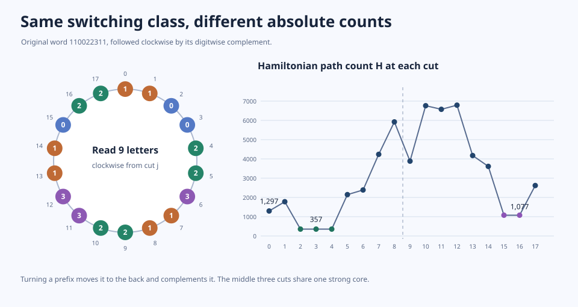
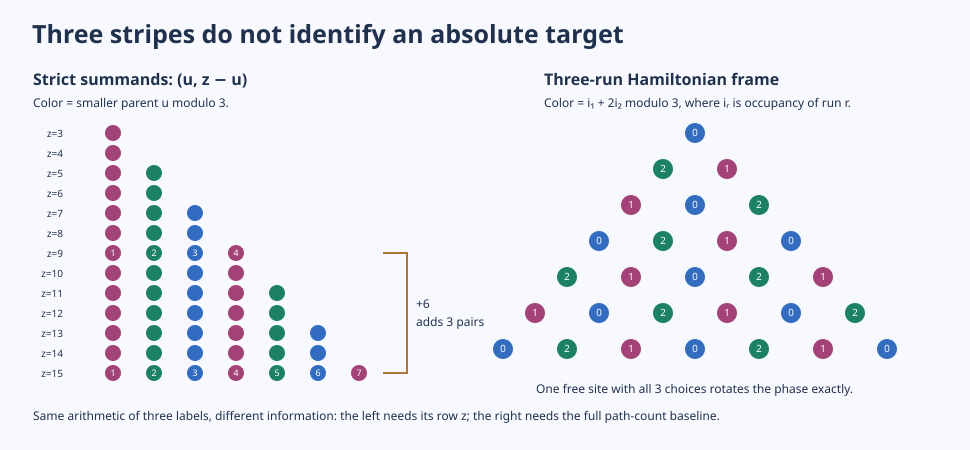

# Session 334: Two-hub switching compass and the three strands

**Chan–Pak is open.** This session gives exact target hits and obstructions on families that grow without bound, not another extension of the numerical census.

1. [Switching compass](ROTATION_COMPASS.md). A path is a spanning-tree chart on the full switching class. Requiring the same transitive spine restricts this chart to a wheel: read a window through the word and its complement. On the inherited smooth macro $11\,0^k\,2^\ell\,311$, the minimum normalized count is exactly $1+89\,2^\ell$; two further cuts produce $1+(30\,3^k-1)2^\ell$. Cutting inside the 2-block gives a two-price curve $C-\alpha X-\beta L/X$ over powers of two. Invert the quadratic for a prescribed target, or find the closest cut by searching its two monotone sides. Even across both sides its mesh grows.
2. [Target trap and exact escape](target/LOCAL_RESIDUE_TRAP.md). For $k,\ell\ge10$, one edit cannot take the macro count $H$ to $H+2$. At positive multiples of 24, the complete fixed-spine switching wheel with either hub direction also misses $H+2$. The obstructions use the joint moduli 32 and 9, not either alone for the single-edit test. Yet taking one fewer ternary inflation and multiplying the count by 3 via a triangle gives exactly the desired integer. Two ternary operations disagree only on the baseline.
3. [Three strands and Zeckendorf guards](strands/THREE_STRANDS.md). Every triply eligible site in a locked frame gives exact balance across three phases; Fibonacci-address charges give a higher-rank balance criterion. For fixed block patterns, phase differences repeat mod 6 in the lengths even as ordinary counts grow. The same surjection polynomial counts three-way canonical atom splits, but a literal positional compiler for all Zeckendorf words needs exponentially long spines. This distinction separates knowing local acceptance from encoding the exact target.
4. [Smooth sum fan](strands/SMOOTH_SUM_FAN.md) and [aliquot boundary](ALIQUOT_BOUNDARY.md). There are exactly four pair geometries preserving smoothness. No nontrivial subset of a primitive smooth antichain can be regrouped back into a smooth term. The aliquot successor likewise leaves the smooth chart unless a valuation cancels at one of two boundaries. The summand graph and its transitive closure differ by the doubling exclusions, illustrating why dropping the chosen parents destroys exact information.

## Reproduce

- Run **python replay_compass.py** to verify the 18 all-scale phase charts, labelled switch enumeration, several independent literal tournament counts, and the inverse formula.
- In **target/** run **python cert.py** and **python compass_escape.py** for the infinite edit and compass families (NumPy).
- In **strands/** run **python three_strands.py** for exact phase transfer versus literal run assignments.

**Next proof obligation:** a return that changes the absolute baseline or encodes the target while retaining nonlocal adjacency and endpoint data. The +2 case solves that obligation on one explicit family, but is not a universal correction.
