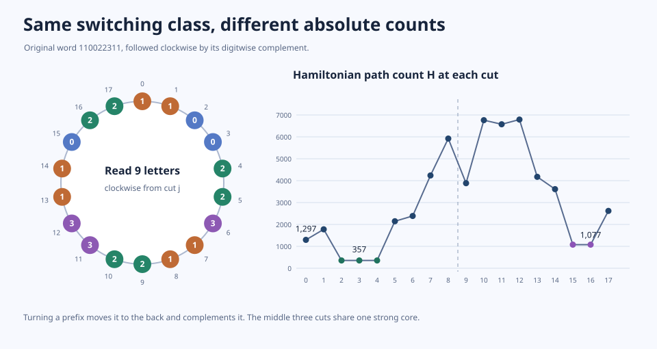

# The two-hub switching compass

## Drawing the whole gauge slice

Write the spine letters as $w_1,…,w_s$, with δ(v)=2[x→v]+[y→v] and $x→y$. Put $w\bar w$ on a ring, where the bar replaces each digit $d$ by $3-d$. Read a clockwise window of length $s$ starting at any cut. These are exactly the normalized representatives obtained by switching while retaining the **specified set** of spine vertices as a transitive subtournament: there are $2s$ labelled cuts for $s\ge1$, possibly fewer distinct words. This does not classify switches allowed to pick a new hub pair.

Indeed, an alternating membership triple 010 or 101 on the original spine becomes a directed triangle after reversing the edges across the switch. If the bits have at most one change, they split the spine into a prefix and suffix; after switching the new order is suffix followed by prefix. Normalize $x→y$ by requiring the two hubs to have the same switch bit; take the global complement if needed to make that bit zero. The only operation left is to move a prefix to the end and complement its letters, including the option to complement the whole word. The geometry is antiperiodic rather than periodic: travelling halfway around the wheel complements the word.

A Hamiltonian path is a spanning tree, so, over the binary cut space, each prescribed ordered spanning path has precisely one switch orienting it forward. More generally a consistent system of oriented edge constraints on a graph with $c$ components including isolates has $2^{c-1}$ switch solutions in a compatible class, and the compatible fraction of switching classes is $2^{-(m-n+c)}$. The existence of a unique switch for a path says nothing about whether that switch falls in the thin $2s$-point compass. For example, two different phases have different totals 1297 and 357 in the compass below.

**A directional obstruction.** In the full compass, allowing either direction of the hub edge, a prescribed unordered Hamiltonian order cannot be admitted in *both* directions when the spine has at least seven vertices. The unique switch that reverses every path edge is the alternating checkerboard along the path. To keep the spine transitive, on the current spine order its membership bits have at most one change. Each consecutive run of spine vertices in the Hamiltonian path is increasing and its bits alternate, so each run has length at most two; three runs give at most six vertices. Equivalently, for $s\ge7$ the total of the full $4s$ compass counts counts distinct **unoriented** path orders (not merely distinct ordered path orders). By contrast the whole switching class has precisely $n!$ ordered path incidences.

## Exact absolute targets in a single switching class

Take $w=11\,0^k\,2^\ell\,311$, $k,\ell\ge1$; its original count is $1+36\,2^k3^\ell$ (Session333). Split a phase into $j$, the length of the turned prefix, and a flag for starting with $w$ or $\bar w$. The minimum over the normalized compass is exactly
$$
               1+89\,2^\ell .
$$
It is attained at **every** cut in or at the ends of the original zero block, i.e. $j=2,…,k+2$, and at no other cuts except for two more when $k=1$. Those two, on the complemented half at $j=k+\ell+2$ and $j=k+\ell+3$, have exact count
$$
               1+(30\,3^k-1)2^\ell .
$$
The rotation and the complement preserve vertex count and switching class, but change *absolute targets*, not only residues. The first plateau word is $0^{k-t}2^\ell31122\,3^t$, $0\le t\le k$; its exterior zeros and threes are neutral transitive head and tail. The strong core is $2^\ell31122$ with both hubs: $x\to y\to 1\to x$, each 2 lies between $x$ and $y$, and the 3 reaches them through a later 1 or 2. On both complemented plateau cuts the common strong core is $2211\,0^k2^\ell$, with optional neutral head 0 or tail 3. In this core the middle zeros reach the hubs directly and are reached through the earlier 2s. Thus both offset-one families also have strong realizers.

## Prescribed-target compiler on the moving 2-block phase

A cut $p$ steps into the 2-block on the original half, with $1\le p<\ell$, has
$$
 H_p=C-\alpha X-\beta L/X,\quad
 K=2^k,\quad L=2^\ell,\quad X=2^p,
$$
where $C=47+100K+296KL$, $\alpha=23+100K$, and $\beta=296K-89$.

**Exact inverse.** Given a prescribed $N$, solve $\alpha X^2-(C-N)X+\beta L=0$. The target is attained in this chamber iff a root is an integer power of two between $2$ and $2^{\ell-1}$. No two admissible roots can occur: their product would be a power of two, but it is $2^\ell\beta/\alpha$, and $2<\beta/\alpha<3$.

**Exact nearest target.** Since $H_{p+1}-H_p=-\alpha2^p+\beta2^{\ell-p-1}$ is positive iff $2p\le\ell$, the chamber folds at $p=\lfloor\ell/2\rfloor+1$ (clamp to the available range). Binary search on each monotone branch, checking the neighboring integer indices and endpoints, to find a minimum of $|H_p-N|$. This is an exact inverse and a nearest-absolute-target algorithm, not a local coverage claim.

**Even the two branches together are coarse.** For $p<q$ the absolute gap is $(2^q-2^p)|\alpha-\beta 2^{\ell-p-q}|$. If $p+q\le\ell+1$, then $p\le\lfloor\ell/2\rfloor$ and $2^q-2^p\ge2^{q-1}$, giving a lower bound $(\beta-2\alpha)2^{\ell-p-1}$. If $p+q\ge\ell+2$, then $q\ge\lfloor\ell/2\rfloor+1$ and the bound is $(\alpha-\beta/4)2^{q-1}$. As $K\ge2$, either bound is at least $(57/2)K\,2^{\lfloor\ell/2\rfloor-1}$. Switching exposes where this entire chamber has holes; an additional control must change its absolute anchors. The other phase types can be scored using the same exact polynomial certificate or the 36-state counter.

## All-scale certificate

For either hub order each spine vertex is assigned to a run. An empty run has state 0. A nonempty run has state 1 or 2 according to whether its last site has the required right-hand junction; the last run has no such test and hence only uses states 0 and 2. The first vertex in runs 1 and 2 tests the preceding hub; only the final version of the last vertex in runs 0 and 1 is tested, and an empty middle run tests the hub arc. This gives two systems of $3×3×2=18$ states. Assignments advance in spine order; each accepting trace yields exactly one Hamiltonian path.

The polynomial bases are $1,2^r,3^r$ separately in each variable block length $r>0$. Fixing the set of runs occupied by any homogeneous block leaves the outside eligibility independent of the internal distribution. The inside count is a surjection onto 1, 2 or 3 labels, hence respectively $1,2^r-2,3^r-3\cdot2^r+3$. So lengths 1,2,3 certify the identity at every length. There are only nine phase types per half: the seven fixed boundary cuts, and cuts inside the two long blocks. To prove the minimum, the replay interpolates the excess above $1+89\,2^\ell$ on each chart in the basis
$$
1,\quad E_r=2^r-2,\quad F_r=3^r-3-3(2^r-2).
$$
Both variable coordinates are nonnegative by the forward differences $2^r$ and $2\cdot3^r-3\cdot2^r$; $F_1=F_2=0$. Every interpolated coefficient is nonnegative. Apart from the asserted plateaus and the two exceptional complemented phases (whose excess is $(30\,3^k-90)2^\ell$), every type has strictly positive constant coefficient. The replay also checks the macro and the three displayed target formulas, actual switches and independent path DP for selected words, and the sample wheel below.

For $k=\ell=2$ the phase scores are
```
1297 1779 357 357 357 2147 2387 4239 5921
3883 6761 6575 6791 4175 3611 1077 1077 2619
```


