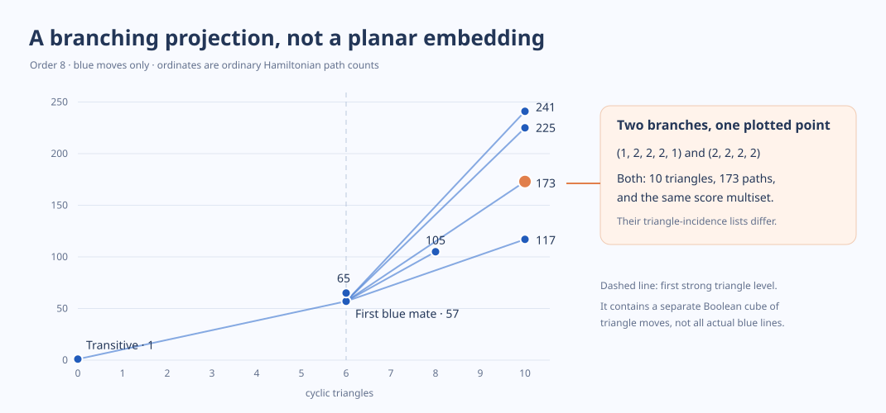

# Session 337: Branching from transitivity without losing the exact target

**Chan–Pak remains open.** This session supplies exact unbounded witnesses and proves that two natural versions of shallow branching cannot cover all already-attained counts.

1. [The complete first strong triangle terrace](TERRACE.md). The unique blue outlet from the transitive class leads to the tribonacci tournament. The score sequence there attains the minimum $n-2$ cyclic triangles among strong tournaments. Every class on this entire terrace is a transitive order with the edges of one increasing chain reversed, and the classes form a Boolean cube of dimension $n-4$ under **triangle reversals**, not under blue moves. An interval-packing projection keeps enough data to reconstruct the whole ordinary Hamiltonian count; triangle height and scores alone do not. Positive gaps give the exact strong products $\prod(1+2^{r_i})$, compressed by $k-1$ vertices compared with stacking $k$ factors. A single zero seam gives an exact shifted-product compiler, including primes. Since the first two actual lines touch only two classes on this entire cube, its abstract branching must not be confused with rooted reachability. Even the whole terrace over all orders cannot realize 11. [An exact tribonacci corridor inverse](ZERO_CORRIDOR.md) unifies the product and shifted product and also realizes 573 at order twelve on the terrace.
2. [The literal second blue shell](branch/ROOTED_BLUE_SHELL.md). The blue branches are palindromic compositions with no adjacent singleton parts. The two-seam tournament construction gives its exact cyclic-triangle heights. A genuine blue move $105\to91$ increases cyclic triangles, so there is no monotone route from a triangle height to a target count. At order eight two distinct blue branches share the same score sequence, triangle height and $H=173$. Further, a faithful plane embedding is already impossible at order six, where the rooted component has orientable genus at least 13, and at order seven the bound is at least 871. The blue radius-two ordinary count set has density zero across all orders.
3. [The mixed-power inverse at exactly specified branches](exact/ROOT_SECOND_BRANCH.md). Three literal blocks give a two-hub family reached in at most two actual metagraph moves. At fixed order and middle width, a quadratic determines its two wing powers. It retains the split that an overlap monomial forgets: ordinary counts 993 and 1025 have the same locked weight 48. The entire two-hub radius-two cone, including black moves, gives only $O((\log X)^8)$ counts at most $X$ and misses $\Omega(\sqrt X)$ **already-attained** one-hub values. Enumerating more shallow branches cannot repair this route.
4. [All fixed depths are too shallow](exact/FIXED_DEPTH_OBSTRUCTION.md). After $r$ literal line moves the reversal errors have degree at most $2r$. In a two-hub chart, this forces the spine word to be within $12r$ letters of two monotone cutoffs. At every fixed depth only polylogarithmically many counts can occur. Even a budget of roughly $(\log_2 X)/192$ moves still misses $\Omega(\sqrt X)$ attained one-hub counts at scale $X$.
5. [Follow-up to the cubic and overlap comparisons](https://github.com/eliottcassidy2000/math/blob/11859957b73bbe5821c32e3d3c002c2bd9c568ab/05-knowledge/results/session336_overlap_inverse_and_intercyclic_20261114/followup/README.md). The 36-vertex example has domination number **10**, strengthening the previously exhibited upper bound 12. The same graph and optimal dominating set still leave seven different labelled overlap weights. Minimum whole counts for prescribed ternary depth reduce to a small anchored core; e.g. the four-site floor is 777.

Run **python replay_terrace.py**, **python branch/shell.py**, **python branch/surface.py 7**, and **python exact/replay_root_surface.py**. The figure was generated by **python draw_surface.py**. All use only the standard library.

**Next proof obligation:** a target-selected return through deeper branches that preserves enough interval or seam data to hit the prescribed integer. Merely reaching more nodes at fixed radius or projecting onto a scalar depth cannot supply that return.
