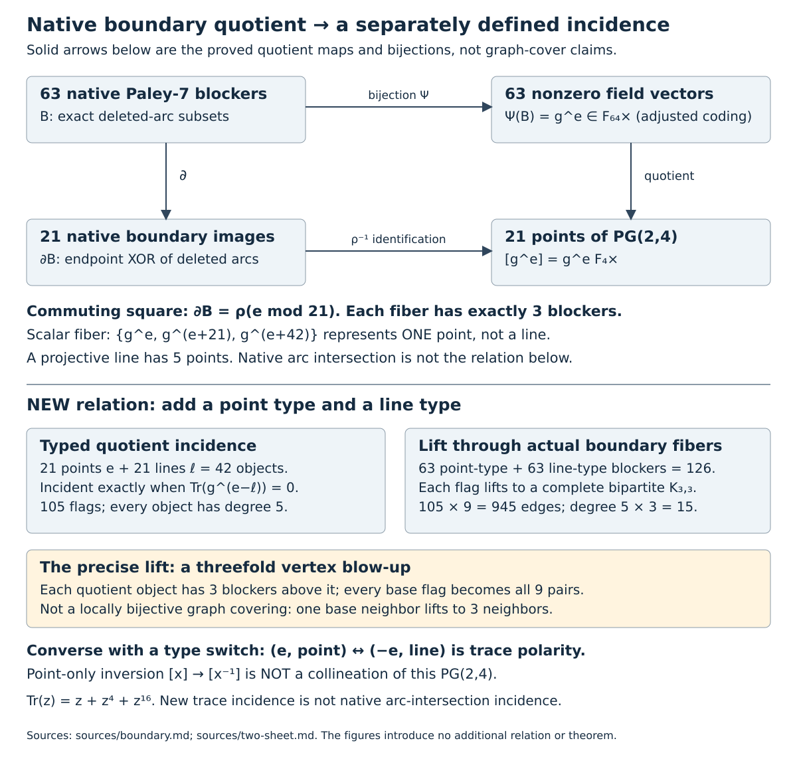
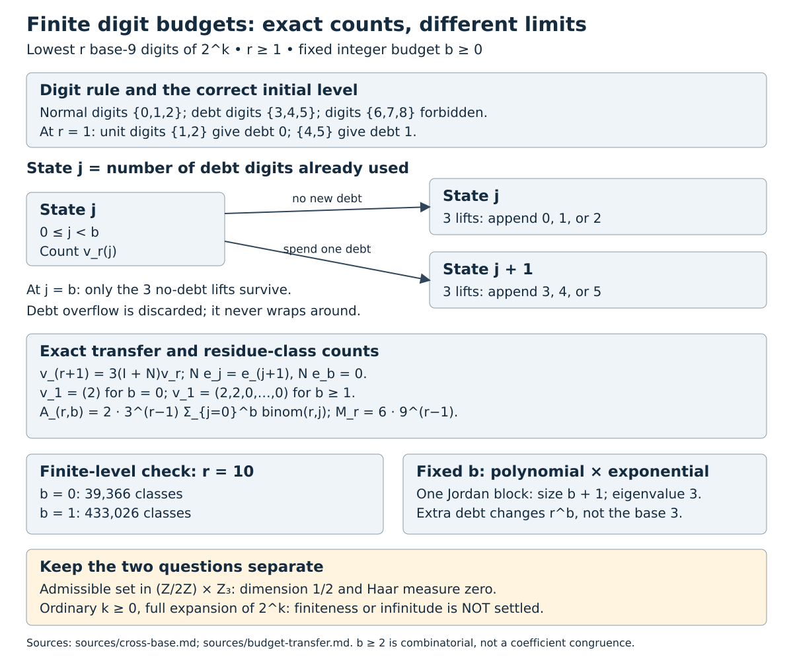

# Session 54: what the old numerical patterns were hiding

25 October 2026 (UTC). We revisited ten earlier numerical-analogy verdicts,
then pursued the strongest candidates through explicit maps and hostile
tests. Several directions genuinely reopened. Others failed again, but in
a way that revealed the missing structure. No literature-priority claim is
made. Detailed proofs and independent audits are in the [research report](README.md).

## 1. The old 63 coincidence has a real carrier

The 63 minimum six-arc Hamiltonian-path blockers of Paley 7 admit explicit
symmetry-preserving descriptions. One uses the nonempty even subsets of
seven vertices. A stronger one uses F64*, preserving converse as inversion.
The phase quotient F64*/F8* has order 9; phase orders 1,3,9 explain the full
symmetry orbits 7,14,42.

This does not restore the original Sierpinski identification. Nor can it be
made into a six-dimensional linear converse action: an involution in that
binary space fixes at least seven nonzero vectors, while blocker converse
fixes exactly one. The nonlinear part is essential, not a cosmetic choice.

The native boundary map itself becomes projectivization after an adjusted
field coding. Its three-element fibers are F4* cosets, giving 21 projective
points. Bare inversion preserves no projective lines. Restoring a point
sheet and a line sheet repairs it as a trace polarity, with 105 incidences.
Pulling this new relation back gives 945 incidences on 126 typed blockers.
It is a blow-up, not a locally bijective graph cover or the native shared-arc
relation.

The operational lesson is exact: field conjugation x->x^8 alone forgets a
norm factor. Inversion is x^8/Norm(x), with Norm(x)=x^9. Keeping that factor
changes the fixed-point count from seven to one and restores the correct
converse behavior.

## 2. The larger-order failure led to a classification theorem

The tempting F1024* extrapolation fails at order 11. Its order-five symmetry
has three fixed nonzero field elements; the native minimum-blocker family
has only one corresponding fixed blocker. The full count is not 1023 but 121.

The replacement proof is more useful than the failed guess. Hamilton-cycle
averaging forces every minimum blocker to meet every Hamiltonian cycle in
exactly two arcs. A small full-rank cycle certificate then forces binary
row-column potentials on the bipartite support graph. Integrality comes
from support-tree propagation, not from pretending a rational rank minor
is an integral lattice basis.

Nested levels of those potentials have positive integer deficiencies
totaling 2. Doubly regular expansion classifies every possible level; marked
endpoint paths exclude the remaining mixed source/sink candidates. This
proves the complete P11 family:55 two-source sets,55 two-sink sets,11 stars.
The same argument recovers P7's 63, including its two exceptional Hall types.

The sufficient criterion has now been certified at orders 19,23 and 31 as
well, giving complete counts 361,529,961. Only 135,209,405 cycle witnesses and
small exact modular rank calculations are needed, not enormous deletion
censuses. Maximal cycle span for every Paley order remains a precise open
obligation. It is not supplied by these finite successes.

## 3. A numerical-looking CM point is uniquely selected

For integer m>4, the Legendre curve with parameter tan²(pi/m) has complex
multiplication exactly at m=8. The known j=8000 point was not rediscovered;
the all-parameter exclusion is the important result.

The mechanism is a reusable theorem. A nonconstant rational observer of
degree d on a real cyclotomic coordinate can take a CM value only when the
ambient Galois square subgroup has size at most d. This gives an explicit
finite conductor screen depending on degree, not on a presumed complete
idoneal list. Exact algebraic degree, integrality and small-discriminant
checks finish the tangent-family classification.

This gives the old m=8 connection genuine mathematical selectivity. It does
not prove a theta expression for the MRB defect or explain the greedy
algorithm's choice of 8. Different rational observers can select other CM
conductors, so the uniqueness theorem must keep its specified family.

## 4. The fractal is exact, but its completion is not the integers

Session 53's coefficient laws turn the intersection of dyadic exceptions
with modulo 3 or 9 exceptions into an exact base 9 language for 2^k. At depth r,
the exponent clock is 6*9^(r-1). There are 2*3^(r-1) surviving classes, or
2(r+1)*3^(r-1) with one allowed defective digit.

The p-adic logarithm transports this digit set to the completed exponent
space, giving Hausdorff dimension exactly 1/2. For ordinary exponents the
proved bounds are instead uniform O(sqrt K) and O(sqrt K log K) in intervals
of length K. Positive completed dimension does not prove infinitely many
ordinary solutions; zero ordinary density does not prove finiteness.

The cheap hostile was productive:2^13=8192=(12212)_9 disproves the guess
that only exponents 0 and 1 survive. The observed lists through 2000 are still
not global classifications.

Allowing a fixed number b of defects introduces a Jordan block of size b+1
in the exact transfer matrix. It changes a polynomial factor r^b and the
rational generating-function pole order, not the fixed-budget Hausdorff
dimension. This is an actual algebraic explanation of the fractal pattern,
not resemblance to a familiar Pascal picture.

## 5. The 1729 direction keeps arithmetic structure after the pattern fails

The old prime-factorization pattern fails at 19; that did not imply that all
modular-adjacent structure disappears. Retaining ordered endpoint counts
gives an operator E=aA+bA^T in the Paley adjacency algebra. Rédei parity
forces a-b nonzero. Its nontrivial eigenvalue generates the imaginary
quadratic order of conductor |a-b| in Q(sqrt(-q)), for every Paley prime in
scope.

At 19 the counts are 3040229428 and 3817640437. The quadratic-order observer
still exists even though a=1 modulo q and q dividing a-b both fail. The
whole integral algebra has an additional congruence joining its rational
and quadratic factors. A rational product decomposition is not an integral
direct product.

This is a genuine replacement observer. The ambient Paley algebra already
contains the quadratic field; path aggregation determines the generated
order inside it. We have not constructed a modular form whose coefficients
are the scalar ratios, nor identified this varying field with the old
fixed-field factorization story.

## 6. Why the endpoint marking matters

For the classified blocker potentials, a path's intersection count depends
only on its ordered endpoints. Nevertheless all 121 P11 minima have the
same scalar histogram:17290 paths meet them once and 77805 twice. Scalar
incidence totals cannot distinguish them.

A sharp marked test is available. Within a fixed observer's pool of
2(n-1) endpoint queries,2n-4 are necessary and sufficient for the stated
n² family. Exactly n-1 optimal designs exist: omit both directions to the
same other vertex. This is a proved optimum within that pool, not over all
possible queries. It gives 18,34,42,58 queries in the certified orders
11,19,23,31.

## What to pursue next

- Prove maximal Hamilton-cycle affine span uniformly in the larger Paley
  family, rather than extrapolating from its certificates.
- Determine the ordinary integer exponent intersection, not merely its
  completed p-adic geometry or finite surviving lists.
- Investigate new observer families with the finite-conductor screen,
  without treating CM selectivity as an MRB-defect formula.
- Preserve joint endpoint responses and integral congruences when using
  these constructions in native tournament metagraph wiring.

The common successful move was not to deny coincidences or assume they must
be profound. It was to restore the action, the coordinate, and the relation
being compared. Some old directions then became theorems; others acquired
precise obstructions and a mathematically meaningful replacement.
