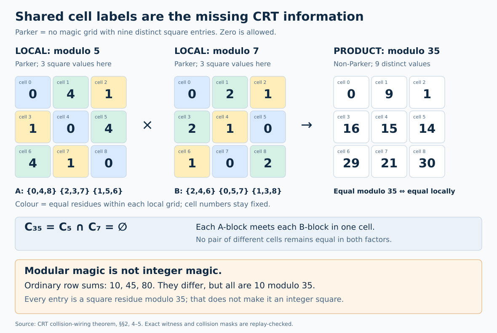
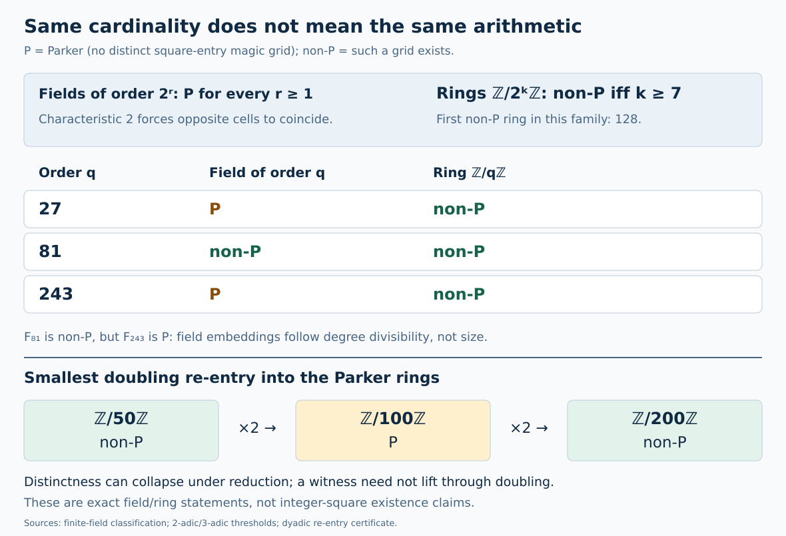

# Session55 synthesis: from Parker flags to exact arithmetic gluing

25 October 2026. This session follows the user's Parker-field/no-wrap question and recovers earlier fixed-port, Gaussian-norm, and generating-function ideas. The major outcome is a complete quotient-ring classification, with independent proof and computational audits. The integer magic-square-of-squares prize remains open here. No assertion of external priority is made.

Convention: square residues include zero; arrays are labelled and all nine values must be distinct unless stated otherwise.

## 1. The exact boundary of the proposed prize

The no-wrap proposal is valid when the actual entries being added are nine distinct integer squares. Equal line sums modulo m, lying in (0,m], must be equal as integers. But a quadratic residue need not be an integer square when represented by its least nonnegative integer.

The smallest prime for this WEAK canonical no-wrap residue predicate is 59:

    28  3 17
     5 16 27
    15 29  4

Every line sums to 48. Every entry is a square modulo 59, but only 4 and 16 are squares as integers. Even the center is an actual integer square, so testing the center alone does not repair the inference.

For a genuine integer solution, the center is e² and the common sum 3e². Conditional on existence, its least faithful prime no-wrap modulus is the first prime above 3e²; the smallest center determines the smallest faithful prime modulus. This does not claim that distinct centers must have different next primes. We have not found such a solution. The complete e<=100000 search is a reproducibility demonstration, not a new record: historical work already reports much larger bounds. [Proofs and search](integer-search/RESULTS.md); [audit](audit-integer-search/REPORT.md).

The missing information has an exact form. The linear magic lattice is a split rank-three sublattice of Z^9 with a six-coordinate residual map S. If r is the residue grid, u the chosen roots, and u²=r+mh, then

    S(u²)=0 iff S(h)=-S(r)/m.

This is the actual root-carry obligation. Passing more residue tests without controlling h does not solve it. [Carry theorem](carry-lattice/PROOF.md).

## 2. Complete fields, and why their order is not an integer modulus

The independently audited field classification is: every characteristic-two field is Parker; the odd Parker orders are exactly

    3,5,7,9,11,13,17,19,23,25,27,31,43,47,67,243.

The proof uses a six-factor character-sum slice, a uniform existence threshold 14400, and independent exact verification of all 1730 smaller odd prime powers. A newer Lai paper states the same classification; this is an independent reproduction, not a first-discovery claim. The smallest non-Parker field is F29, but the smallest with a nonzero center is F59.

The interweaving is real but characteristic-dependent. F81 is non-Parker, F243 is Parker, and every characteristic-three extension of degree at least six is non-Parker. In characteristic two there is no eventual exit at all. [Field proof](finite-fields/THEOREM.md); [audit](audit-finite-fields/AUDIT.md).

An integer map into F_(p^r) factors through F_p. A numbering of the extension-field elements does not convert that field into Z/p^rZ. This explains why infinitely many Parker extension fields do not obstruct an integer square.

## 3. The main closure: all quotient rings Z/nZ

Keeping the actual equality relation on the nine named cells makes Chinese-remainder gluing exact. For coprime components, two global cells coincide iff they coincide in every component. Thus collision masks combine by intersection. Local Parker/non-Parker flags discard too much information.

The smallest repair is 35=5*7: both factors are Parker, but their complementary three-colour equality partitions separate all nine cells globally. The colours have a precise affine nine-position interpretation: the two coordinate partitions are fibres of i-j and i+j+1 over F3, up to naming. This is not a Fano-plane or tournament identification.

The construction generalizes: the square AP(1,25,49) stays distinct modulo every odd modulus at least 5. Two complementary AP partitions therefore produce a square-residue magic grid whenever the odd modulus has two coprime factors at least 5. Simple Lo Shu transforms handle large prime powers. All remaining moduli reduce to 203 exact compatibility tests.

The result is a full classification:

- Exactly 28 odd Parker moduli n>=2, largest 201.
- Exactly 136 Parker moduli n>=2 overall, largest 3216.
- The trivial modulus 1 adds one to each count.

These establish the bounds stated as Conjectures 9.3 and 9.4 in Cain's supplied paper, using the separately audited prime-field theorem. They are not merely observations through 3216. All remaining candidates, local antichains, witnesses, and independent tables are supplied. A limited literature search does not establish priority. [Classification](crt-wiring/CLASSIFICATION.md); [independent audit](audit-odd-rings/AUDIT.md).

This also closes one proposed route negatively: there cannot be an unbounded family of Parker quotient rings that disproves the integer problem, because there are only finitely many such rings. It does NOT imply that an integer solution exists.

## 4. Re-entry has a mechanism, not just a sequence

Let O consist of 1 and the 28 odd Parker moduli, and E={25,49,75,147}. For n=2^a m with m odd, the full classification becomes

- a=0 or 2: m in O;
- a=1,3,4: m in O minus E;
- a=5,6: m in{1,3};
- a>=7: never Parker.

The layer sizes are 29,25,29,25,25,2,2. Modulo 4, every square-magic array is constant. Modulo 8 and 16, the collision patterns of binary magic arrays return by explicit affine/scaling maps. This is why 50 can work,100 fail, and 200 work again. Increasing modulus is not automatically a valid lifting operation.

The proof also exposes all six proper-divisor counterpairs in the finite obstruction set. [Structural theorem](dyadic-reentry/THEOREM.md). This is a concrete answer to the user's interest in small-size interweaving: we can name the lost and restored relations, not merely plot an alternating list.

## 5. Exact generating functions and counting, beyond existence

For labelled distinct square-residue grids over Z/p^kZ, the verified series are

    N_2(z)=1536z^7/[(1-z²)(1-2z)(1-4z)(1-8z)],
    N_3(z)=216z³(1+27z)/[(1-z²)(1-3z)(1-9z)(1-27z)].

These follow from exact collision-arrangement counts and square-content descent, not interpolation. In particular N_2(7)=1536 and N_3(3)=216. The normalized limits are 1/504 and 27/728. [Proof](prime-power-counts/PROOF.md); [independent counting audit](modular-count-audit/PROOF.md).

For ordinary magic grids without the square constraint, there is an all-modulus degree-three quasipolynomial of minimal period 60. Its generating function has reduced denominator

    Phi_1^4 Phi_2^3 Phi_3^2 Phi_4^2 Phi_5^2 Phi_6^2.

There is no primitive 60th-root pole: the joint period is the least common multiple of smaller surviving periods. The primes 2,3,5 here arise from Smith invariants of linear collision constraints; the Parker square-residue prime exceptions are a different layer. [Exact formula and numerator](ordinary-count-gf/PROOF.md).

For CRT counts, minimal collision antichains preserve existence but not mass. Retain the full equality-partition histogram M_n(pi):

    M_ab(pi)=sum_(sigma meet tau=pi) M_a(sigma) M_b(tau), gcd(a,b)=1.

A partition-lattice zeta transform makes these coordinates multiplicative, and Möbius inversion recovers the distinct count. This gives 24 labelled grids at 35 and 40 at 55, hence 3 and 5 D4 position-orbits. Multiplying a coprime modulus by 3 preserves feasibility but doubles every histogram weight. The exact fixed-label interface resembles earlier named-boundary signature work, but no native tournament wiring equivalence is asserted. [Weighted theorem](weighted-crt/THEOREM.md); [audit](audit-weighted-density/AUDIT.md).

## 6. A genuine source for recurring constants

For odd finite fields, labelled distinct square-magic counts satisfy

    F(q)=q³/512+O(q^(5/2)),

uniformly in characteristic, with an explicit audited error bound. This is proved by character sums, not independent-square heuristics. Comparing the dyadic and ternary ring limits with 1/512 gives 64/63 and 1728/91.

The first 63 comes from a two-exponent square-content descent in a three-coordinate magic space: the renewal ratio is 2^(-6). The 1728 is the exact simplification of the ternary density ratio; it is not itself a new modular invariant. F64, MRB, CM, and Monster interpretations are not implied. This is the requested discipline for revisiting numerology: retain the number when a proved operation generates it, without transporting unrelated theorems. [Density bridge](density-bridge/PROOF.md).

## 7. Search improvements tested rather than advertised

The integer target is an additive diamond in the exact opposite-square gap set D_e:

    x,y,x-y,x+y in D_e, with x>y>0 and x!=2y.

Gaussian representations construct D_e completely, but many representations do not force closure: e=1105 has 13 gaps and no required diamond. A Parker-prime collision filter reduces 347561 bounded candidates to 474. Nevertheless it is slower than checking the exact difference gap first, which already rejects every candidate in this benchmark. We retain the sound sieve and its content guards, but do not market it as a speedup. [Benchmark and proof](collision-sieve/RESULTS.md); [audit](audit-collision-sieve/AUDIT.md).

## 8. Tournament endpoint correction and the remaining frontier

The user's half-ceiling equation is correct after deleting a Hamilton CYCLE: the residual total is n(n-3)/2. Deleting the fixed Hamilton PATH leaves one additional edge, so that same two-value prescription has n/2+1 high vertices for even n. We prove exact cut criteria and all prescribed-high-set realizability in the stated ranges; internal balanced ports retain both endpoints. Different score patterns can have different multiplicities. [Residual score theorem](residual-scores/THEOREM.md).

What remains open here: an actual integer magic square and its least center; a genuinely faster search on the relevant much-larger height range; native all-size tournament metagraph wiring and A000568 prediction. The useful next obligation is to control the archimedean root/carry condition, not to keep deepening already-smooth local lift trees. All new results above have explicitly stated domains, independent audits, and reproducible certificates.
