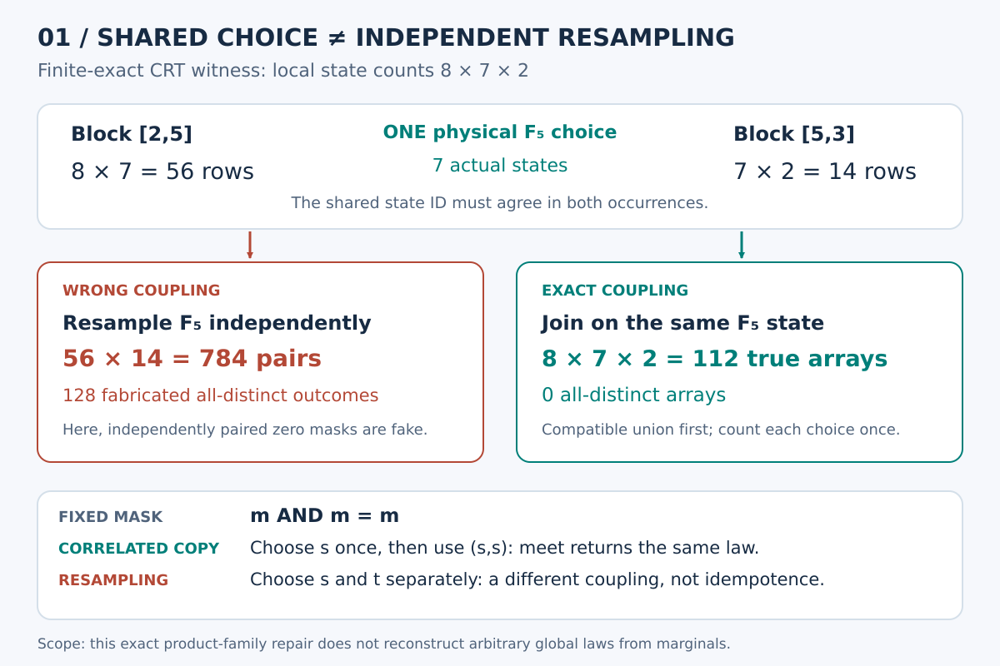
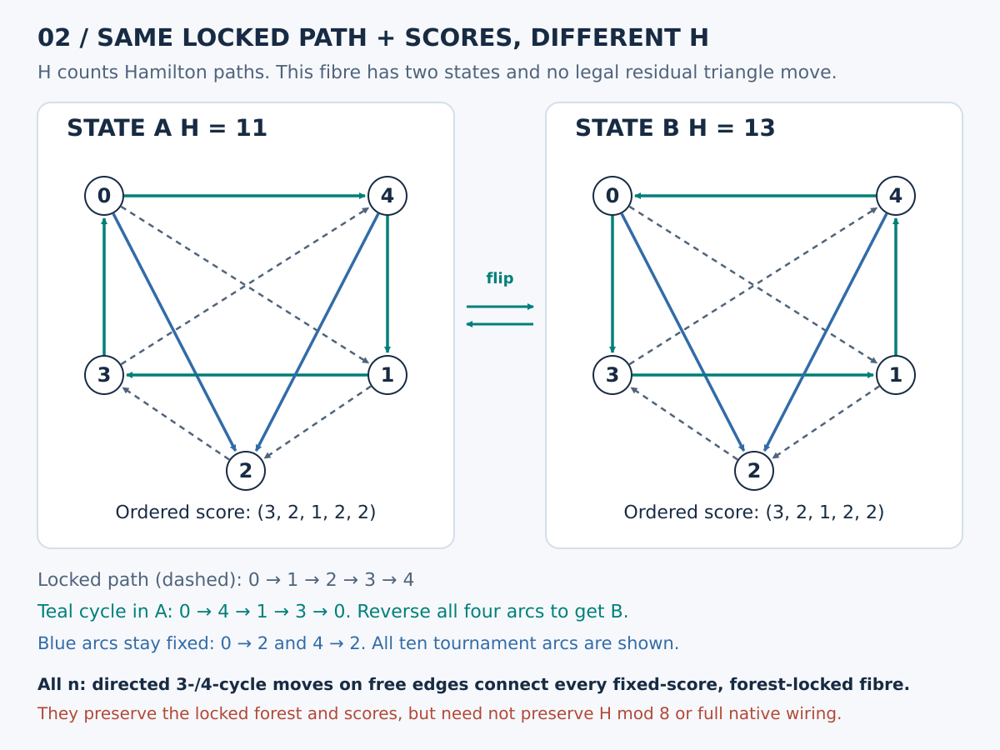

# Session56 synthesis: what a tree remembers, and what a query forgets

25 October 2026. The requested connection list is in [CONNECTIONS.md](CONNECTIONS.md). This session combines recovered repository ideas, classical machinery rederived in the required domains, new scoped applications, implementations and independent audits. No external-priority claim is made.

## 1. The useful starting point: an exact interface is query-relative

RMQ and LCA are equivalent through a stable Cartesian tree, but the tree preserves interval argmin indices, not all array data. It can lose values, ties and comparisons across branches. This became a precise test for our own summaries: name the query family and continuation operation before declaring a quotient lossless.

A shape's source multiplicity is also explicit: n!/product(subtree sizes). Those nonuniform weights distinguish counting source permutations from counting their Catalan query types. The tree-only tournament capacity bound is an encoding statement, not a lower bound on enumerating A000568. [Proof and controls](cartesian-fibres/PROOF.md).

## 2. A genuine overlap bug, and two exact repairs

For the coprime factors [2,5,3], the left block has 56 possible array tuples and the right block 14. Naively combining the overlapping blocks independently produces 784 ordered block-row pairs and 128 fabricated distinct-cell outcomes. The true modulus 30 problem has 112 arrays and no distinct-cell outcome.

The missing datum is whether both blocks refer to the SAME choice for factor 5. Fixed selected masks may be intersected twice because AND is idempotent. Families of alternatives and weighted counts cannot be reused that way.

Two repairs are proved and tested:

1. Use disjoint sparse tables or segment trees, retaining component identities, labels and weights. [Range theorem](range-signatures/THEOREM.md).
2. Retain the shared-assignment interface and use correlated natural join, evaluating each original weight once. This recovers the full genuine 112-array histogram without dividing by a possibly zero weight. Certified observational quotients may compress that interface; full physical IDs are sufficient, not universally necessary. [Join theorem](correlated-gluing/THEOREM.md).

The latter also gives a classical all-size sufficient criterion on a running-intersection join tree. A cycle of constraints can have pairwise compatibility and no global realization. Abstract relational realizability does not itself supply native geometric or arithmetic witnesses.

## 3. Trees across arithmetic scales

A low-digit-first p-adic trie gives LCA depth v_p(x-y), and its sorted adjacent-prefix array supports RMQ. That is an exact arithmetic map, not a visual analogy. It recovers the old repeated-Collatz-block fuel observer while retaining its itinerary and clock restrictions. [Valuation carrier](valuation-lca/REPORT.md).

Different primes give crossing partitions on the same labels. A single synchronous common-refinement filtration has a tree, but it does not retain every independently queried prime block as a node. The minimum number of trees containing a cluster family is exactly the chromatic number of its crossing graph. Affine lines on nine points require four trees; a five-cycle shows why a largest crossing clique can underestimate the answer. [Cover theorem](hierarchy-covers/REPORT.md).

The algebraic counterpart is equally sharp: zeta coordinates diagonalize collision meet convolution, but nonnegative real idempotents are only zero or deterministic states. Formal signed Möbius projectors are not physical menus of possible choices. Correlated copying and independent resampling remain different even after probability normalization. [Projectors](partition-projectors/THEOREM.md).

## 4. A real tournament hierarchy and its circulation sidecar

Canonical strong modules give an intrinsic LCA hierarchy. To recover an arc, retain the two child ports and the quotient tournament at their lowest common module. Prime tournaments can leave the entire hard quotient at one star, so there is no tree-only classification shortcut. Three five-vertex prime examples with the same star have 9,13,15 Hamiltonian paths. [Hierarchy interface](tournament-hierarchy/REPORT.md).

Ordered scores and net cut fluxes are another incomplete observer. They record electrical divergence, not circulation. Two fixed-Hamilton-order tournaments with identical scores and flux have 11 and 13 Hamiltonian paths; a directed quadrilateral reversal relates them.

This produces an all-size scoped move theorem: if any forest of arcs is locked, every fixed labelled-score fibre is connected by legal directed triangles and quadrilaterals. The complement of a forest has no induced cycle of length at least five, and chord refinement turns longer directed reversals into smaller legal ones. The quadrilateral bound is sharp in the five-vertex two-state fibre. Classical reversal machinery is explicitly credited. [Proof and constructive certificates](cycle-moves/REPORT.md); [independent audit](audit-cycle-moves/AUDIT.md).

These moves preserve locked arcs and scores, but not Hamiltonian counts modulo 8. They do not yet preserve every native converse, dyadic, mirror or relational guard required by the original metagraph project.

## 5. Counting the fibres without enumerating all tournaments

The number of realizable labelled orientation-score vectors of G equals the number of integer points in its graphical zonotope. A self-contained deletion–contraction argument gives

    E_G(t) = sum over spanning forests F of t^|F|.

At t=1, the fibre count is T_G(2,1), the number of unrooted spanning forests. For G=K_n minus the fixed Hamiltonian path, weighted composition inclusion–exclusion and integer-partition compression are independently checked by subset-tree calculations through n=14. The counts for n=5,...,14 are

    52, 478, 5706, 83824, 1461944, 29510268,
    676549450, 17361810016, 492999348348, 15345359136232.

This computes a declared tournament-adjacent sequence without enumerating all 2^78 path-gauged orientations at n=14. It does not compute unlabelled tournament classes. [Proof, algorithms and timing scope](score-forest-counts/REPORT.md).

A useful parity corollary and the weighted complement skeleton are recorded separately in [COROLLARIES.md](score-forest-counts/COROLLARIES.md). The degree-fibre partition is not the isomorphism-class partition: a loop in the original merged metagraph is not excluded by a loop-free degree-fibre skeleton. “All vertex degrees even” also must not be confused with the different automorphism-parity definition of even graphs in the Royle et al. A000568 result.

## 6. A recovered exact connection to the user's earlier sequence

The sequence 1,3/2,8/3,125/24,54/5,16807/720 consists of rooted-forest EGF coefficients a_m=(m+1)^(m-1)/m!. If T=z exp(T), then F=exp(T)=T/z. For n>e, F(log(n)/n) is the distinct mirror base satisfying r^(1/r)=n^(1/n).

The repository already proved the whole bridge in Session 31, including the branch guard at n=2 and stronger approximation bounds. This session explicitly credits it as RECOVERED, rechecks it independently and puts it beside the new score-fibre observer. [Proof and source lineage](cayley-mirror/PROOF.md).

The distinction matters: det(I+L) counts rooted/component-weighted forests, not the unrooted forests above. On a triangle the counts are 16 and 7. The shared word “forest” is not permission to identify those observables.

## 7. Older niche ideas that now have a sharper interface

The ten historical cards recover exact source paths and testable maps involving Zeckendorf carry cocycles, Rule30 innovation scales, Fibonacci/Berggren address distortion, persistent versions, tropical kernels and higher-arity interaction. [Atlas](niche-atlas/ATLAS.md).

The affine-credit continuation is particularly concrete. A block retains its endpoint map and worst normalized prefix debt, with exact chronological composition and integer/congruence guards. Endpoint cone closure alone can miss an internal credit failure, and the native Collatz ledger's positive-charge term cannot be erased while claiming an equal orbit. [Debt theorem](debt-range/RESULT.md).

These are useful algorithms and criteria in their stated carriers, not universal Collatz coverage or automatic native wiring.

## 8. What remains

The strongest next obligations are to lift the new cycle moves through the actual additional native guards, exploit the exact score-fibre enumeration without confusing it with A000568, and find smaller continuation-equivalent separator states for correlated queries. The original integer magic-square, general Collatz coverage and full tournament metagraph classification are not closed.

All substantive packets have source pins, explicit finite universes and independent audits. Assertion-based producers are validated normally; where their optimized mode removes checks, the receipts distinguish this from the exception-safe independent optimized audits. Two exact SVGs have deterministic replays and visual inspection. The full disk was handled using a separate temporary publication checkout; no Git pack data was deleted, and the final remote checkpoints are the durable records.
