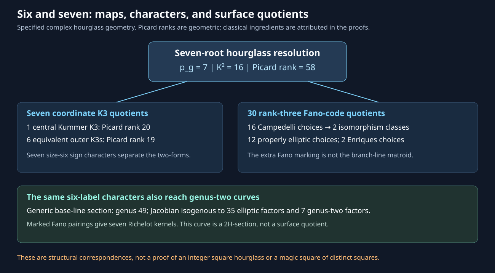

# Session60 — structural six/seven geometry

User focus: connect six-root K3 resolutions and seven-root hourglasses with other occurrences of six and seven. The connections here use actual maps, characters, equations and invariants, not the recurrence of a numeral.

Status: final audited research package. **PROVED** statements retain the hypotheses in their packets; classical identifications are **CITED**, and bounded algebraic controls are **FINITE-EXACT**. No historical-priority claim is made. Publication status is established by the containing Git commit and independent remote readback, not this text alone.

## Results

- [Root thresholds](thresholds/ROOT_THRESHOLDS.md): the canonical balance for simultaneous r-th-root covers over a d-dimensional base is `(r-1)n-r(d+1)`. Six and seven are the adjacent plane-square-root values `K=0` and `K=H`. Coordinate sections give genuine dimension-changing ladders. Multiple crossings expose a noncrepant hostile, while a positive-genus quotient repairs the non-torification conclusion for every arrangement above the stated threshold.
- [Deck characters and K3 quotients](deck-k3/DECK_CHARACTERS_AND_K3_QUOTIENTS.md): seven canonical forms correspond to seven actual root-deletion maps onto six-root K3 resolutions. The six-root even-sign subgroup has fifteen symplectic involutions, each with eight fixed points. Quotient and resolution models are kept separate.
- [Hodge decomposition](deck-k3/HODGE_DECOMPOSITION.md): the seven K3 correspondences give an orthogonal decomposition of the rational transcendental Hodge structure, with pairing scale two. For the hourglass this gives `rho(Y)=6 rho_outer-56`; the [later exact-rank theorem](outer-picard/EXACT_RANK_COROLLARY.md) sharpens the first-checkpoint bounds to `rho_outer=19` and `rho(Y)=58`.
- [Hourglass symmetry and CM](hourglass-symmetry/RESULT.md): the full projective branch-arrangement group is the dihedral group of order twelve. The central deletion is related to the genus-two curve `v^2=u^6-1`, whose Jacobian is isogenous over C to a square of a j=0 elliptic curve. The [explicit Gale transform](deck-k3/KUMMER_GALE_BRIDGE.md) identifies the central six-root K3 itself as Kummer, rather than inferring this from its Kummer quotient.

- [Fano-code surface quotients](seven-lines/RESULT.md): thirty chosen rank-three kernels have dependency counts0,1,3 in multiplicities16,12,2. Their minimal models are respectively Campedelli, properly elliptic and Enriques. The sixteen Campedelli choices give exactly two complex isomorphism classes, with full automorphism groups C2×A4 and (C2)^3; no corresponding elliptic classification is asserted.
- [Curve, pants and Richelot bridges](recovered-bridges/THEOREM.md): transverse base-line curves have genus17/49 and one/seven genus-two character quotients. An inherited Fano pairing supplies maximal isotropic two-torsion kernels; an actual magic slice gives seven nonsingular geometric Richelot targets. The base-line section is2H, notH, and label actions need not lift to the fixed curve.

- [Exact Picard ranks](outer-picard/EXACT_RANK_COROLLARY.md): an explicit non-torsion elliptic section and [two-prime discriminant upper bound](picard-upper/INDEPENDENT_UPPER_BOUND.md) prove outer rank19 and hourglass rank58. The seven K3 deletions form exactly two complex isomorphism classes. The special area-six elliptic fiber recovers the square AP(1,25,49), not a magic-square solution.
- [Incoming Boolean reflection](reflection/BOOLEAN_REFLECTION.md): an explicit marking lifts modified complement to the actual central half-turn. It pairs all thirty Fano kernels with no fixed marking; its quotient resolution has geometric genus4.

[Concept board](CONCEPT_BOARD.md) records the inherited mechanisms and hostiles. [Synthesis](SYNTHESIS.md) gives the connection ledger and remaining frontier. Independent audits, exact source captures and replay receipts accompany the packets.

## Reproduction and limits

Run the checker named by each packet. [PUBLICATION_CHECKS.md](PUBLICATION_CHECKS.md) records the executed normal/optimized runs, source pins and document gates. Run `python3 verify_packet.py` for exact file-set, byte-size and SHA-256 verification.

Geometric assertions are over C unless a narrower rational statement is explicitly given. A rational Hodge decomposition is not an integral lattice decomposition or arithmetic descent. The six-root polarization has genus five, not six. Neither integer-square existence nor a general claim about E6/E7 root systems, Fano planes, tournaments or the Riemann Hypothesis follows.
