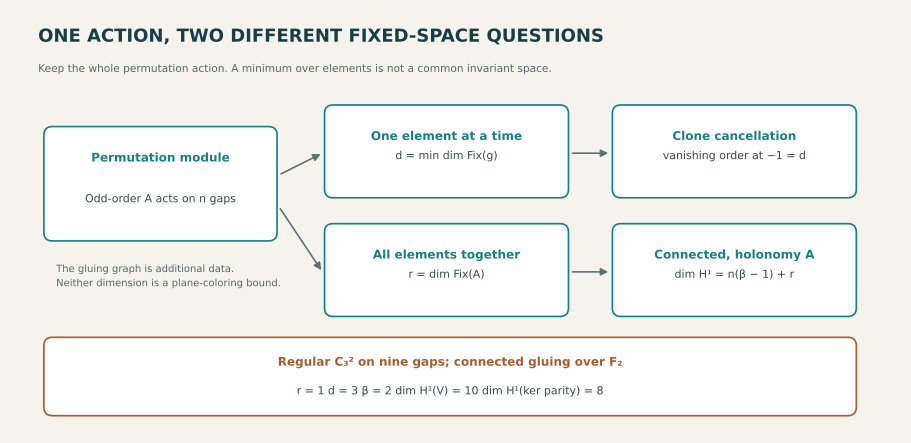

# Session62: what survives wrapping, transport, symmetry and counting

This session develops four precise continuations of other agents' work.
The common question is not why the same small numbers recur, but which
information a quotient preserves and which extra data restores the target.
Classical linear algebra, Burnside averaging and local coefficients are
attributed mechanisms; no literature-wide novelty claim is made.

## 1. Closing the physical-incidence wrap boundary

The earlier cube-plus-bridge grammar computed a common three-direction
line-sum kernel only before modular wrap. We now retain the actual physical
line labels on the cyclic support instead of treating the support as an
abstract rectangular box.

For the four-column support
T_L={(-a−3b,j−9b): a,b in{0,1}, 0≤j<L} over F_p, let J be the common
kernel of line sums in directions (1,0),(0,1),(3,9), with coefficients in
an arbitrary field K. For p≥17 and every 1≤L≤p, the complete answer is

    dim J = L−1+(L−10)_+ +(L−p+6)_+ +(L−p+3)_+
            + [char K=p][L≥p−6].

Here x_+=max(0,x), and brackets are 0/1 indicators. The earlier formula
survives the first two wrap lengths. A coefficient-characteristic mode
appears at L=p−6; ordinary geometric corrections appear at p−5 and p−2.
At full length the dimension is 2p−2, or 2p−1 in characteristic p.
The small physical primes 5,7,11,13 have separately proved tables.

For every physical prime p>3, a stronger theorem handles every nonempty
punctured subset I⊆F_p, not
only intervals. The surviving boundary equations form a step-three path
forest. Alternating path vectors and one possible corrected constant mode
give a constructive basis. If k is the number of unanchored components,
o records whether an odd-sized one exists, and b records compatibility of
anchor parities, then dim J=|I|−1+k−o+[char K=p]bo.

The mechanism is exact: a cyclic difference equation leaves a constant c,
and the column-sum condition is p c=0. This explains the exceptional
characteristic without assuming a semisimple Fourier decomposition where
it does not exist. Independent full incidence matrices and integer Smith
forms check the claimed field behavior. The stated coupled-kernel theorem gives nullity
2 dim J under the hypothesis that all three weights are nonzero; the literal weights
(−3,−9,1) do not satisfy that premise in characteristic 3.
No kernel vector is thereby a binary error pattern or a geometric section.

## 2. Signed cancellation can be much deeper than the available toggles

The other agents' clone-cut involution cancels a weighted inflation fibre
inside one fixed tournament. We keep its actual automorphism action on the
canonical module gaps and study the entire cut-orbit polynomial P(t).

For any finite odd-order action A on a gap set G,

    ord_(t=−1) P(t) = min_(g in A) #cycles(g on G).

Burnside expresses P as an average of products (1+t^ell). All cycle lengths
ell are odd, and every lowest-order coefficient at −1 is positive, so the
minimum orders cannot cancel. This also gives the first nonzero signed
binomial moment, not just the zeroth-moment cancellation.

By contrast, the fixed symmetric-difference operations that actually
descend to cut-set orbits have rank r=#(A-orbits on G). Equality of r with
the cancellation order requires ONE group element to cycle through every
orbit simultaneously. Different elements working on different orbits do
not suffice.

These distinctions are realized by explicit tournaments. A 24-vertex
example has 9 gaps, one legal invariant-gap toggle, but cancellation order 3.
An observer construction gives tournaments on 2·3^k+3k vertices, k≥2,
with one gap orbit and cancellation order 3^(k−1). Thus the separation is
unbounded, not an artifact of an abstract permutation example. A 33-vertex
example isolates the synchronization failure: r=4 but order 6, even though
each orbit separately admits a cyclic action.

The exterior-algebra interpretation explains why an apparent extra
factor need not be another operation. For a real finite-group representation,
the exterior-invariant Hilbert polynomial has root order equal to the
minimum individual fixed-space dimension. The common invariant subspace
supplies a genuine nonnegative exterior factor, but higher vanishing can
arise by cancellation beyond it. In the regular nine-gap example, dividing
by all three factors (1+t) gives negative coefficients, so those three
factors cannot be interpreted as three positive degree-one exterior factors.
None of this implies a faster unrestricted tournament enumerator.

## 3. Exact color interfaces can be smaller without dropping correlations

The other agents' path interface has q+2 Boolean states: dead, free, and
one forced state for each named color. Its relational extension retains
the SAME exterior coloring across all local tests. We keep that joint
relation and quotient only by a simultaneous palette symmetry.

For q≥2 and 0≤k≤q, with w active exterior variables and k distinguished
colors, let N(w)
count their assignment orbits under permutations of the remaining colors:

    N(w)=sum_j binom(w,j) k^(w−j) B_(≤q−k)(j).

B_(≤m)(j) counts partitions into at most m blocks. Exact path tables have
at most 2N(w)+N(w+1) orbit rows; an anchored cycle has at most
2N(w+1)+N(w+2). Joins require compatible partition amalgamations on the
full union of both retained variable sets. Independently fixing canonical
representatives can lose valid alignments; replacing joint relations by
marginal possibilities can instead introduce fictional witnesses.

For q=6,w=6 and no distinguished colors, the budgets are 1,282 and 5,863,
compared with 373,248 and 2,239,488 named rows. These are exact storage
bounds under the stated symmetry and separator hypotheses, not a proof
that arbitrary unit-distance exteriors have bounded width. Naming all
colors restores the original budgets.

Counting requires different information. Over Q, the exact linear
boundary dimension is q for a processed nonempty prefix, q+1 for the
whole path-counting series INCLUDING the empty path, and q² for full
named two-port responses. The empty-word correction is essential: the
Hankel minor on the empty word and singleton lists has determinant(−1)^q.
Thus six colors yield seven whole-series counting coordinates but eight
Boolean feasibility states. Neither is automatically the eight-conic cube.
One homogeneous linear scalar register carried by the deterministic free
tag is also insufficient:
already at q=3 over Q, two free prefixes have nonproportional future
singleton responses.

The integer response lattice exposes a further exact boundary. The signed
integer span of nonempty list-word matrices consists exactly of matrices
whose individual row sums are divisible by q−1; adjoining the empty
word's identity permits one common row-sum residue. These spans have integer
cokernels (Z/(q−1))^q and (Z/(q−1))^(q−1). Consequently, in coefficient
characteristic dividing q−1 the positive-word matrix span has dimension
q(q−1), and the all-word span has dimension q(q−1)+1, rather than q².
The whole path-series dimension q+1 still survives every characteristic:
its displayed Hankel minor is unimodular. These are different response
objects, so there is no contradiction. Independent integer Smith checks
corroborate the constructive row-lattice proof. A matrix in the signed
integer span need not itself be a physical nonnegative word response.

## 4. Allowing pair permutations changes the exact missing obstruction

Session61 treated three ORDERED color pairs. We now allow pair permutations
along seams. Their endpoint-reversal space V=F2^3 becomes a permutation
local system. Parity p:V→F2 still records the Fano completion bit, and
V splits equivariantly as E=ker p plus the invariant vector(1,1,1).

On a connected gluing graph with cycle rank beta and holonomy H≤S3,

    dim H^1(E) = 2(beta−1)+dim E^H.

The forgotten obstruction dimension is 2beta,2beta−1 or2beta−2 for trivial,
transposition or transitive holonomy. A single cycle with three-cycle
transport has no remaining even obstruction, while two such cycles still
retain two. This proves the exact extension that Session61 explicitly
left outside its constant-coefficient formula.

The eight endpoint choices form a cube, and its two parity halves are
exactly the two Fano completions. A marked conic-direction basis supplies
an actual translation-label comparison with the eight conic components.
It does not make every abstract coordinate permutation a surface
automorphism, or identify a section with a trivialization of all labels.
The six-color path automaton's eight states have different stabilizers
and remain a different carrier.

## 5. The shared action explains two different notions of rank

The clone and gluing lanes meet on the SAME permutation module. If n is
its dimension and r the common invariant dimension, a connected graph local
system with holonomy image A has H^1 dimension n(beta−1)+r. Clone cancellation instead uses
min_g dim V^g. A minimum over individual group elements is not the common
fixed space of the whole group.

For the regular C3² action on 9 gaps and a connected two-cycle gluing graph over F2
whose two cycle holonomies generate that group, the
numbers are concrete: common fixed dimension 1, cancellation order 3,
full gluing-obstruction dimension 10, and parity-forgotten dimension 8.
The marked action gives the bridge; no equality between those numbers
is asserted. The added gluing graph is not an intrinsic tournament-move
graph and supplies no black-path transport theorem.

## Boundaries and useful next questions

This session closes the stated cyclic-incidence gap and the unordered-pair
local-system qualification, and refines exact counting/cancellation
mechanisms. No Hadwiger–Nelson six/seven decision, LRC closure, general
black-core connectivity theorem, new K3 Picard rank, or integer-square
hourglass existence result is claimed.

A useful next step would be to exploit these exact interfaces in a fully
specified geometric exterior or tournament continuation problem while
retaining its shared variables and holonomy. The present results make
those tests more faithful; they do not discharge the missing global
quantifiers. This is a future direction, not work automatically continuing
after the session ends.

## Proofs, checks and diagram

- [Wrapped-incidence proof and generators](incidence/cyclic_common_kernel.md) · [independent incidence audit](audits/incidence/AUDIT.md).
- [Higher clone cancellation](clone/README.md) · [independent clone audit](audits/holonomy-clone/CLONE_AUDIT.md).
- [Palette continuation and linear ranks](palettes/RESULT.md) · [coefficient-characteristic and integer-lattice proofs](audits/palettes/AUDIT.md).
- [Unordered-pair local systems](holonomy/TWISTED_PAIR_LIFTS.md) · [independent transport audit](audits/holonomy-clone/HOLONOMY_AUDIT.md).
- [The same-action bridge](common-action/COMMON_ACTION_BRIDGE.md) · [independent bridge audit](audits/holonomy-clone/COMMON_ACTION_AUDIT.md).
- [Concurrent geometry, retained maps and inherited scope](incoming/INCOMING_GEOMETRY.md).

[Deterministic figure generator](figures/make_action_map.py) · [Reproduction and publication checks](PUBLICATION_CHECKS.md) · [Exact file manifest](MANIFEST.json).

This navigation block is a presentation-only packaging addition; the audited synthesis above is unchanged.
