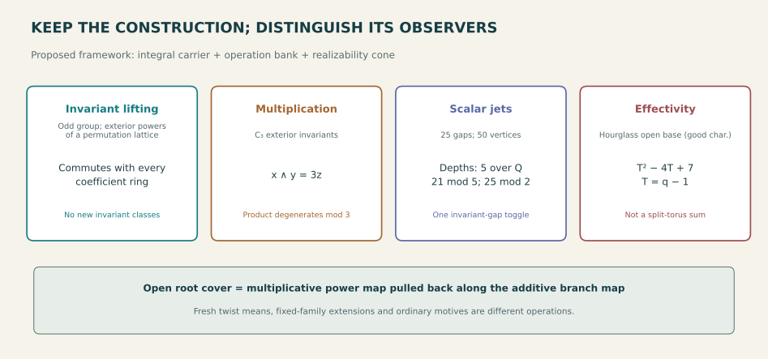

# Proposed unifying theory: integral observers of decorated constructions

## Status and ambition

This is a **proposed research framework**, supported by the specific proved
lemmas and independently audited examples linked in this session. It is not
a theorem that every repository result is equivalent, a new foundation of
algebraic geometry, or a classification of all the objects discussed.

The strongest shared theme is more precise than "the same numbers recur":
start with an actual construction and its allowable operations, choose an
observer, and determine exactly what that observer forgets. Retain integral
and positivity data whenever specialization or reconstruction is intended.

The proposed basic package has three parts:

1. **Integral carrier:** a lattice, algebra, chain complex, equivariant
   cohomology object, or explicitly marked geometric construction.
2. **Operation bank:** the continuations, gluing maps, power operations,
   group actions, coefficient changes and boundary restrictions that matter.
3. **Realizability cone:** which formal elements come from actual counts,
   effective strata, legal moves or geometric objects.

The scalar counts discussed here do not retain these parts. They are also not
one interchangeable kind of mathematics: the maps between carriers must
be specified and proved.

## 1. Operation-complete observers have a precise universal property

**Classical continuation principle, stated and proved here.** Let a monoid
C act on states S, and let f:S->R be an observable. Define

    x ~ y iff f(c x)=f(c y) for every c in C.

This is the coarsest equivalence relation that refines equality of f and
is stable under every continuation. Stability follows because dc is again
a continuation. Conversely, any stable equivalence refining f gives equal
observations after every c, so it is contained in ~. Every exact quotient
of S therefore maps onto S/~; the direction of this factorization matters.

For a module M, linear continuations and a linear observable, the analogous
invisible submodule is intersection_c ker(f composed with c). Quotienting
by this submodule is the smallest exact LINEAR observer. It says nothing
about arbitrary nonlinear encodings or about contexts absent from C.

**Repository instances.** The named path automaton, its weighted q+1
whole-word state, complete boundary Fourier table, bounded tournament gcd
response, and local-system frame equations each implement this principle
with different context banks. The C5 marginal phantom and six-palette
nonproportional continuations explain why separate marginal success is
not a shared witness. A count of states does not identify their actions.

**Prediction / program.** Whenever a proposed common invariant is offered,
first close its observation bank under the operations to be used. A failed
closure should produce an explicit distinguishing continuation, not merely
a warning that information might be lost. This is testable in finite
models and remains an open implementation program for broad geometry.

## 2. Integral specialization has several genuinely different defects

For a map A:M->N of finite free abelian groups, integral Smith data control
specialization. For a prime ell the kernel defect fits the standard exact
sequence

    0 -> ker(A) tensor F_ell -> ker(A mod ell)
      -> Tor_1(coker A,F_ell) -> 0.

This follows by factoring through the free subgroup im A and tensoring the
two short exact sequences. A rational rank does not retain the torsion
exponents; [2] and[4] have the same rational and field-rank profile but
behave differently over Z/4. The incoming integral wrap theorem is a
concrete example: its single factor D retains information that a prime-
field dimension jump loses.

Group invariants are a different operation. The specialization packet
proves that a signed basis-line orbit contributes R or R[2], according to
whether its stabilizer orientation is trivial. In particular odd-group
exterior permutation lattices have invariant bases over every ring.
The tournament's depth jump modulo 5 is NOT an extra invariant class.

A third defect occurs in multiplication. For the cyclic permutation action
C3 on Z^3, exterior invariants have bases 1,x,y,z with x y=3z. Their graded
ranks commute with reduction, but multiplication degenerates modulo 3.
The invariant complex with differential x-wedge has top cohomology Z/3.
This torsion appears after applying an additional operation, not in the
degreewise invariant base-change map.

A fourth observer is a scalar polynomial jet. If P(-1+x)=sum b_j x^j,
let Delta_r=gcd(b_0,...,b_(r-1)), with gcd of zeros equal to zero. Then

    depth(P mod ell at -1)>=r iff ell divides Delta_r,
    Delta_(r+1) divides Delta_r.

For the 25-gap example the successive nonzero gcd levels are
3000,600,120,24,1. They explain depths 5,21,25 over Q,F5,F2; they are not
Smith factors of the original permutation action. Ordinary derivatives
in characteristic p may miss all p-multiple-degree coordinates, as the
incoming cyclic-versus-elementary comparison makes explicit.

**Proposed integral profile.** Record the presentation's Smith factors,
the operation maps' structure constants, and the target's Hasse-jet ideals
separately. Which is necessary depends on the question. A single "bad
prime" label is too coarse to unify these mechanisms.

## 3. Rooted arrangements are a natural geometric carrier

For an arrangement complement U and invertible branch ratios f_i, the
open rooted cover is the actual Cartesian pullback

    V = U x_(Gm^r,[m]) Gm^r,
    U -> Gm^r given by (f_1,...,f_r).

The multiplicative power map is only half the object. The map U->Gm^r
remembers the additive branch equations and their coefficients. Forgetting
it leaves a torus but loses the geometry being studied.

For the hourglass, the seven additive forms are E,E±x,E±z,E±(x+z).
On U, in the chart E nonzero and characteristic different from 2, six
ratios define the degree 64 Kummer torsor. Its character
algebra retains multiplication

    r_S r_T = r_(S symmetric_difference T) product_(i in S intersection T) f_i.

This is an explicit answer to why the additive branch data must remain:
it appears as multiplication constants, not merely as a drawing or count.
Across zero coordinates one needs a boundary atlas. The classical iterated
root stack of the seven branch divisors is naturally [X/G] and retains
inertia that the coarse P2 quotient discards. At triple points it need not
be smooth. The resolved quotient is a blowup, a different operation.

The incoming Kummer-coordinate theorem further distinguishes marked-root
algebra from ambient torus geometry. On the unit locus, exponent matrices
invertible modulo m give marked-root algebra isomorphisms after radicand
corrections. The specified monomial map of ambient tori is an isomorphism only when
its exponent matrix has determinant±1.
For quadratic roots every mod 2-invertible matrix admits a unimodular lift;
this is special to that modular condition, not a claim about every modulus.
The corrections use units and do not automatically extend across zeros.

**Proposed category.** Use rooted arrangements with their base map, root
order, character marking, unit/boundary atlas and permitted coordinate
changes as objects. Morphisms must commute with the base and root maps.
Then incidence, point-count, cohomology and torification questions are
separate functors or predicates on this common construction. This is a
research organization proposal, not a proved equivalence of all such
functors or a claim that this data classifies arbitrary varieties.

## 4. Equivariant information reconciles the twist averages

In characteristic different from 2 and 3, for the open cover V, fresh 64-twist
averaging at each finite field gives
q²−6q+12. For the singular projective cover it gives q²+q+1; after resolving
nodes it gives q²+4q+1 in good characteristic. The models are not interchangeable.

A FIXED collection of twists over Fq has a different extension law. For
constant finite abelian G, degree m extension averages to the quotient
by G^m, not necessarily by G. For exponent 2, odd extensions retain the
base quotient, while even extensions collapse all twists to the original
cover. The session's exact zeta correction records the missing even part.
Thus trivial-character projection and the Adams operation on characters
(chi->chi^m) do not generally commute. Frobenius itself still commutes
with the constant group action and its invariant projector. No ordinary motive identity arises from averaging the forms.

The full 64-character profile restores the entire marked twist-count
profile at that field, not all arithmetic geometry. The seven
canonical/K3 characters are a specific block among 63 nontrivial modes;
they are not the trivial mode that computes the average. Legendre controls
with the same four-point incidence have different twist variances, and
other controls have equal means and variances but opposite marked phases.
The integral Fourier-effectivity theorem records both the exact lattice
and its positive cone. Neither incidence nor unsigned energy is complete.

## 5. Effectivity is an additional lifting problem

A factorization or specialization in a Grothendieck group or polynomial
ring need not lift to a product, legal toggle family or geometric
stratification. These are distinct positive-model questions.

- The clone orbit polynomial may vanish much more deeply than the rank of
  invariant gap toggles. Negative coefficients after dividing by apparent
  exterior factors block a positive factor interpretation.
- The hourglass base complement has polynomial T²−4T+7 at T=q−1. The
  negative coefficient blocks a finite split-torus stratification. More
  generally n distinct complex projective lines give linear T coefficient 3−n, irrespective
  of their intersection multiplicities.
- Positive coefficients alone do not solve a reconstruction problem. Over C the
  resolved quotient blowup is torifiable, while its root-cover source has
  nonzero geometric genus and is not. A quotient's positive model does not
  lift automatically.

The value 7 at q=1 is a well-defined Euler specialization of the base
complement. It is not literal arithmetic over a one-element field, and it
is not automatically the same invariant as geometric genus 7. For seven distinct complex lines with at most triple intersections,
changing triple incidence changes the former while leaving the latter
unchanged in the stated root-surface scope.

## 6. Falsifiable next steps, not claims of a universal solution

1. **Operation closure:** build complete character/boundary observers for
   an explicitly chosen geometric or tournament continuation bank, and
   produce distinguishing witnesses whenever a proposed compression fails.
2. **Boundary descent:** extend unit-locus Kummer coordinate repairs only
   after checking all divisor valuations and local inertia. The incoming
   integral wrap torsion is a useful intrinsic control, not the same map.
3. **Integral versus positive lift:** test candidate decompositions first
   against Smith/jet defects, then against the actual model cone. Passing
   these necessary tests still requires an explicit construction.
4. **Character-resolved arithmetic:** replace fresh scalar twist averages
   by marked character traces and power-compatible extension data. This
   can distinguish arithmetic forms without pretending to classify points
   or polarized varieties from a single count.

These proposals connect selected audited repository mechanisms. They do
not unify unrelated open problems by analogy, prove a global coloring or
integer-square theorem, or establish historical novelty for classical
invariant, Fourier, root-stack or cohomological machinery.

## Packaged navigation (presentation-only)

The audited body above is preserved byte for byte. This suffix only supplies
portable links and is not an additional mathematical claim.

- [Session overview and status boundaries](README.md) · [synthesis](SYNTHESIS.md)
  · [proposed framework, not a universal classification](PROPOSED_UNIFYING_THEORY.md).
- [Cancellation proof](cancellation/RESULT.md) · [cancellation audit](audits/cancellation/REPORT.md).
- [Twist carriers](twists/RESULT.md) · [root stack](twists/ROOT_STACK.md)
  · [zeta/effectivity](twists/ZETA_AND_EFFECTIVITY.md) · [twist audit](audits/twists/AUDIT.md).
- [Integral specialization](specialization/RESULT.md) · [Fourier criterion](fourier-effectivity/FOURIER_EFFECTIVITY.md)
  · [integral/Fourier audit](audits/specialization/REPORT.md).
- [Current source reconciliation](CURRENT_SOURCE_UPDATE.md) · [historical source map front door](recovery/README.md).
- [Final integral readback](audits/specialization/FINAL_ROOT_READBACK.md)
  · [final geometric/visual readback](audits/twists/READBACK_SYNTHESIS_THEORY_FIGURE.md).

[Deterministic figure generator](figures/make_observer_map.py) · [verification scope](PUBLICATION_CHECKS.md).
