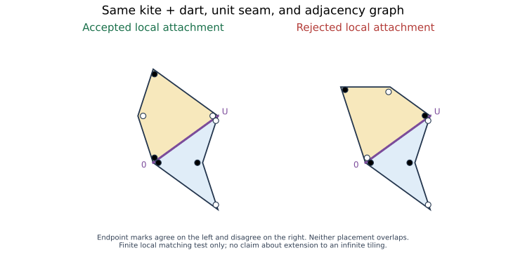

# Exact bridges, and the information each bridge must retain

Session71, 2026-10-26. This synthesis is a map of precise results, not an
identification of every object sharing the numbers four, five, or forty-four.
CITED external optimality, inherited theorems, new elementary deductions, and
finite controls are distinguished in the linked lane reports.

## 1. What Fermat does, and what it does not do

Fermat's prime two-square theorem and its composite valuation criterion
classify Gaussian norms. For a positive integer N, a rational-coordinate
square of area N exists exactly when N is a sum of two integer squares.
Thus 5 works and 44 does not: the latter contains 11, a prime congruent to
3 modulo4, to odd exponent. This is a restriction on coordinates, not on
the existence of a square of real area44.

The same Gaussian arithmetic has an actual graph-theoretic isomorphism in
the recovered [THM-3333, Gaussian-square/Farey light cone](../session71-norms/sources/01-THM-3333-gaussian-square-farey-pythagorean-triangular-light-cone.md): primitive lattice vectors modulo common sign map by

    (m,n) -> (m²−n², 2mn, m²+n²).

Their Lorentz pairing is twice the square of their determinant. Consequently
Farey determinant-one adjacency corresponds exactly to Lorentz-pairing-two
adjacency on the CANONICAL RAW IMAGE. Arbitrary integral light-cone points,
rescaled triples, and a list of norms are different carriers. [THM-3336, primitive Gaussian multiplication/content](../session71-norms/sources/02-THM-3336-primitive-gaussian-multiplication-content-curved-farey-triangulation.md) retains
the content factors introduced by primitive normalization; discarding them
breaks determinant transport. The norm65 already has two inequivalent
representations and cannot recover angular or Farey incidence information.

By contrast, the minimum number of pieces for a fixed triangle/square pair
is invariant under common similarity. Area5 and area44 versions both have
minimum four in the published no-flip polygonal category. A square paired
with itself has minimum one at either area. These controls rule out deriving
the minimum from area or Gaussian-norm membership alone.

## 2. The paper's actual bridge is joint geometric compatibility

The requested v3 and current published ITCS2026 paper use cut graphs and
coupled edge/vertex matching diagrams. The geometric theorem remains CITED
here: no three-piece polygonal dissection without flips. Our own results do
not substitute an arithmetic argument for its topology, angle and metric
case analysis.

The official v4 notice warns that v3 compiled an outdated file. Served v3/v4
artifacts compared in this session did not reveal the expected substantive
text change. The published ITCS version was separately checked for theorem
scope, displayed inventories and cited mechanisms. Figure-label and diagram-
type presentation cautions remain in the source audit. They are not asserted
refutations, and we do not claim an independent exhaustive certification of
the paper's geometric case proof.

The displayed inventories have44 square cut types and5 triangle types.
Their220 formal pairs reduce to46 through the listed angular filters. This
is a verified reading/count of the displayed inventory, not a fresh proof
that it exhausts every possible geometric cut.

## 3. Exact linear compatibility needs labelled relations

For a proposed matching template, let x record unknown segment lengths and
let L=Cβ record named boundary lengths in a Q-independent basis β. With
rational matrices A,B,C,

    Ax=BCβ is solvable over R  iff  rank_Q[A | BC]=rank_Q A.

Equivalently, the entire forced relation space must lie in the rational
annihilator of L. Its dimension alone is insufficient. At golden lengths
(1,φ,1+φ), the relation(-1,-1,1) vanishes whereas(1,-1,0) does not, although
both span one-dimensional spaces.

This theorem is exact for unconstrained equalities. It does not enforce
positive lengths, allowable cyclic orders, angle budgets, geometric closure,
nonoverlap, or a piece budget. These are not optional implementation details;
they are precisely the guards that distinguish a realizable assembly from a
formal solution of its linear equations.

The inherited PS-D2 rigid-ear obstruction illustrates the metric layer:
uncut equilateral/altitude-half pieces with edge lengths in a·Q(√3) cannot
form the corresponding equal-area square. More generally, for regular-closed
polygonal pieces in the normalized side-two problem, every square side needs
an exposed piece-edge length outside Q(√3), because the side length is
θ=3^(1/4). This forces four distinct exposed edge occurrences, NOT four
pieces. One piece can supply several boundary edges. Coordinates and lengths
also differ: the rational vector(1,1) has irrational length√2.

## 4. Ordered affine transport repairs the next loss

A split-length step with total L is the partial reflection R_L(x)=L−x on
0<x<L. Equality propagation is the identity. Any finite chain has either an
empty domain or the exact state

    (ε,c,I),     F(x)=εx+c,     ε in {−1,1},

where I is an open interval of admissible named input lengths. Composition is

    (δ,d,J) ∘ (ε,c,I) = (δε, δc+d, I ∩ F^{-1}(J)).

This is an exact partial-affine composition law. The sign, ordered offset,
and domain all matter. The triple is minimal for Boolean continuation guards
when every positive future split total is allowed: distinct domains separate
immediately; distinct positive outputs at a common input are separated by a
future threshold strictly between them. A restricted finite threshold menu
may give a smaller quotient.

Arithmetic can constrain a formally closed chain without making it legal.
For σ=3^(1/4), τ=2, the word(σ,τ)^3(τ,σ)^3 has identity affine composition
and perfectly balanced odd/even counts of both totals. Yet its fifth output
is3σ−4−x<0 for every positive x, since243<256 implies3σ<4. Its admissibility
domain is empty. This is a concrete survival of the Session70 guard lesson:
algebraic cancellation is not permission to carry out the operation.

The associated angle-charge construction is also exact but limited. Regular
triangle/square matching components have a cyclic charge carrier of order6;
regular pentagon/square components have one of order10. Both force all-or-none
odd-polygon corner participation and even square-corner participation. Their
charge groups are NOT isomorphic. Similar-looking consequences do not make
all angle systems the same.

## 5. Coordinate-field obstruction: degree four versus degree eight

Suppose both equal-area targets have real Cartesian coordinates in a number field F⊂R.
For triangle edge(a,b) and square edge(c,d),

    √3 = 4(c²+d²)/(a²+b²).

Hence √3 belongs to F. No totally real F can satisfy the relation: an
embedding sending√3 to−√3 leaves both nonzero sums of squares positive.
The least possible degree is therefore four, attained by F=Q(θ), θ⁴=3.
This field is real in its chosen embedding but is not totally real.

For complex vertex coordinates in a number field K⊂C, a square supplies i through an
adjacent-edge quotient, and an equilateral triangle supplies a sixth root of
unity. Thus Q(i,√3)⊂K. If K is Galois with central complex conjugation c,
then for w=the square-edge/triangle-edge ratio,

    w c(w)=√3/4,
    σ(w c(w))=|σ(w)|²≥0.

An automorphism sending√3 to−√3 contradicts the second equality. In particular
no abelian complex field works. Degree4 would be exactly Q(i,√3), so the least
complex-coordinate degree is8, attained by Q(θ,i). Its Galois group is D4;
any degree-eight Galois example must have that abstract group, since Q8's
unique involution would make conjugation central.

There is an honest finite-action isomorphism here: label the four roots
θ,iθ,−θ,−iθ cyclically. The Galois generators r:θ↦iθ (fixing i) and complex
conjugation act on this root set as a quarter-turn and a reflection. Their
faithful action is the square's dihedral action. This does NOT identify field
automorphisms with rigid motions of the whole plane: r fixes1, whereas a
quarter-turn about0 sends1 to i. Nor is this root-square the equal-area target
square above. The preserved object is the four-point permutation action.

These are two different coordinate conventions. The degree-eight statement
must never be stated as the minimum degree of the real x/y coordinate field.
The explicit targets are triangle0,2,1+iθ² and square0,θ,θ+iθ,iθ. No assertion
is made that all cut vertices of Dudeney's dissection lie in those fields.
Field degree8 is not a lower bound of four pieces.

A golden counterpart holds for Penrose tiles. Their standard area ratio is
φ, whose other conjugate is negative. Equal-area similar kite/dart copies
cannot both have complex coordinates in a finite abelian field: after
adjoining the native fifth roots of unity, their similarity-factor ratio
would have complex normφ. Native Penrose kites and darts are NOT excluded;
they have unequal areas. Q(ζ5,√φ) is a degree-eight escape for equal-area
copies. The bound is sharp: either tile's equal long edges at its72-degree
tip forceζ5 into its complex-coordinate field, so its degree is a multiple
of4; degree4 is abelian and excluded. Unlike the triangle's example, this
explicit golden degree-eight field is NOT Galois. If it were normal, an
extension of golden conjugation would sendα=√φ to±i/α, forcing i into the
field. It would then equal Q(ζ5,i)=Q(ζ20), an abelian degree-eight field,
contradicting the norm obstruction. Thus equal degrees here do not identify
the fields or their automorphism structure.

## 6. The promised structural isomorphism: two whole-side involutions

Let S be the named intrinsic whole-side occurrences of all pieces. Each
assembly defines an involution on S: a degree-two edge-matching node swaps
its two incident sides; a degree-one node fixes its side. The paper's
bipartition-labelled, edge-labelled incidence multigraph is recovered exactly
from the two orbit partitions. Conversely the diagram recovers the two
involutions. Boundary, internal and virtual-flat node types must be kept.

This is an actual combinatorial isomorphism. Atomizing every long side into
shorter seam segments gives a different refinement, not that literal diagram.
Its product alone also loses information: two identity involutions on two
sides give two one-link components, while two equal transpositions give a
two-link cycle; both products are identity.

If separate assembly frames are forgotten, the remaining alignment is a
relative double coset of their stabilizers in the declared relabeling group.
This is the same exact group-action construction used for aligned tournament
ports, with a different admissibility predicate. Cyclic side order, endpoint
slots, flips, lengths and angles remain geometric data beyond this diagram.

## 7. A native Penrose realization of the Vitali correlation mechanism

The displayed kite/dart pair has two nonoverlapping placements along the same
unit seam. Both have identical tile counts and simple incidence graph K2,
but one matches the endpoint colors and the other does not.

Place k copies in disjoint oblique columns and stage each kite away from its
dart. The same named translation in either hidden orientation is legal exactly
for its bit value1. Moving a selected subset J therefore tests precisely

    g_J(b)=product_{j in J} b_j.

The construction uses actual marked Penrose shapes, exact rotations and
translations, and a proof of nonoverlap throughout the motion. Its guard
matrix is the Boolean zeta matrix. It is isomorphic, as a finite named-test
system on the hidden bits, to Session70's tournament conjunction family.

This is the rigorous transfer: individual states require k bits; the exact signed-law response space has
linear dimension2^k (normalized laws have affine dimension2^k−1), with all
joint moments providing one complete coordinate system; parity mixtures
agree on every proper marginal but disagree on a global test. This does not
identify the entire tournament metagraph with a Penrose tiling space, or
prove anything about infinite extension of a disconnected finite patch.

## 8. Frame consistency is still not global geometric validity

For a connected declared seam graph, specified Euclidean seam transitions
admit global placements up to a common rigid motion exactly when their products around every closed seam walk are
identity. No-flip geometry restricts the transitions to SE(2); disconnected
seam graphs permit an independent overall motion on each component. This
frame-development criterion does not prohibit overlaps.
Five unit squares joined along a path with translation steps east,north,west,
south bring the fifth square back onto the first. The seam graph is a tree,
so its cycle-consistency test is vacuous; local seams are nevertheless valid.

This is the geometric counterpart of retaining each Petersen cluster's
one-/two-run choices without yet checking global connectivity. In both cases
local transfer and global acceptance are separate predicates. The graceful
overwrite protocol supplies the opposite control: signs genuinely can be
forgotten when no allowed future operation observes them. Minimality is
always relative to a declared operation and observation language.

## 9. Forty-four, five, and the surviving frontier

The recovered derangement identity !5=44, order-six pure-black tournament
count44, strong-atom rooted-target counts5 and44, and displayed cut-type
inventory count44/5 count different objects. No structure-preserving bijection
between these whole sets has been established. The current independent
HYP-9416 audit confirms the strong-atom counts while repairing broader
observer claims. Its full-state sandwich and scalar sandwich must remain
distinct; the former reconstructs strong two-port states, the latter can
compress them.

What closes here is a collection of exact interfaces and obstructions:
Gaussian/Farey incidence, labelled boundary equations, guarded affine length
transport, simultaneous coordinate fields, whole-side matching involutions,
and native Penrose conjunction guards. What remains open is a globally
minimal geometric dissection carrier that also incorporates realization and
nonoverlap economically, and any proposed broader equivalence of the full
mathematical structures. None of these results replaces the paper's cited
four-piece proof or extends it to flips or curved pieces.
