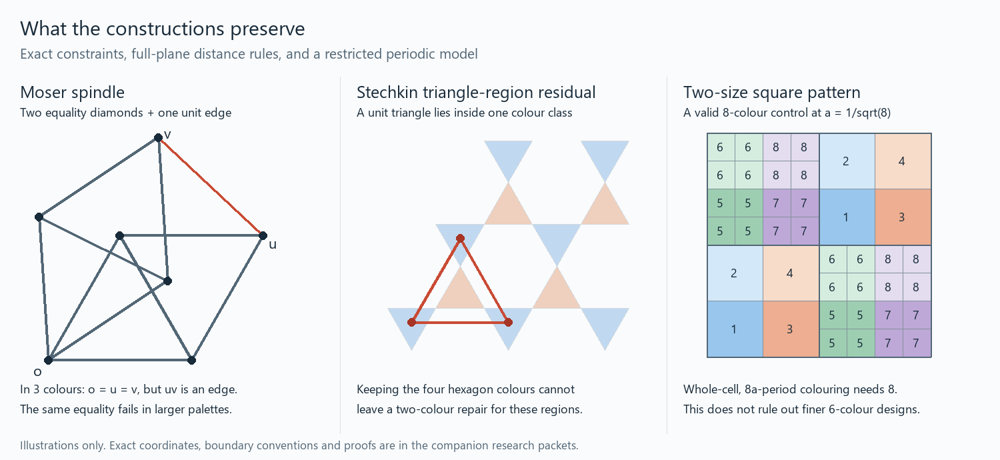

# Stechkin, paired colours, and the joint constraints behind the spindle

2026-10-11. **PROVED scoped reductions and obstructions; FINITE-EXACT
certificates; CITED published constructions.** No six-colouring of the whole
unit-distance plane and no six-colour forced-equality fragment are produced.
The results below distinguish restrictions on particular designs from the
unrestricted plane problem.

The diagram is illustrative; floating-point drawing coordinates are not proof
certificates. Its [vector version](plane_construction_panels_20261011g.svg)
and [renderer](../../04-computation/experiments/plane_construction_panels_20261011g.py)
accompany the exact arithmetic packets linked below.

## 1. Inheritance and the fundamental objects

The four-arc partial tournament, actual unit rhombus, and Moser spindle have
different vertex sets and predicates. The useful inherited mechanisms are
[marked four-arc completion](partial_four_tournament_20261011c.md),
[joint boundary relations](boundary_palette_compression_20261011.md),
[three bipartite parts](plane_six_reframes_parity_20261011b.md), and
[corrected Vitali selectors](vitali_atom_recovery_20261011.md).
The hostile is a reversible encoding that forgets actual unit edges or a
colour-dependent forbidden distance. The corrected near miss is extending a
colouring of a field/direction graph to the plane without checking new edges.
The least-used sidecars here are boundary stabilizers and the covered set after
different colours are scaled differently.

Board: **joint boundary support / actual unit incidence / colour-distance type /
coverage / diagonal symmetry / parity seam**. Anchor: a proper six-colour plane
construction; niche: the two-scale square model; wildcard: Vitali-style component
transport and the periodic dilation obstruction. The META-PATTERNS cards used
are 'Retain local incidence through counting' and 'Preserve the selected side,
not only the walls'. No claim of a new universal research pattern is made.

Incoming commits f75651e98 and bf77abc00 contributed
[cyclotomic palette escape](cyclotomic_palette_escape_20261011.md) and
[unit-path localization](cyclotomic_unit_component_20261011.md). Their field
and complete marked-context restrictions matter: the full plane has additional
unit directions and no remaining unit-path coset decomposition. Their
Cartesian refinements preserve marked support, so they cannot silently supply
the stronger forcing relation sought here.

## 2. The tournament-to-spindle analogy has an exact, limited map

The prescribed partial tournament is the oriented four-cycle
a->b->c->d together with a->d, missing ac and bd. Its underlying graph is C4.
Its four orientation completions give the four tournament types in the
inherited marked section. These are not four colouring states.

Place a,b,c,d at 0,1,1+alpha,alpha, where alpha=(1+i sqrt3)/2. Adding the
actual unit diagonal bd makes a diamond; ac has length sqrt3. At palette k,
its extension counts with fixed tip colours are

\[
 e_k=(k-1)(k-2),\qquad d_k=(k-2)(k-3).
\]

It forces equal tips at three colours, but has twelve extensions of any fixed
different-tip assignment at six colours. Two equality diamonds and a closing
unit edge give the spindle contradiction only at the appropriate palette.

The [spindle/interface packet](spindle_tournament_interfaces_20261011g.md)
also gives a six-point induced unit graph with three marked tips. Its
three-colour tip relation is exactly **not all equal**, but all three pairwise
projections permit both equality and inequality. Thus a complete pairwise
summary can lose the decisive joint constraint even in a tiny actual unit graph.
The packet's composition API retains differing port sets, shared vertices,
complete support and every declared cross-edge, and exports lift witnesses.

**CITED:** the 509-vertex graph is Jaan Parts' five-chromatic construction
following the de Grey/Polymath developments. Its reported two pieces have
374 and136 vertices, sharing one centre, and1860 and564 edges; the full2442
edges include18 cross-edges. The Type M construction is not just two independent
mono-pair gadgets with one closing edge. [Parts, Sections4–6](https://arxiv.org/html/2010.12665v1).
The paper's certificates are not replayed in this session. The transferable
mechanism is compatibility of complete boundary patterns with actual cross
constraints, not the number509 or a relabelling as a tournament.

## 3. Stechkin already covers the plane; the distances need synchronization

The user's reference is Stechkin1970, published in Raiskii's paper. After a
uniform scaling, its six colour classes have forbidden-distance type

\[
                         (1,1,1,1,1/2,1/2).
\]

Four hexagon colours avoid one; the two triangle colours avoid one-half.
The whole plane is covered, but not with a common forbidden distance.
[Original paper, p.323](https://www.mathnet.ru/php/getFT.phtml?jrnid=mzm&paperid=9512&what=fullt).
The [Stechkin packet](stechkin_whole_plane_obstructions_20261011g.md)
retains the source convention, strict interiors and exact coordinates.

Three concrete conclusions replace a purely visual comparison:

1. Each original triangle colour contains a strict-interior unit equilateral
   triangle. Keeping the four hexagon colours and recolouring the remaining
   region with only two colours is impossible. Every pairing of the six
   **whole original classes** into three pairs also fails. Pointwise splitting
   and moving points between pairs remain outside this obstruction.
2. Separately normalizing each class's forbidden distance does create six
   unit-safe sets. At the hexagon-centred normalization their union covers
   density13/16 of the plane, and the uncovered set has density3/16.
   Overlaps can be resolved by choosing the first available colour. This is
   a concrete partial colouring, not a whole-plane six-colouring.
3. Changing the common centre cannot remove all holes. If T is the periodic
   triangle region, coverage would require T subset 2T+w. Equal densities
   would then force equality almost everywhere, and successively halved
   periods would make its measurable indicator constant almost everywhere.
   Its nontrivial density rules that out.

The residual is explicit: T minus 2T at the stated centre. A recursive attempt
to fill it must preserve unit safety between old and new points of each reused
colour. A safe new patch cannot simply be unioned with an old colour class.
This is where the boundary-support machinery is relevant.

## 4. The proposed square geometry gives an exact eight-colour model

Use macroblocks of side4a, alternately subdivided into2x2 squares of side2a
and4x4 squares of sidea. First require one colour per whole half-open cell
and repeat the colour rule with coordinate periods8a. This is a declared
restriction; a three-cycle colour rule may need a larger period.

The [square conflict packet](square_cell_conflicts_20261011g.md) proves that
the optimum over all positive scales in this model is **exactly eight**.
Writing S=1/a^2:

- if S<8, a large cell itself contains a unit pair;
- if S>36, one cell conflicts with its own period translate;
- on the remaining interval, five quotient eight-cliques, with seven exact
  interval certificates, cover every real scale;
- at a=1/sqrt8, an explicit eight-colouring works, including every boundary.

Each quotient edge retains the actual pair of translated regions witnessing
the conflict. A quotient clique is not claimed to be an eight-point unit
clique. The positive construction is shown in the diagram.

A bounded-width diagonal repair cannot rescue six or seven colours while
either far half-plane retains this periodic whole-cell rule. Every obstruction
has a finite collection of period witnesses that can be translated arbitrarily
far into that half-plane. A successful change must alter the bulk constraints:
for example by refining cells, changing the colour period or varying the rule
throughout the plane.

## 5. A separate sharp diagonal-symmetry obstruction

Reflection R across y=x commutes with translation T along that diagonal.
If both act by fixed permutations on colours, their palette actions must obey
the same relation. If every used colour advances in a three-cycle under T,
a proper whole-plane colouring with that reflection symmetry needs at least
**nine colours**. This is sharp within this symmetry class.

The fixed diagonal requires a reflection-fixed colour, and commutation fixes
its entire three-cycle. A unit-separated mirror pair requires a moved colour;
an involution commuting with a three-cycle cannot move colours within that
orbit, so it must exchange two other three-cycles. The requirement is3+6=9.
An explicit nine-colour square grid realizes the bound. This is not a lower
bound for unrestricted plane colouring.

Opposite three-phases on the two sides repair one commutation error, but a
reflection that swaps all three colour pairs has no colour for the fixed axis.
The [diagonal packet](diagonal_palette_holonomy_20261011g.md) identifies exact
ways to leave these hypotheses, including a separate seam rule and a different
translation cycle type. None automatically solves the metric constraints.

For an actual three-pair construction, retain each component's binary frame
and every same-pair unit edge crossing pieces. These give signed parity
equations. Zero sum on every finite seam cycle is equivalent to compatible
global flips, assuming the supplied local pieces are bipartite. Two crossings
between the same components can already impose contradictory bits. A bijection
between halves is insufficient without this edge information.

## 6. The precise Vitali connection and next design targets

Cosetwise copying of a colouring works for a restricted direction set because
all its edges stay in the generated additive subgroup's cosets. With every
real unit direction present, that subgroup is the whole plane: any vector of
length at most two is a sum of two unit vectors. Thus the full unit-distance
graph has one component; a selector supplies no independently colourable
residual cosets.

The Stechkin packet makes the regularity distinction concrete. Using only
rational-coordinate unit directions gives an abstract two-colouring of the
whole point set via coset choice, but no Lebesgue-measurable two-colouring.
Adding all directions changes the edges and invalidates that colouring.
No measurability hypothesis is imposed on the unrestricted six-colour target.

The next useful objects are therefore:

1. **Pointwise pair assignments**, with whole unit graphs bipartite inside
   each pair; they must split some of Stechkin's old triangle classes.
2. **Bulk refinements with authenticated seams**, beyond the fixed40-cell
   palette period and beyond one global three-cycle/reflection action.
3. **Coverage completion for the explicit3/16 residual**, retaining complete
   old/new same-colour conflicts; independent distance normalization alone
   cannot close it.

These are precise obligations and search spaces, not claims that the remaining
coverage is small or that a six-colouring necessarily exists.

## 7. Checks and status

| Packet | Always-active exact checks |
|---|---:|
| Spindle, partial tournament and joint interfaces |1,307|
| Stechkin, normalization and whole-plane components |3,617|
| Two-scale periodic square model |10,625|
| Diagonal symmetry and signed seams |9,210|
| Total |24,759|

Normal and optimized runs agree with saved outputs. Independent peer audits
cover each proof and checker. The detailed notes retain finite universes,
positive and hostile controls, reproduction commands and source scope.
The drawing is excluded from these exact-check counts. No whole-plane
six-colour construction, six-colour equality fragment, or Collatz proof follows.
