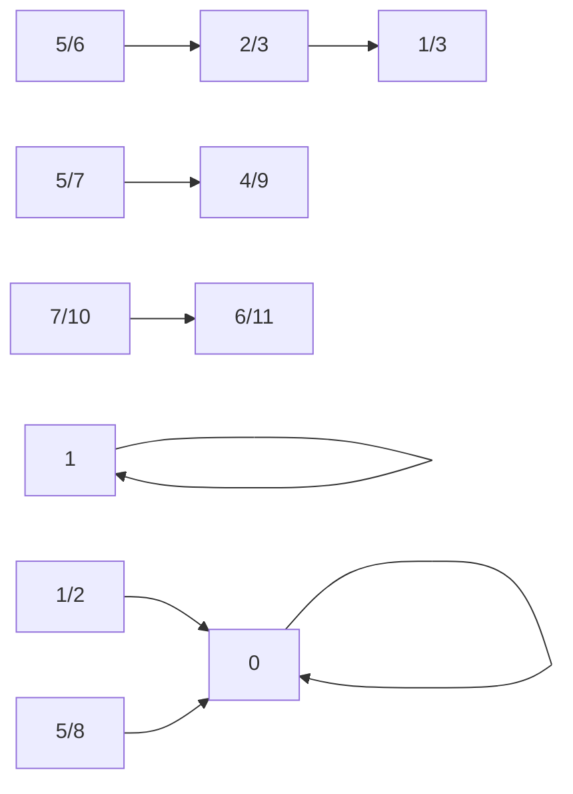

# An operation-sensitive metagraph and three new counting sequences

**PROVED family injections and composition; FINITE-EXACT head through6.
No complete all-order tournament classification or new A000568 term.**

The full tournament metagraph retains the ordinary graph or marked-root
isomorphism class. For the two-observation consumer in TRANSPORT, a useful
smaller graph has rational repair slopes as vertices. Each nontrivial
rooted context with singular response matrix supplies a directed edge
ρ→σ. Decorate the edge with its actual rooted graph, order, full response
and magnitude multiplier q. Keep parallel edges: equal slopes can have
different targets and endpoint behavior. A legal word glues the witnessed
contexts to an actual initial pair; it is not supplied by a numerical walk.

Define R_n as the number of rooted tournament isomorphism classes,
J_n as the number of these with singular neutral-response matrix, and
S_n as the number of input slopes present **at exactly order n**, for n≥2.
The complete finite head is

| n | A000568(n) | R_n | J_n | S_n |
|---:|---:|---:|---:|---:|
|2|1|2|2|2|
|3|2|4|3|3|
|4|4|12|5|3|
|5|12|48|13|5|
|6|56|296|33|6|

These are definitions and computed terms, not claims of new OEIS entries.
The rooted quotient uses exact root-preserving canonicalization of every
labelled orientation with its root fixed. Forgetting the root and
canonicalizing again recovers the known A000568 head as a control. It does
not count each root as a different class when an automorphism identifies it.

There is an all-order structural lower bound. For n≥3,

    J_n ≥ 2 A000568(n-1) + A000568(n-2).             (1)

Proof: adjoining a named universal source to any(n-1)-vertex tournament
gives the rule1→1; adjoining a named sink gives0→0. The constructions are
injective on isomorphism classes by deleting the named root, and disjoint.
For any nonempty I on n-2 vertices, the ordinal join I→r→u, rooted at r,
has profile(h,0,h,f), P_(A-r)(2)=2f, where h=H(I), f=P_I(2).
It gives1/2→0, by the exact response matrix. Deleting the two distinguished
terminal singletons recovers I; these roots have both an in- and an
out-neighbour, so this third family is disjoint from the first two. QED.

Thus the newly observed numbers13 and33 have a precise decomposition:
at n5,13=2·4+2+3; at n6,33=2·12+4+5. The final3 and5 count contexts
outside these three explicit infinite families. This is a relation to
ordinary tournament enumeration with an actual forgetful map, rather than
an identification based on numerical coincidence.

Input slopes need not persist at the next size:2/3 and5/6 occur at n5
and do not occur at n6. The cumulative head has eight slopes, while S_6=6.
Adding vertices to a context changes its response and hence its accepted
repair type. This explains why an unmarked size-growth rule does not
automatically lift to a stable operation rule.

This diagram shows one selected rule per input slope through6. It omits
edge multiplicities, target values and all singleton identity actions;
those omissions are why the actual receipt is needed for construction.
Reproduce `context_sequences.py`; TRANSPORT retains actual lifted pairs.
