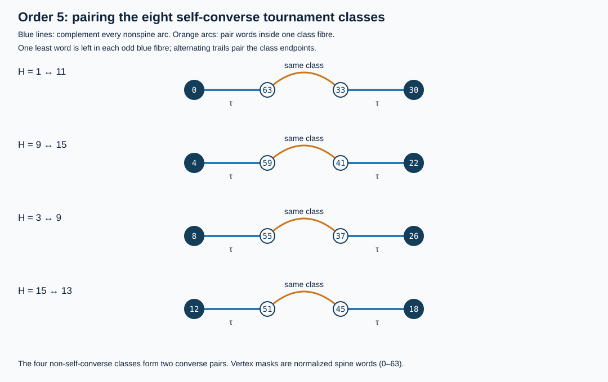

# Ordinary tournament parity and an explicit pairing diagram

**PROVED:** ordinary tournament classes have even cardinality exactly at
orders `n>=3`. The count is one at each of `n=0,1,2`. This parity and the
stronger binary divisibility laws below are **INHERITED PROVED**, not a new
enumeration theorem. The contribution here is a fully specified
alternating-trail class involution built from the inherited presentation
geometry, together with its preservation/loss audit and executable diagram.
The all-order Hamilton-count spectrum is not classified by this construction.

## 1. Inheritance and exact objects

The carrier is **ordinary unlabelled tournaments**, with converse classes
kept separate. Put `a_n=#I_n=A000568(n)` and

    F_n(z)=sum_([T] in I_n) z^H(T),     F_n(1)=a_n.

Here `H(T)` counts directed Hamiltonian **vertex orders**, not cycles,
isomorphism classes of paths, converse pairs, or presentation fibres. At
order zero the empty vertex order has count one.

Closest proved mechanism:

- [LEM-003, free action on Hamiltonian paths](../../../01-canon/theorems/LEM-003-aut-acts-freely-on-ham-paths.md)
  identifies the normalized fixed-spine fibre as `h(T)=H(T)/|Aut(T)|`.
- [THM-643, blue/black line parity, T1–T5](../../../01-canon/theorems/THM-643-blue-black-line-parity-structure.md)
  supplies odd fibres, reflection-fixed blue fibres, and complement lines.
  Its maintained pure-blue-leaf/cap corrections remain in force.
- [THM-305, binary valuation of tournament counts](../../../01-canon/theorems/THM-305-two-adic-valuation-tournament-count.md)
  already gives the exact odd-order valuation. The
  [October25 precision theorem, P3–P7](../port_residual_integral_20261025/precision/README.md)
  and its [independent review](../port_residual_integral_20261025/precision/INDEPENDENT_REVIEW.md)
  give the even baseline and exact leading-bit classification. The
  [October29 precision extension](../metagraph_scheduled_recursion_20261029/PRECISION.md)
  retains stronger low-bit information. These results settle the premise.

The canonical hostile is order three: the transitive tournament and cyclic
triangle are both self-converse, with `H=1,3`. The corrected near miss is
equating an odd-fibre presentation count with the number of ordinary
classes, or interpreting a free presentation complement as a map already
defined on classes. The least-used sidecar here is an **ordered list of
all normalized Hamiltonian presentations in a fibre**. It permits explicit
local cancellations, instead of an unspecified pairing of even sets.

Portfolio: anchor = classify joint class/H structure; niche = inherited
binary valuation and fixed-locus parity; wildcard = turn the genuine cube
reflection into a computable ordinary-class involution. The live board is
`ordinary class / path orbit / mirror fixed locus / complement line /
binary valuation / H-preservation`. The diagram below connects the first
four; the valuation proof supplies an independent count-level control;
the last coordinate gives a sharp obstruction to overinterpreting it.

## 2. The inherited all-order parity theorem

Let `q=binom(n-1,2)` for `n>=1`, with `q=0` also at `n=0`. Fix the forward
spine `0->1->...->n-1`. There are `2^q` tournaments containing this spine,
one for each assignment of the remaining arcs. Call this cube `Q_n`.

Every tournament has an odd positive number of Hamiltonian vertex orders
([THM-001, Rédei](../../../01-canon/theorems/THM-001-redei.md)). A path order
provides a unique relabelling to the fixed spine. Two such normalized
presentations agree precisely when an automorphism transports their
Hamiltonian orders. The action on full orders is free, because fixing a
full order fixes every vertex. Consequently

    |pi^(-1)([T])|=h(T)=H(T)/|Aut(T)|,
    sum_([T] in I_n) h(T)=2^q.                         (1)

Every tournament automorphism group has odd order. Otherwise Cauchy's
theorem gives an involution, and one of its transpositions would reverse
the arc between its two swapped vertices. Thus every `h(T)` is odd. Taking
(1) modulo two proves `a_n=2^q mod2`. Exactly at `n>=3`, `q>=1`. At orders
zero, one and two there is one class. This proves the exact parity range.

### Independent arithmetic route and the stronger inherited result

For an odd partition `lambda=(l_1,...,l_r)` of `n`, put

    E(lambda)=(n-r)/2+sum_(i<j) gcd(l_i,l_j),
    z_lambda=product_d d^(m_d) m_d!.

The inherited Davis/Burnside formula is

    a_n=sum_(lambda odd partition of n) 2^E(lambda)/z_lambda.    (2)

The formula and ordinary-class convention are also recorded in
[OEIS A000568](https://oeis.org/A000568), which links the
[Davis primary paper](https://oeis.org/A000568/a000568_4.pdf).
The proof used here is the inherited repository proof, not a new claim
about that paper's stronger divisibility results.

The summands of (2) are rational numbers; do **not** assume they are
integers. Their odd denominators are units in `Z_(2)`. With `v_2` denoting
the rational binary valuation,

    v_2(2^E/z) >= (n-r)/2 + binom(r,2) - v_2(r!).       (3)

This follows from `gcd>=1` and integrality of
`r!/product_d m_d!`. At odd `n`, `r` is odd. The one-cycle term is
`2^((n-1)/2)/n`; every `r>=3` term has valuation at least `(n+1)/2`.
At even `n>=4`, every `r>=4` term has valuation at least `n/2+1`.
The two-cycle case must be checked separately: distinct odd parts `a,b`
give valuation `n/2-1+gcd(a,b)`; equal parts `d,d` give valuation
`n-2>=n/2+1` because then `d>=3`. Therefore:

    2^floor(n/2) divides a_n,                         n>=3;
    v_2(a_n)=(n-1)/2,                                n>=3 odd;
    a_n/2^(n/2)=phi(n)/2 mod2,                        n>=4 even. (4)

For the last line, only distinct coprime odd pairs `a+b=n` contribute at
the minimal valuation. They number `phi(n)/2`, and each normalized odd
unit contributes one modulo two. In particular the even-order lower bound
is exact precisely when `n=4` or `n=2*p^k`, with `p=3 mod4` prime and
`k>=1`. All of (3)–(4), including the equality classification and the
exception `n=2`, are recovered results cited above. Our fresh calculation
is an independent finite control, not a priority claim.

## 3. An actual involution on ordinary classes

### 3.1 Two genuine symmetries on the presentation cube

Order nonspine pairs `(i,j)` with `i<j`, `j>i+1` lexicographically, assigning
the first pair the least significant bit. A bit is one when `j->i`.
Hence mask zero is the transitive spine presentation.

Define commuting involutions on `Q_n`:

- `tau(x)=x XOR (2^q-1)`: complement **all nonspine arcs**, preserving the
  named forward spine. For `n>=3` this is the fixed-point-free central
  reflection of the bit cube. It is not tournament converse.
- `sigma`: permute chord positions by
  `(i,j)->(n-1-j,n-1-i)`. This is positional reversal **combined with
  converse**, so the spine remains forward; downstairs its class is
  the converse of the original class. No bit negation is applied here.

The first map need not descend through `pi`. The second does, and can
have fixed ordinary classes. These are different maps with different
fixed-point mechanisms.

### 3.2 Odd-fibre cancellation lemma

**PROVED.** Let a finite linearly ordered set `X` have a fixed-point-free
involution `tau`, and let `pi:X->C` have nonempty odd fibres. There is an
explicit fixed-point-free involution on `C` after retaining the given
order on `X`.

**Construction.** In each fibre list elements as
`x_0<x_1<...<x_(2k)`. Leave `x_0` as its representative and pair
`x_1<->x_2`, `x_3<->x_4`, ..., `x_(2k-1)<->x_(2k)` by a local matching
`rho`. Overlay all `tau` edges and `rho` edges, retaining parallel edges
when both matchings pair the same elements. Representatives have degree
one; all other vertices have degree two.

Each finite component is a cycle or a path. A component containing a
representative cannot be a cycle, so its other endpoint is another
representative. The endpoints are distinct, and each fibre contributes
exactly one representative. Pair the two endpoint classes. Reversing
the path gives the same pair, proving the involution property. Every
class appears exactly once. This is an algorithm: start at its least
presentation and alternate `tau`, then `rho`, until another least
presentation is reached. QED.

Apply this lemma to `X=Q_n`, its ordinary class fibres, and integer mask
order. This already produces a specified free class pairing for every
`n>=3`. The choice of mask order is explicit auxiliary structure: the
result is isomorphism-invariant but is not asserted to be an intrinsic
local reflection of unmarked tournaments. It can require long trails.

### 3.3 A refined pairing that preserves self-converseness

Put `B_n=Fix(sigma)`, the **blue presentation subspace**. Because `sigma`
maps a fibre to its converse fibre, a non-self-converse class has no blue
presentation. On a self-converse class it is an involution of an odd
fibre, hence fixes an odd positive number `b(T)` of presentations.

Thus `pi:B_n->SC_n` has odd fibres. Since `tau` commutes with `sigma`,
it preserves `B_n`, where it is still fixed-point-free for `n>=3`.
The cancellation lemma pairs the self-converse classes. Pair every
non-self-converse class with its converse. Their disjoint union is an
explicit free involution `J_n` on **all ordinary classes**, satisfying:

    n(J_n(T))=n(T);
    J_n(T) is self-converse iff T is self-converse;
    H(J_n(T))=H(T) on non-self-converse classes.          (5)

No last-line assertion is made on the self-converse locus. In fact it
cannot hold everywhere, as the next section proves. The construction
also proves that the number of self-converse classes is even at every
`n>=3`. No false identity between that sequence and a shift of A000568
is needed. The existing corrected
[THM-283 anti-Burnside formula](../../../01-canon/theorems/THM-283-sc-burnside-formula.md)
is compatible with this conclusion; its endpoint-monodromy correction
must be retained when using that formula.

## 4. The sharp H-preservation obstruction

**PROVED.** For every order `n`, the unique class with `H=1` is the
transitive tournament. Therefore no fixed-point-free involution of all
ordinary classes can preserve `H`, at **any** order.

**Proof.** A transitive tournament has exactly its unique forward total
order. Every nontransitive tournament contains a directed triangle:
otherwise its orientation relation is transitive. That triangle has
three Hamiltonian vertex orders. Each such order extends to a Hamiltonian
order of the whole tournament. Indeed, to insert a new vertex `x` into
`v_1->...->v_k`, prepend it if `x->v_1`; otherwise insert it immediately
before the first `v_j` that it beats, or append it if it beats none.
All old vertices keep their order. Repeating insertion extends each of
the triangle's three orders, and the three resulting orders remain
distinct on restriction to the triangle. Thus `H>=3`. The singleton
`H=1` fibre cannot be freely paired while preserving `H`. QED.

Consequently `[z]F_n(z)=1` for every `n`, even though `F_n(1)` is even
for `n>=3`. Count parity does not give coefficientwise parity.

At the minimal nontrivial order three, both classes are self-converse.
The unique nonspine bit gives exactly one complement line connecting
the transitive class (`H=1`) with the triangle (`H=3`). Converse fixes
both classes; `J_3` exchanges them. This is the smallest concrete audit
of the distinction.

## 5. Exact diagram and finite controls



The diagram is generated from all order-five presentations, not from
hand-chosen numerical matches. Mask labels are normalized spine words.
Blue horizontal edges are `tau`; orange arcs are `rho` inside one
self-converse class's blue fibre. A row's endpoints are least blue
presentations of the two paired ordinary classes. The four rows are

    0 --tau-- 63 --rho-- 33 --tau-- 30,   H: 1 <-> 11;
    4 --tau-- 59 --rho-- 41 --tau-- 22,   H: 9 <-> 15;
    8 --tau-- 55 --rho-- 37 --tau-- 26,   H: 3 <-> 9;
   12 --tau-- 51 --rho-- 45 --tau-- 18,   H: 15 <-> 13.

The other four classes form two converse pairs. The rows exhibit rather
than conceal H changes. A native SVG render was visually inspected.

**FINITE-EXACT:** [parity_probe.py](parity_probe.py) and
[parity_receipt.json](parity_receipt.json) cover every ordinary class at
orders zero through six. Canonicalization over all vertex permutations
starts from every fixed-spine word; the union of the resulting full
labelled orbits is checked against **every** tournament mask at that
order. Thus the class census has no hidden strong/self-converse filter.
Path counts are computed independently by literal permutations and
subset dynamic programming. Stabilizer sizes come from orbit sizes.
Both full-fibre and blue-fibre trail constructions are checked. The
ordinary/self-converse counts are respectively

    ordinary:       1,1,1,2,4,12,56;
    self-converse:  1,1,1,2,2,8,12.

The script also computes exact rational odd-partition Burnside sums at
every order zero through forty, checks (4), and records every `v_2(a_n)`.
Positive controls include the free fibre identity, total mass `2^q`,
converse transport, and equality of both path-count algorithms. Hostile
controls are the small parity exceptions, unique `H=1` class, actual
self-converse fixed classes, and explicit changes of H along the paired
blue trails. All checks use explicit exceptions and stay active under
optimized Python.

Reproduce in this directory:

```bash
python3 -I -B parity_probe.py --output parity_receipt.json --svg parity_blue_trails_n5.svg
python3 -I -B -O parity_probe.py --output /tmp/tournament-parity-optimized.json
cmp parity_receipt.json /tmp/tournament-parity-optimized.json
```

## 6. Connection contract and remaining interface

**Source:** normalized Hamiltonian-spine presentations, or their genuine
mirror-fixed blue subspace. **Target:** ordinary tournament classes.
**Map:** forget the marked path; to obtain `J_n`, retain ordered fibre
lists and follow the two explicitly specified matchings. **Preserved:**
order, ordinary isomorphism type at each `rho` step, self-converseness
for the refined construction, and H on its non-SC converse pairs.
**Destroyed:** the marked path under projection, H under general `tau`
steps, and all but parity if one records only the degree argument.
**Sidecar:** the complete normalized presentation fibre, its integer
ordering, and the actual complement edges. **Cheapest hostile:** the
single chord at order three.

This answers the symmetry-diagram question constructively, with a stated
choice-dependent cancellation rule. It does not turn converse itself
into a free involution; it does not make full complement a well-defined
one-step class map; it gives no efficient class-generation recurrence or
complete Hamilton-spectrum image theorem. The all-order refined pairing
is proved, while the displayed finite diagram is one exact instance.
