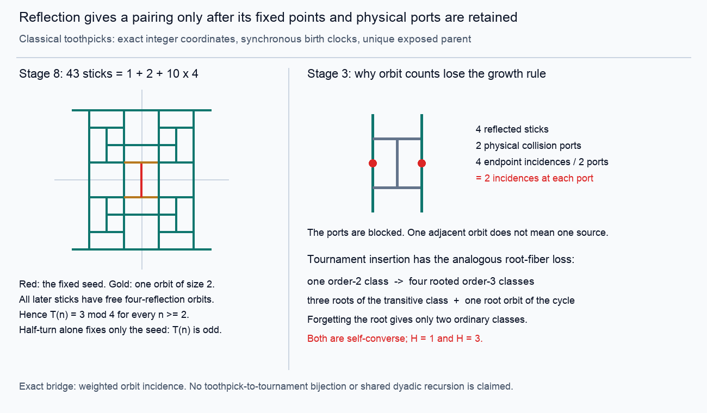

# Toothpick recovery: reflection fixed points and weighted physical ports

**Status:** PROVED elementary symmetry and orbit-incidence statements below;
CITED dyadic recurrences; FINITE-EXACT replay of the unique classical seed
through stage 128. No direct toothpick/tournament bijection, Hamilton-spectrum
classification, or new all-order A000568 parity theorem is claimed here.



The [SVG](toothpick.svg) is an editable vector diagram. Its two geometric
panels come from the executable's exact states, not a hand-drawn approximation.

## Inheritance and concept board

- **Closest proved mechanism:**
  [THM-841, violation-ladder/order-statistic profiles](../../../01-canon/theorems/THM-841-violation-ladder-order-statistic-profiles.md)
  distinguishes an exact ordered Farey-pair rewrite from a false toothpick
  count recursion. The pair `(i,j)`, not its coarse chain-length code,
  determines whether the next stage splits.
- **Canonical hostile:** the Farey count has additions `2 phi(n)` and first
  violates the proposed toothpick addition law at `n=5`; its dyadic total at
  `n=16` is `159`, while the classical toothpick total is `171`.
- **Corrected near miss:** [TANGENTS T1544](../../../00-navigation/TANGENTS.md)
  had dropped `-1` from the cumulative recurrence and used an ambiguous
  `THM-893` citation for converse parity. The current
  [THM-893-eroded-diamond-coincidence.md](../../../01-canon/theorems/THM-893-eroded-diamond-coincidence.md)
  is unrelated. The historical tangent has been repaired in place.
- **Least-used sidecar:** actual endpoint/midpoint incidence, with its source
  stick, orientation, integer birth stage, and reflection transport. A count
  of neighboring orbits forgets the exact exposure predicate.
- **Additional inherited guard:**
  [THM-2000, support-harmonic/figurate surface](../../../01-canon/theorems/THM-2000-support-harmonic-abel-dini-figurate-surface.md)
  already separates the quadratic classical process from the affine-periodic
  LRC quantity also called a toothpick count. Shared terminology supplies no
  common recurrence.

The live board has four entries: reflection fixed loci; port multiplicity;
integer birth clocks; insertion/root fibers. The anchor is the tournament
class/spectrum interface; the niche is an exact classical growth replay; the
wildcard is whether one group-action incidence lemma explains both losses.
The tests below make the wildcard precise without identifying the objects.

## The actual classical process and recurrence

Use length-two sticks on the integer grid. A stick is `(x,y,o)`, with center
`(x,y)` and `o=0` vertical or `o=1` horizontal. Stage zero is empty; stage one
has `(0,0,0)`. An endpoint is exposed exactly when it belongs to one endpoint
and no midpoint. Every exposed endpoint simultaneously becomes the center of
one perpendicular newborn stick. This is the standard
[OEIS A139250 definition](https://oeis.org/A139250), rescaled from the paper's
length-one convention. The executable checks physical incidence, rather than
merely checking whether a coordinate occurs in an endpoint set.

Write `t(n)` for births and `T(n)` for cumulative population. The **CITED**
Applegate--Pol--Sloane [Theorem 2 and Corollary 3](https://arxiv.org/html/1004.3036v2)
give `t(0)=T(0)=0`, `t(1)=1`, and, for `k>=1`,

```text
t(2^k)=2^k,
t(2^k+i)=2t(i)+t(i+1)                       (1<=i<2^k),
T(2^k)=(2^(2k+1)+1)/3,
T(2^k+i)=T(2^k)+2T(i)+T(i+1)-1             (1<=i<2^k).
```

The source's corner decomposition has two copies at clock `i` and one at
clock `i+1`; their boundaries and shifts are part of the construction. The
minus one is necessary: `T(3)=3+2+3-1=7`, not eight. These facts do not
supply a recurrence for tournament insertion. The source explicitly
separates fractal-like growth from strict geometric self-similarity.

## PROVED: complete reflection fixed loci for the classical seed

Let `r_x(x,y,o)=(-x,y,o)` and `r_y(x,y,o)=(x,-y,o)`, and let
`G=<r_x,r_y>` be the group of order four. At every integer stage, each map
preserves the stick set, newborn set, exact birth clock, endpoint/midpoint
incidences, and the unique parent of every newborn other than the seed.

**Proof.** The seed is invariant, and the exposure predicate and perpendicular
placement commute with both reflections. Induction transports every physical
parent and port, rather than merely their names. The maps commute, so their
composition is the half-turn. ∎

For every `n>=2`, the only sticks with a center on either coordinate axis are

```text
(0,0,0), (0,1,1), (0,-1,1).
```

**Proof.** This is the stage-two configuration. Suppose the claim holds at
stage `n`. An endpoint on an axis from an off-axis stick has a second endpoint
source from the distinct reflected stick, so it is blocked. The axis
endpoints belonging to the three displayed sticks are the seed's endpoints,
which are already occupied by midpoints. Their remaining endpoints lie off
both axes. Thus no new center can lie on an axis. ∎

Consequently the seed is a one-element orbit, the two stage-two sticks form
one orbit of size two, and every other stick has an orbit of size four.
Hence, for all `n>=2`,

```text
T(n)=3+4 q(n) for an integer q(n)>=0,
t(n) is divisible by 4 for n>=3.
```

The fixed sets of `r_x`, `r_y`, and `r_x r_y` contain respectively `3`, `1`,
and `1` sticks. At stage one all three maps fix the sole stick; at stage zero
all fixed sets are empty. In particular the half-turn fixes exactly the seed
and pairs all other sticks, proving oddness of `T(n)` for every `n>=1`.
The equality/failure boundary is explicit: the whole process is never a free
half-turn set after the seed is born. A reflection diagram must display that
fixed seed; deleting it changes the carrier.

This supplies an honest positive example of symmetry-line parity. It also
shows the difference from the tournament problem: at order three, converse
fixes both ordinary classes, and their Hamilton counts are different. A free
`H`-preserving pairing cannot exist on that two-class universe. No geometric
placement can remove this set-theoretic obstruction while retaining both the
ordinary class carrier and `H`.

## PROVED: the weighted orbit-incidence lemma

Let a finite group `G` act on finite sets of sources `S` and ports `P`, and
preserve an incidence relation `E subset S x P`. For source orbit `O` and
port orbit `Q`, define

```text
R(O,Q)=|E intersect (O x Q)|.
```

For every physical port `p in Q`, its incidence degree is

```text
d(p)=sum_O R(O,Q)/|Q|.                                      (OI)
```

**Proof.** Transport by any group element carries the incidences above `p`
bijectively to those above its image. The fiber size is therefore constant on
`Q`; summing it over `Q` gives `sum_O R(O,Q)`. ∎

This is a sufficient exact quotient when exposure depends on degree: retain
endpoint and midpoint incidence relations separately, and test
`d_endpoint(p)=1`, `d_midpoint(p)=0`. Retain orientation and the transported
parent if the output must be the newborn geometric state rather than its
count. A support-only quotient retaining just `R(O,Q)>0` is insufficient.

**Minimal collision in the classical process.** At stage three the four
newborn vertical sticks centered at `(+-1,+-1)` constitute one `G` orbit.
The two ports `(+-1,0)` constitute one port orbit. There are four endpoint
incidences between the two orbits, so each physical port has degree `4/2=2`.
They are blocked. The support-only quotient sees one neighboring source
orbit and would incorrectly generate horizontal sticks at those two ports.
Actual stage four has four births and total eleven; the defective rule would
add two extra sticks. The first failed implication is

```text
one adjacent source orbit  =>  one incident physical source.
```

The strongest survivor is (OI). Its missing coordinate is incidence weight
per physical port, not an additional symmetry line.

## PROVED: the exact insertion/root counterpart

Fix an ordinary tournament class `[T]` on `n` vertices, choose a representative
with named old vertices, and let `B(T)={0,1}^{V(T)}` be all adjacency choices
for a new named vertex `*`. The automorphism group of `T` acts on these
choices. There is a canonical bijection

```text
disjoint union_[T] Aut(T)\B(T)
   <--> rooted ordinary tournament classes [(U,*)] on n+1 vertices.  (RI)
```

An insertion maps to its resulting rooted tournament. Conversely, delete the
root and identify the remaining tournament with the chosen representative;
two such identifications differ exactly by `Aut(T)`. This proves both
surjectivity and the precise fiber equivalence.

Let `v(U)=|Aut(U)\V(U)|`, the number of vertex orbits. Forgetting the root in
(RI) has exactly `v(U)` preimages over `[U]`. Since Hamilton-path count ignores
the choice of root, the refined identity is

```text
sum_[T] sum_[b in Aut(T)\B(T)] z^{H(T+b)}
    = sum_[U] v(U) z^{H(U)}.                                (RF)
```

The right side is generally different from `F_(n+1)(z)`. The smallest decisive
case is `n=2`: the sole old class has no nontrivial automorphism and four
insertion choices. Three produce the three distinct rooted transitive
classes, with `H=1`; one produces the rooted directed triangle, with `H=3`.
Thus (RF) is `3z+z^3`, while `F_3(z)=z+z^3`.

The groupoid-weighted version, retaining the source weight, is also exact:

```text
sum_[T] (1/|Aut(T)|) sum_[b in B(T)] z^{H(T+b)}
    = (n+1) sum_[U] z^{H(U)}/|Aut(U)|.                      (RW)
```

For each insertion orbit, its contribution on the left is the reciprocal
order of its stabilizer, which is `Aut(U,*)`. For a fixed `U`, summing these
over root orbits gives `(n+1)/|Aut(U)|` by orbit-stabilizer. This proves (RW)
without assuming rigidity, freeness, or equal orbit sizes.

The exact bridge is now typed:

| Coordinate | Toothpick carrier | Tournament carrier |
|---|---|---|
| Source | physical sticks | chosen old tournament and binary insertion |
| Port | physical endpoint | distinguished new vertex/root |
| Action | two reflections | automorphism relabeling of old vertices |
| Preserved predicate | exposure with incidence weights | rooted isomorphism and resulting `H` |
| Quotient loss | multiplicity at a physical port | root fibers and stabilizer weights |
| Repair | (OI), endpoint/midpoint types | (RI), `v(U)`, or (RW) |
| Cheap hostile | stage three collision ports | order two to three: `4=3+1`, not `2` |

This is a common mathematical mechanism, not a map identifying a geometric
stick with a tournament class. It does not transport the dyadic recurrence,
spatial boundary, birth clock, or `H` across the two domains. In particular,
a count of allowed insertion orbits cannot be used as an ordinary-class
recurrence without paying the root-forgetting fibers.

## PROVED: a same-clock planar population obstruction

A process with a finite seed, bounded spatial propagation speed in the plane,
and bounded number of objects per lattice cell has at most `O(n^2)` objects
at stage `n`: all active cells lie in a disk of radius `O(n)`. On the other
hand every ordinary tournament class has at most `n!` labelled presentations,
so

```text
a_n >= 2^{binom(n,2)}/n!.
```

This grows faster than any polynomial, since
`log_2(n!) <= n log_2(n) = o(n^2)`. Thus such a process cannot represent every
order-`n` tournament class by a distinct active object at stage `n` for all
orders. The conclusion does not cover changing the clock superpolynomially,
storing exponentially large integer weights in a cell, or counting full
computation histories instead of current objects.

## Exact replay and remaining interface

From repository root:

```bash
python3 05-knowledge/results/tournament_joint_parity_20261102/toothpick_probe.py
python3 -O 05-knowledge/results/tournament_joint_parity_20261102/toothpick_probe.py
```

The program has no computational dependencies beyond the standard library.
Optional Pillow renders the PNG from the same primitives as the SVG. All
checks use explicit exceptions and survive optimized mode. It checks every
stage through 128 against an independent dyadic recurrence, every reflection
on states/newborns, exact parent transport and birth clocks, all axis fixed
loci, the physical-port hostile, and the order-three rooted insertion
fibers. Selected totals are `T(8)=43`, `T(16)=171`, `T(32)=683`, `T(64)=2731`,
and `T(128)=10923`. This is a finite replay, not the proof of the all-order
claims above. The positive controls and hostile failures are explicit in
[toothpick.out](toothpick.out).

The concept board changes as follows. Reflection is productive only after
its fixed loci are specified. Multiplicity and integer clocks are both
load-bearing in the classical recurrence. Insertion carries an exact rooted
object but does not preserve ordinary-class counts. The useful next
interface is an `H`-aware class-growth law that retains vertex-orbit fibers,
or a different all-order pairing with a declared target predicate. A free
converse pairing, a free `H`-preserving pairing at every order, and a literal
same-clock toothpick population model have already failed their cheap
hostile tests.
