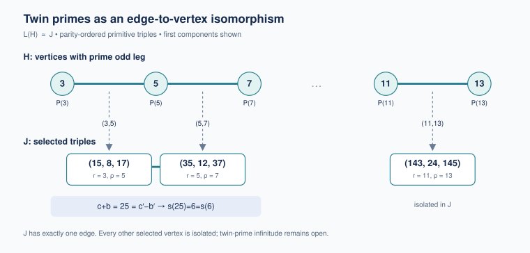

# Twin primes, two Pythagorean rays, and the eight-point 1–2–4 bridge

2026-10-26. **PROVED elementary maps and obstructions; CITED inherited
Euclid/Berggren and tournament results; FINITE-EXACT controls; CONDITIONAL
abc consequence.** Twin-prime infinitude, abc, prime-untouchable completeness
and the remaining tournament spectrum questions stay open. No historical
priority claim is made.

There is a natural isomorphism answering the requested tree question. It
uses edges on one Berggren ray and selected vertices on another, with an
explicit inverse and adjacency law. The selected triangles also have the
twin primes as their inradius and the exradius opposite the even leg.

## The exact isomorphism

Use the parity-ordered primitive triple `(a,b,c)=(odd leg,even leg,hypotenuse)`.
For every twin pair p,p+2, put

    T_p=(p(p+2), 2(p+1), (p+1)^2+1).

Then T_p is primitive, and

    inradius(T_p)=p,       even-leg exradius(T_p)=p+2.

Conversely, these two radii being prime forces precisely this form. An
equivalent test on the sides is `c-a=2` and `Omega(a)=2`, counting prime
factors with multiplicity. The inverse is `p=b/2-1`, or the two square roots
`sqrt(c-b),sqrt(c+b)`. The root `(3,4,5)` fails the radius-primality test;
the first image is `(15,8,17)`.

This subset bijection extends to an actual graph isomorphism. Let H be the
subgraph of the full Berggren tree induced by triples with prime odd leg.
Every such triple is

    P(p)=(p,(p^2-1)/2,(p^2+1)/2),

on the U ray. All edges in H are exactly `P(p)—P(p+2)` for twin primes.
Let J be the tree subgraph induced by the T_p images on the D ray. Then

    L(H) ≅ J,
    {P(p),P(p+2)} ↦ T_p,

where L means line graph: its vertices are edges of H, adjacent when they
share an endpoint. The branch words are

    U^((p-3)/2)—U^((p-1)/2)  ↦  D^((p-1)/2).

The index shift is essential. This is not an identification with the full
ternary tree: J has exactly one edge, joining T_3 and T_5; all its other
vertices are isolated. Three odd primes spaced by two must be3,5,7.
[Complete proof and ancestry controls](tree/RESULT.md).

## The unique-six theorem lands on the unique edge

The two endpoints of J's only edge have a common square boundary:

    T_3=(15,8,17):       c+b=25,
    T_5=(35,12,37):      c-b=25,
    s(25)=6,            s(6)=6.

Thus the shared prime5 in `(3,5),(5,7)` becomes the shared square25, whose
aliquot image is the unique perfect target of a prime square. This joins
the previous unique-six theorem to the tree adjacency by actual maps.
It does not identify the two roles of6: T_3 has aliquot-collision target6,
whereas T_5 has twin centre and half-even-leg6.

For a prime-radius triangle with `(r,rho)=(p,p+2)`, the exact collision is

    s(2r)=s(rho^2)=p+3.

Conversely, for odd primes p,q, `s(2p)=s(q²)` forces q=p+2. Therefore twin
pairs, marked prime-radius triangles and these marked two-preimage
collisions are bijective. They do not necessarily give the **whole** fibre:
at p71, target74 has `{70,142,5329}`, with70 an extra source.
[Radius proof, complete-fibre hostile and classical provenance](arithmetic/README.md).

## abc and F1: exact transports, exact losses

The centre identity is a primitive abc triple,

    1+p(p+2)=(p+1)^2.

For a twin pair its radical is
`p(p+2)rad(p+1)>(p+1)^2`. Thus this family already satisfies the stronger
elementary height-below-radical inequality; abc supplies no exclusion from
this equation alone. Squaring the Euclid construction gives
`(m²-1)²+4m²=(m²+1)²`, m=p+1, and adds exactly the radical factor
`rad(m²+1)`. The conditional bound and its unknown constant remain explicit.

The F1-compatible free prime monoid gives two different evaluations of the
proper-divisor polynomial: prime weights produce s(n), and weights1 produce
`tau(n)-1`. For the twin collision the difference of the polynomials is

    X_2+X_p-X_(p+2).

Arithmetic evaluation kills it; augmentation gives1. Hence the collision
does not survive forgetting the weights: the two divisor counts are3 and2.
This is a proved obstruction for these specified maps, with Deitmar's monoid
interpretation cited precisely in the arithmetic note. It is not an RH claim.

## From the Pythagorean conic to F8

The smooth projective conic over F7 has eight points, parametrized by
`P1(F7)` using t=m/n. With `F8=F2[alpha]/(alpha³+alpha+1)`, mark them by

    E(infinity)=0,       E(t)=alpha^t, t in F7.

The reciprocal r=n/m is the residual slope in this section, not the inradius.
This is a finite-set marking, not an embedding between fields of different
characteristics. On its eight labels there are two disjoint Steiner
quadruple systems. One consists of the four-element sets whose images sum
to zero; the other uses the cubes of those images. Each has14 blocks and
each triple of points lies in exactly one block.

The determinant-square subgroup PSL2(7) preserves each system. The other
PGL2(7) coset exchanges them. Consequently the middle Berggren branch A
swaps the two systems, while U and D preserve them. The parity of the number
of middle branches is an exact transported state. It cannot be read from
the endpoint alone: words UU and A have the same slope r=n/m=6 modulo7 and opposite
parities. [Proof, conventions and finite controls](finite_field/README.md).

Taking blocks through the marked pole and deleting that point gives the two
Fano planes on seven points and the
Paley7 stabilizer of order21. The incoming
[S69 field-action packet](../session69_prime_ports_power_aliquot_20261026/session69-tournament/REPORT.md)
already supplied the full21-element action, trace predicate and two Fano
systems; the unpunctured paired designs and branch determinant transport
are the continuation here. The numbers7 and21 are point/group sizes in
this statement. Their occurrence does not by itself prove a forbidden
Hamiltonian-path count.

## What the finite maps cannot decide

The twin pair `(3,5)` and composite pair `(213,215)` give primitive triples
`(15,8,17)` and `(45795,428,45797)`, both reducing to `(1,1,3)` modulo7.
They have the same marked conic point. More generally CRT constructs such
a twin/composite collision for **every fixed modulus**, even preserving the
D-ray depth modulo that modulus. [Proof and explicit lift construction](residue_obstruction/README.md).
The geometric map preserves incidence while losing the global prime test.

Ordinary H omits7,21 at all orders by the inherited
[THM-1370 / h-spectrum-omits-7-21-all-n](../../../01-canon/theorems/THM-1370-h-spectrum-omits-7-21-all-n.md).
The quotient `tc=H/|Aut|` has the distinct through-eleven exclusion of
[THM-4790 / presentation-fibres-7-and-21-absent-through-eleven-vertices](../../../01-canon/theorems/THM-4790-presentation-fibres-7-and-21-absent-through-eleven-vertices.md).
All-order tc exclusion and ordinary-H completeness remain open. No map here
identifies those image problems with twin primality or aliquot untouchability.

## Reproduction and integration

The [concept board](CONNECTION_BOARD.md) records inherited mechanisms,
hostiles, losses, sidecars and remaining decisive tests. The [audit](AUDIT.md)
separates all-parameter proof review from finite computations. Frozen inputs
and exact normal/optimized receipts are bound by [MANIFEST.json](MANIFEST.json).

    python3 -I -B 05-knowledge/results/twin_pythagorean_124_20261026/verify_packet.py

The verifier checks the closed file set, source pins, audit hashes, and all
replay receipts without changing them. No theorem ID is reserved or promoted;
the concurrent S60 reservation is not a proved dependency.
