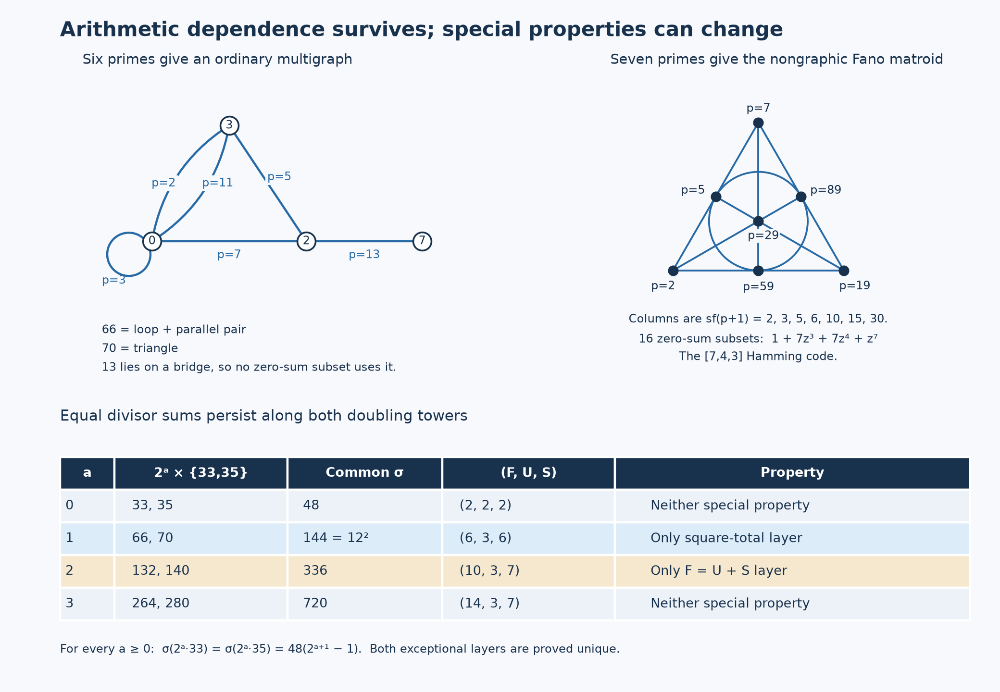

# Arithmetic dependence and graph reconstruction

2026-10-28. **PROVED elementary bridges**, **CITED and inherited mechanisms**,
and **FINITE-EXACT controls**. This session asks which larger theories explain
the repository's recurring successes across divisor arithmetic, tournaments,
square sums, graceful labellings and Berggren descent.

The strongest common structure is **a relation system with a specified
operation and a specified observation**. Incidence algebras explain divisor
shapes; binary matroids explain square-class cancellation; signed incidence
explains sum and difference reconstruction; continuation equivalence explains
which compressed states remain usable. None of these alone guarantees the
positive integer or bounded-label realization required by the original problem.

Two concrete bridges make this more than a vocabulary comparison:

1. The sources 66 and 70 have the same square divisor sum, but different
   minimal dependence structures. Their next doubling gives 132 and 140,
   precisely the old `p^2qr` shape satisfying `F=U+S`. The square layer and
   the divisor-balance layer are distinct and each occurs exactly once in
   these doubling towers.
2. Seven explicit primes realize the Fano matroid through the square classes
   of their successors. Exactly 16 squarefree products of these primes have
   square divisor sum: their supports form the classical binary Hamming code.
   This gives a real arithmetic map to coding theory and an obstruction to
   reducing every such relation system to an ordinary graph.

The [proofs](THEORY.md), [recovery ledger](RECOVERY.md), and
[exact checks](check.py) state the maps, hypotheses and failure boundaries.



## The number sets have different original meanings

The six-symbol chain comes from the small-prime part of the Monster/Baby
Monster order ratio:

```text
N = 2^5 3^7 5^3 7^4 11 13^2 = 39046339332000,
13 -> 2 -> 5 -> 3 -> 7 -> 4,       11 -> 1.
```

The arrows initially mean `p -> v_p(N)`. The corrected
[Session43 construction](../session43_observers_phase_guards_20261023/cycle-geometry/PROOF.md)
extends this to `h_N(b)=max{k:b^k divides N}` for composite bases. Then

```text
4 -> 2 -> 5 -> 3 -> 7 -> 4
```

is a literal five-cycle, with 13 another predecessor of 2. Folding 4 and 13
preserves their next value, but loses primality and incoming histories.
Changing the denominator from the group order `|B|` to the involution
centralizer order `|2.B|` changes N to N/2 and the displayed recurrent cycle
to `2 -> 4 -> 2`. The normalization is mathematical data.

By contrast, the original `{2,3,11}` consists of the primes whose doubles
remain in their own odd-square bracket `((2m-1)^2,(2m+1)^2]`. This is a
scale inequality, recovered in [Session74](../session74_eleven_mechanisms_20261027/session74-inheritance/INHERITANCE.md).
Its later connection to `{2,5,7}` uses a different, exact map:

```text
sigma(2*3*11)=3*4*12=144=3*6*8=sigma(2*5*7).
```

This identity and the full sigma-144 fibre are inherited from
[Session83](../session83_aliquot_divisor_grammar_20261028/CARRIER_AND_144_BRIDGE.md).
The new synthesis keeps those two origins separate before composing them.

## Square classes turn the two triples into different dependence types

Let `Q(x)` be the vector of prime-exponent parities of x. For a fixed bank
of distinct primes, give prime p the column `Q(p+1)`. For any subset A,

```text
sigma(product_(p in A) p) is square  iff  sum_(p in A) Q(p+1)=0 over F2.
```

This is an exact binary matroid and code construction. The coprimality
condition is automatic for subsets of distinct primes. Minimal nonempty
zero-sum subsets are its circuits.

| Prime p | Squarefree part of p+1 | Role in the bank {2,3,5,7,11,13} |
|---:|---:|---|
|2|3|Parallel with 11|
|3|1|Zero column, or loop|
|5|6|One edge of the three-element circuit|
|7|2|One edge of the three-element circuit|
|11|3|Parallel with 2|
|13|14|The only column with a 7 coordinate; a coloop|

Thus `{2,3,11}` is a loop plus a two-element circuit; `{2,5,7}` is a
three-element circuit. They are not interchangeable dependence structures.
The exact square-sigma sources from this six-prime bank are
`1,3,22,66,70,210,385,1155`. None uses 13.

There is even a literal multigraph model for this particular bank. Use
vertices `0,2,3,7`; let the prime-labelled edges be
`2:0--3`, `3:a loop at 0`, `5:2--3`, `7:0--2`, `11:0--3`, `13:2--7`.
Delete the row of vertex 0 from its binary incidence matrix. The resulting
columns are exactly the square classes above. This construction preserves
subset dependence, not the numerical values of the products or divisor sums.

### The ordinary graph model has a sharp boundary

The prime bank

```text
p:             7   2  19   5  89  59  29
sf(p+1):       2   3   5   6  10  15  30
```

gives all seven nonzero vectors on prime coordinates `{2,3,5}`. Its kernel
has the weight polynomial

```text
1 + 7 z^3 + 7 z^4 + z^7.
```

These are the 16 words of the classical `[7,4,3]` Hamming code. The seven
weight-three supports are the lines of the Fano plane; for example
`{2,5,7}` gives the source 70 and square total 144. This builds on the
repository's earlier [Fano squareclass work](../arithmetic_braids2_20260917_fano_code.md),
but changes the map from `Q(p)` to **`Q(sigma(p))=Q(p+1)`**. The target
predicate is now square total of an actual aliquot edge.

The Fano matroid is not graphic. An ordinary graph representing these seven
distinct nonzero columns would have no loops or parallel edges and rank
three, hence at most six edges. This elementary obstruction stops the
claim that every arithmetic dependence is a hidden ordinary graph cycle.
No universal realization theorem for binary matroids by primes is asserted.

## The exact bridge to F equals U plus S

Use the repository's definitions: F counts proper nontrivial divisors,
U counts the prime divisors among them, and S counts the squarefree divisors
among them. U is a subset of S; this is a cardinality identity, not a
disjoint union. The inherited complete classification is

```text
F=U+S iff n is p, p^3, or p^2qr,
```

where distinct letters denote distinct primes. See the corrected
[divisor-balance family](../collatz_mod6_20260917_divisor_balance_family.md).

For every a>=0,

```text
sigma(2^a*33)=sigma(2^a*35)=48(2^(a+1)-1).
```

| a | Sources | Common sigma | (F,U,S) | Interpretation |
|---:|---|---:|---|---|
|0|33,35|48|(2,2,2)|Two distinct primes|
|1|66,70|144|(6,3,6)|The unique square-total layer|
|2|132,140|336|(10,3,7)|The unique F=U+S layer|
|3|264,280|720|(14,3,7)|Both earlier equalities have failed|

The equal-sigma relation persists through the whole tower. The two special
predicates do not: square total occurs **iff a=1**, while `F=U+S` occurs
**iff a=2**. This is proved for all a, not inferred from the displayed rows.
The complete sigma-336 fibre has exactly two F=U+S members, 132 and 140.

The full odd sigma-48 fibre is `{33,35,47}`, so the third tower `2^a*47`
has the same totals and the same unique square layer (source 94). It never
has the `p^2qr` shape. Equal divisor sums preserve a specified multiplication
law while still losing divisor incidence.

Incoming [Session84 balance work](../session84_guarded_unification_20261028/BALANCE_AND_EXCESS.md)
also sharpens the earlier 20 question: among all F=U+S sources, **650 alone**
has `s(n)=n+2`. Here `650=2*5^2*13`, `(F,U,S)=(10,3,7)`, and
`s(650)=652=1+1+650`. Its actual proper-divisor list has eleven entries.
This is an inherited all-size intersection theorem; compression into
three summands and counting literal proper divisors remain different predicates.

## Signed incidence connects the graph questions

For a graph G, let `B_G x` assign edge uv the sum `x_u+x_v`. For connected
graphs with n vertices and m edges, the integral classification is

| Graph | Nonzero Smith factors of B | Free rank of coker B | Torsion |
|---|---|---:|---|
|Bipartite|n-1 copies of 1|m-n+1|None|
|Nonbipartite|n-1 copies of 1, then 2|m-n|Z/2|
|K3,3|1,1,1,1,1|4|None|
|K5|1,1,1,1,2|5|Z/2|
|Petersen|Nine copies of 1, then 2|5|Z/2|

The rational reconstruction and the three graph ranks were already in the
[E atlas](../e_atlas_20261019.md). The Smith formulation retains the integer
obstruction as well. The underlying theory is classical signed-graph
incidence; see [Zaslavsky, section 4](https://people.math.binghamton.edu/zaslav/Oldcourses/510.S18/mts.pdf).

For a bipartite graph, changing the signs of the labels on one shore converts
edge sums to edge differences. For a tree, a root value then determines all
vertex values from the edge differences. This is the genuine connection to
graceful labelling. To be graceful, however, vertex labels must lie in
`{0,...,m}` injectively and absolute edge differences must be exactly
`{1,...,m}`. For square sums, the decoded vertex values must instead be
distinct positive integers and edge values must be squares. Neither
realization condition follows from incidence rank.

The exact graceful discriminant and its root-system interpretation are
[THM-2761 / edge sums and graceful sign gauge](../../../01-canon/theorems/THM-2761-graph-edge-sum-discriminant-codegree-factorization-and-graceful-sign-gauge.md)
and [THM-2770 / tree incidence A/D clutch](../../../01-canon/theorems/THM-2770-tree-incidence-a-d-weyl-clutch-and-four-vertex-fan-dichotomy.md).
For Petersen, [THM-261 / A4 root orthogonality](../../../01-canon/theorems/THM-261-petersen-root-orthogonality.md)
supplies a different exact root-system map. The roots, their orthogonality
graph, and the graceful discriminant are related objects, not identical ones.

There is a crucial minor boundary. Petersen has neither K5 nor K3,3 as a
subgraph, but contracting its five spokes produces K5. Consequently the
unit-circle graphs of [THM-4701](../../../01-canon/theorems/THM-4701-kuratowski-graphs-the-petersen-graph-and-the-finite-unit-circle-graphs.md)
can forbid both literal Kuratowski subgraphs while remaining nonplanar.
An excluded-minor classification applies only after proving that the
relevant labelled realization property survives the chosen minor operation.

## Berggren supplies a successful descent model

Berggren's three branches on Euclid pairs have disjoint slope ranges, a
unique inverse branch away from `(2,1)`, and a strictly decreasing positive
height under that inverse. These are the concrete ingredients that turn
generation into a complete classification. Matrix preservation alone would
not suffice. The classical tree theorem is restated and checked in
[THM-4808 / non-backtracking branch character](../../../01-canon/theorems/THM-4808-berggren-tree-is-non-backtracking-branch-character-pole-frame-every-modulus-obstruction-cusp-pairing.md).

Its branch sign `chi=(-1)^(number of A steps)` is the determinant character
of the word matrix. This is the same *kind* of multiplicative sign transport
as Liouville on a prime-factor word. Liouville factors through commutative
multiplication; a Berggren endpoint still depends on word order. Fixed
residue data cannot recover chi: THM-4808 gives an explicit opposite-sign
pair at every modulus.

This does not require storing the entire word to update the sign: two states
suffice, with A flipping the state and U,D preserving it. The incoming
[guarded-observer analysis](../session84_guarded_unification_20261028/GUARDED_OBSERVERS.md)
separates that finite sign observer from residue non-descent and from
the unbounded support memory needed for named coprime multiplications.

### A direct arithmetic image of a Berggren ray

The incoming [semiprime bridge](../session84_guarded_unification_20261028/BERGGREN_SEMIPRIME_BRIDGE.md)
provides a more concrete link. For an even distinct semiprime 2q,

```text
sigma(2q) is square iff q=12k^2-1 is prime,   k>=1.
(q-2, 2 sqrt(sigma(2q)), q+4) = 3 Phi(2k,1),
Phi(m,n)=(m^2-n^2,2mn,m^2+n^2).
```

The pairs (2k,1) form the D-ray from the Berggren root. At k=1, q=11,
giving `22 -> 14` with total 36; multiplication by the coprime prime 3
gives `66 -> 78` with total 144. The prime triple `{2,5,7}` reaches
the same total through the different minimal circuit described above.
At k=5, q=299=13*23 is composite: the geometric ray continues, but the
semiprime interpretation fails. The actual sigma(2q)=sigma(598)=1008
differs from the formal square 900. Geometry generates candidates and
the prime condition decides which retain the arithmetic meaning.

The divisor-height five-cycle provides the hostile control for transplanting
descent indiscriminately: no strictly decreasing rank can exist on every
edge of that cycle. Graceful-tree existence would likewise need a proved
extension or descent that preserves the full label budget; the current
incidence changes of coordinates do not supply one. The 2026 revision of
[Letzter–Pokrovskiy–Williams](https://arxiv.org/abs/2511.11331v2) gives an
asymptotic gracesize result, not the exact conjecture. The statement is cited
from its abstract; its proof is not used here.

## The original tournament example is a test of the same principle

The recovered [81/27 fibre theorem, F1–F3](../tournament_composition_classification_20261026/fibre/RESULT.md)
gives `|Aut(Q[T_i])|=|Gamma(Q;[T_i])| product_i |Aut(T_i)|`,
where Gamma preserves the oriented child isomorphism classes.
For `A=C3 -> 1` and `B=1 -> C3`, the tournaments `C3[A,A,A]`
and `C3[B,A,A]` retain exactly the same labelled cyclic triples.
Each child still contributes 3 automorphisms, but changing one child colour
reduces the quotient stabilizer from 3 to 1: the orders are 81 and 27.
The missing information is a colour equality pattern, not another triple count.

There is an exact arithmetic comparison. With the prime bank `{2,3,11}`,
6 and 22 have the same current `(mu,lambda)=(1,1)`, but multiplication
by 3 produces mu-values 0 and -1. The prior
[Liouville–Möbius theorem D2](../liouville_mobius_eleven_20261027/THEORY.md)
proves that k named primes require exactly `2^k+1` continuation states for
mu, two for lambda, and `2^k+2` for the joint observer.
Both examples expose information lost by a chosen observation. They do
not identify tournament substitution with integer multiplication.

## Three larger theories and their next decisive tests

1. **Incidence algebras and relation modules.** Divisor boxes, Möbius
   inversion, graph gradients and square-class kernels are concrete
   instances. Retain the coefficient ring: the same triangle has a Z/2
   signless-incidence obstruction but a Z/3 Laplacian obstruction.
   Next test: determine which arithmetic prime banks have graphic, regular,
   or genuinely nongraphic binary matroids. The seven-prime Fano bank is
   already a decisive nongraphic case.
2. **Context equivalence and compositional state.** Two objects may be
   identified only when every allowed continuation gives the same observed
   response, including whether that continuation is legal. This is the
   Myhill–Nerode principle applied to a declared operation system. It
   organizes the repo's exact Möbius/Liouville states and decorated tournament
   modules. Next test: specify a restricted square-sum gluing operation and
   compute its smallest boundary response, including labels and endpoints.
3. **Normal forms and well-founded reduction.** Berggren gives a model where
   the inverse is unique and decreases height. The valuation cycle shows
   where that model fails. Next test: for any proposed tournament or graceful
   reduction, prove coverage, termination, and preservation of the actual
   target before interpreting an observed recurrence as classification.

These are organizing theories with explicit successful instances and
counterexamples. They do not amount to a classification of all prime
tournaments, a proof of the Graceful Tree Conjecture, or an LRC(14) closure.

## Reproduction

```text
python3 -B 05-knowledge/results/unifying_relations_20261028/verify.py --replay
python3 agents/check_docs.py
```

The check uses Python and SymPy. Universes include all 64 and 128 subsets
of the two prime banks, all 771 connected labelled simple graphs on two
through five vertices, explicit Petersen and K3,3 matrices, 923 divisor
profiles, all 5759 nonunit divisors of N, and every primitive Euclid pair
with first coordinate at most 100. The all-order conclusions have displayed
proofs; normal and optimized runs are controls. This is same-agent proof
review with independent computational paths, not an independent-agent audit.
